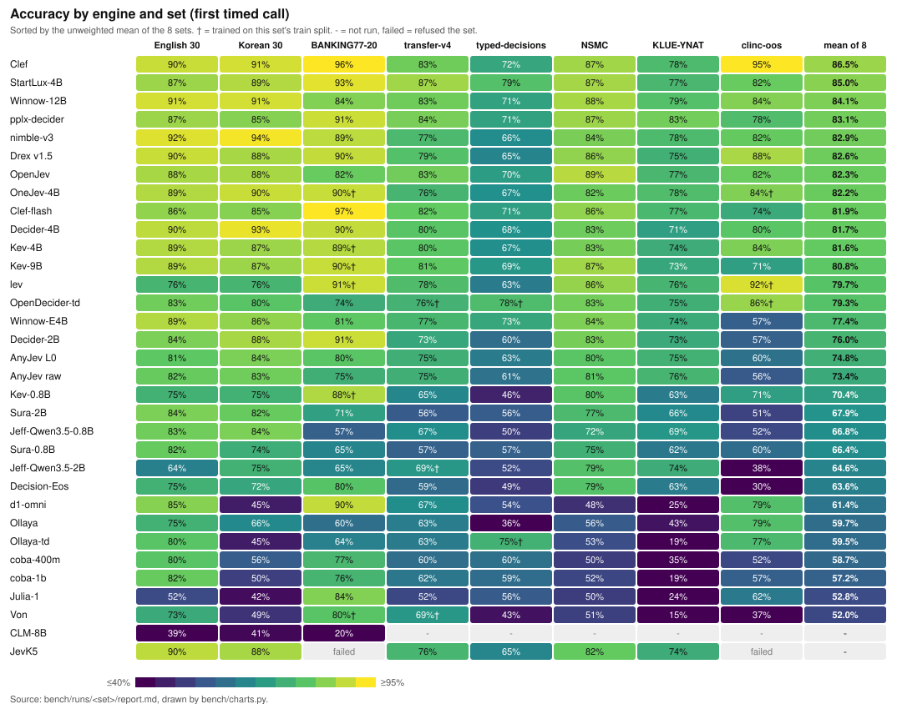
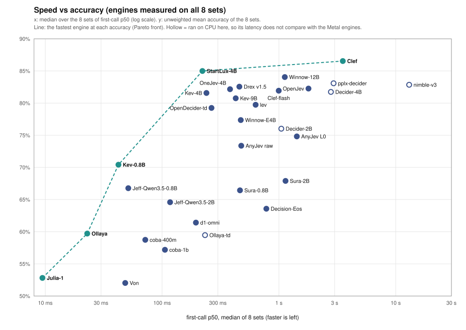
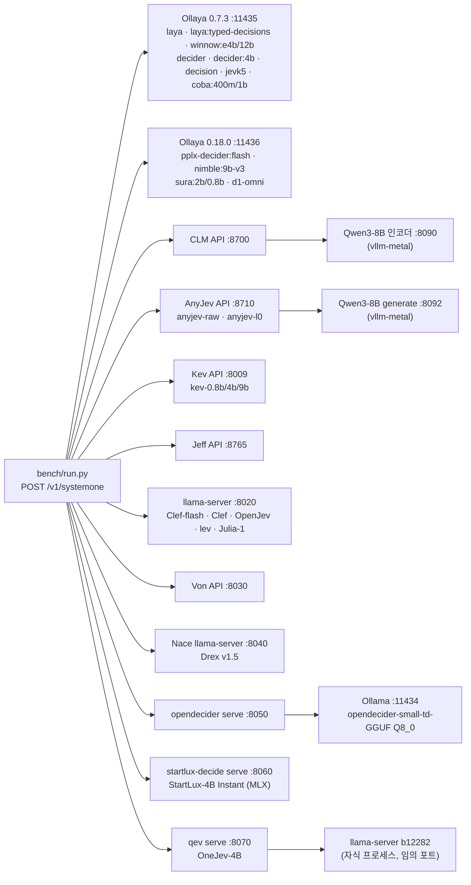
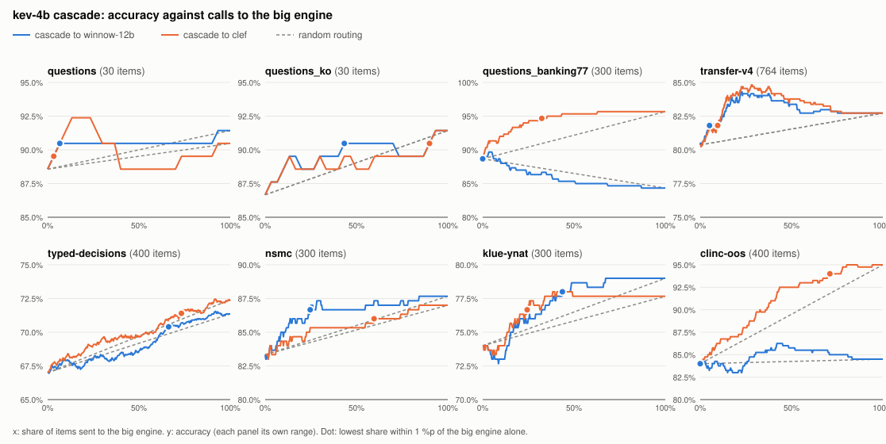
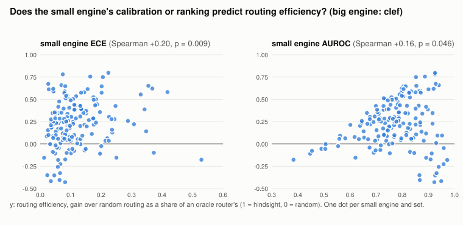

# local-jev-bench: Apple Silicon 맥에서 돌리는 Jev 스타일 결정 모델

[English](README.md) | 한국어

local-jev-bench는 Jev 스타일의 System One 결정 모델을 Apple Silicon 맥에서 로컬로 돌린다. 결정 모델은 타입이 정해진 질문을 받아 보정된 확률로 답하는 모델이다. 여기서는 여러 엔진을 같은 질문으로 비교한다. 비교에 쓰는 셋은 다음과 같다.

- 영어·한국어 고객 문의
- 공개 셋 BANKING77 20-way 인텐트 분류
- Kev의 분포 밖 셋 transfer-v4
- typed-decisions 리더보드 셋
- 한국어 셋 두 개: NSMC 영화 리뷰, KLUE-YNAT 뉴스 제목

## 차트로 보기





- **전체 정확도 1위:** Clef(8개 셋 평균 86.5%). 다음은 StartLux-4B(85.0%), Winnow-12B(84.1%)다.
  여기서 Clef는 호출당 1.5-8.4초, StartLux-4B는 122-1273ms다.
- **셋별 1위:** transfer-v4(87%)와 typed-decisions(79%, OpenDecider-td의 분포 내 78%†와 동률)는 StartLux-4B,
  clinc-oos(95%, v1 세트, 철회)는 Clef, BANKING77-20(97%)은 Clef-flash, KLUE-YNAT(83%)은 pplx-decider다.
- **속도 대비 가장 정확한 엔진(점선):** Julia-1, Ollaya, Kev-0.8B, StartLux-4B, Clef. 이들보다 빠르면서 더 정확한
  엔진은 없다.
- **동률:** 상위권 사이의 1-2포인트 차이는 대부분 유의하지 않다. 짝지은 McNemar p가 0.05 미만일 때만 두 엔진이
  다르다고 본다([FAQ](#faq)).

차트는 `uv run python bench/charts.py`가 `bench/runs/<set>/report.md`에서 그린다.

## 한눈에 보기

필요별로 한 줄씩, 전부 아래 결과에서 뽑았다. 두 엔진이 다르다고 말할 조건은 McNemar p < 0.05([FAQ](#faq) 참고)다.
그보다 가까우면 같다고 본다.

| 필요 | 엔진 | 이유 |
|---|---|---|
| 전반적으로 가장 정확 | Kev-9B, Kev-4B, Winnow-E4B/12B, Decider-4B, pplx-decider, Drex v1.5, OpenJev, OneJev, StartLux-4B, Clef-flash, Clef | 대부분 셋에서 상위 그룹 |
| 분포 밖 전이(transfer-v4) 최고 | StartLux-4B | 87%(665/764). pplx-decider 84%보다 나음(p < 0.001). 대부분 `emotion` 출처에서 |
| typed-decisions 최고 | StartLux-4B(79%, 학습 데이터 세부 미공개) 또는 OpenDecider-td(분포 안, 78%†. 둘은 같음, p = 0.121) | 주의점 참고 |
| 한국어(NSMC + KLUE-YNAT) 최고 | pplx-decider 또는 Winnow-12B | KLUE-YNAT 83% vs 79%(p = 0.111), NSMC 87% vs 88%. OpenJev의 NSMC 89%는 둘과 같음 |
| clinc-oos(인텐트 + 범위 밖) 최고 | 철회: v1 세트는 대부분 `oos` 옵션 선택 성향을 쟀다([감사](reports/2026-11-12-set-audit.md)) | v1: Clef 95%, lev 92%†, Drex v1.5 88%. v2로 재측정 필요 |
| 가장 빠름 | Ollaya(`laya`) | typed-decisions 제외 첫 호출 p50 10.2-43.7ms |
| 보정 최고 | Clef-flash | typed-decisions ECE 0.021, KL 0.220 |

전체 표·셋별 주의점·McNemar 결과는 [결과](#결과-2026-10-1416-m3-max-36gb)와 [FAQ](#faq)에 있다.

## 결과 요약

<details><summary>셋별·엔진별 핵심 결과 (펼치기)</summary>

**핵심 결과 (M3 Max 36GB. 2026-10-14~16에 유휴 머신에서 모든 엔진을 모든 셋에 다시 쟀고, 이전 정확도 수치가 그대로 재현됐다).**
전체적으로 가장 정확한 엔진은 Kev-9B, Kev-4B, Winnow-E4B, Winnow-12B, Decider-4B, pplx-decider, Drex v1.5, OpenJev, OneJev, StartLux-4B, Clef, Clef-flash다.
typed-decisions에서는 StartLux-4B(79%, 학습 데이터 세부 미공개)와 분포 안 파인튜닝 둘, OpenDecider-small-td(78%)와 Laya의 `ollaya-td`(75%)가 전부 앞선다. StartLux-4B는 transfer-v4 최고 점수(87%)도 갖고 있다. 이들 사이의 차이는 대응 McNemar 검정으로 봤을 때 일부 셋에서만 난다.

- **transfer-v4**: Kev가 Winnow보다 낫다(Kev-9B 81% vs 77%, p = 0.003). 하지만 차이는 정책 구조 홀드아웃 출처 두 개에서만 난다. 이 두 출처는 Kev가 학습하는 프로그램 생성 정책 데이터에서 구조만 뺀 것이다(Kev-4B 160/176, Winnow 125/176). Kev가 학습하지 않은 공개 출처 여섯 개에서는 셋이 같고(588개 중 454, 465, 460, p ≥ 0.228), 학습 없는 AnyJev도 같다(raw 458, L0 457).
- **typed-decisions**: Winnow가 Kev-4B(73% vs 67%)와 Kev-9B(69%)보다 모두 낫다(둘 다 p < 0.001).
- **NSMC와 KLUE-YNAT(한국어)**: 셋과 Clef-flash·Clef를 구분할 수 없다. 예외는 NSMC에서 Clef가 Kev-4B보다(p = 0.043), KLUE-YNAT에서 Kev-9B보다(p = 0.014) 나은 두 경우다. 네 번째 상위 엔진 Winnow-12B는 KLUE-YNAT에서 앞선다(79%, Kev-4B·Kev-9B·Winnow-E4B보다 p ≤ 0.024).
- **clinc-oos(v1 세트로 측정, 2026-11-12 철회: [세트 감사](reports/2026-11-12-set-audit.md) 참조). v1은 `oos` 자체를 20개 옵션 중 하나로 넣어 선택 300개 중 186개의 정답이 `oos`였고, yes/no 100개는 정답이 전부 "아니오"였다. 아래 v1 결과는 대부분 엔진이 `oos`를 얼마나 쉽게 고르는지를 잰 것이다. `make_sets.py clinc-oos`는 이제 v2를 만든다. 엔진을 비교하려면 재측정해야 한다.** v1(CLINC150 상위 20개 인텐트, 선택 300개 + 범위 밖 yes/no 100개): Clef가 단독 1위다. 95%(380/400)로 모든 엔진을 앞서고(p < 0.001), 두 절반 모두 강하다(선택 283/300, 범위 밖 97/100). 그다음은 Kev-4B와 Winnow-12B로 84%다(둘 사이 p = 0.894). Kev-9B는 의도 선택은 Clef 다음(269/300)이지만 범위 밖 요청 100개 중 86개를 범위 안이라고 답해 71%로 Kev-4B보다 낮다(p < 0.001). Clef-flash는 반대로 범위 밖 97/100, 선택 197/300(74%)이다. Ollaya(79%)와 Ollaya-td(77%)는 점수 대부분을 범위 밖 절반(96-99/100)에서 얻는다.
- **AnyJev(학습 없는 Qwen3-8B)**: KLUE-YNAT에서는 상위 그룹과 같고(75-76%), transfer-v4에서는 Winnow와 같다(75%). typed-decisions에서는 뒤진다(61-63%). 거기서는 gold 분포와의 거리도 멀다(KL 2.8-3.8, 상위 그룹은 0.2-0.3). BANKING77-20에서는 자기 README를 다시 재현했고, 대응 검정으로 보면 L0의 정확도 향상이 실제로 있다(p = 0.005).
- **Clef-flash(Cloudflare, 9B, 2026-10-05 측정)**: 상위 그룹에 든다. BANKING77-20을 빼면 모든 셋에서 Kev-9B와 같다. BANKING77-20에서는 앞선다(97% vs 90%, p < 0.001; Clef-flash는 학습 데이터를 공개하지 않는다). transfer-v4에서는 Winnow보다 낫지만(82% vs 77%, p = 0.003), 이것도 정책 홀드아웃 두 출처에서만이다(176개 중 152 vs 125). 공개 출처 여섯 개에서는 Kev, Winnow, AnyJev와 같다(588개 중 471, p > 0.08). typed-decisions에서 전체 엔진 중 ECE가 가장 낮고(0.021, KL 0.220), 선택지 순서를 뒤집어도 답을 하나도 바꾸지 않는다. 대신 여기서는 느리다. llama.cpp에서 첫 호출 p50이 415-2246ms로, 같은 유휴 머신의 Kev-9B보다 1.5-2.8배다. Cloudflare가 자사 GPU에서 보고한 중앙값은 38.8ms다.
- **Clef(Cloudflare, 27B, 2026-10-05 측정)**: clinc-oos를 빼면 어느 셋에서도 Clef-flash와 구분되지 않는다(p ≥ 0.092. clinc-oos는 95% vs 74%, p < 0.001). 시간은 3.4-3.7배 든다(첫 호출 p50 1480-8365ms, Q4_K_M. Cloudflare가 자사 GPU에서 보고한 중앙값은 209.3ms). Kev-9B와는 BANKING77-20(96% vs 90%, p < 0.001), typed-decisions(72% vs 69%, p = 0.004), KLUE-YNAT(78% vs 73%, p = 0.014), clinc-oos(p < 0.001)를 빼면 같다. typed-decisions gold 분포에는 분포 안 파인튜닝 둘(OpenDecider-td, Ollaya-td) 다음으로 가깝다(KL 0.196 vs 0.092, 0.134).
- **Von(395M ModernBERT, 2026-10-05 측정)**: 모델 카드대로 영어 전용이다. KLUE-YNAT 15%, 한국어 30문항 49%, NSMC 51%(2지선다)다. 영어 셋에서도 상위 그룹보다 낮다(transfer-v4 69%, typed-decisions 43%). 첫 호출 p50은 29-366ms다.
- **새 엔진(2026-10-10 측정, `ollaya-td` typed-decisions는 2026-10-09).**
  - **ollaya-td(`laya:typed-decisions`, 421M)**: typed-decisions 1505/2000(75%). OpenDecider-td(78%, 2026-11-10)가 나오기 전까지 벤치 최고 기록이었다. 나머지 엔진은 Winnow(p = 0.021), Kev-9B(p < 0.001), Clef(p = 0.012)까지 전부 앞선다. 보정은 OpenDecider-td 다음 2위다(KL 0.134, Brier 0.071). upstream 주장 0.766을 재현한다(0.753, Wilson 73-77). 대신 스페셜리스트다. transfer-v4 63%, BANKING77-20 64%, 한국어 30문항 45%(order-flip 33%)다. 카드가 typed-decisions 4개 워크플로를 파인튜닝 데이터로 적고 있으므로 그 75%는 분포 안(†)으로 본다. 2026-10-12 backfill에서 NSMC 53%, KLUE-YNAT 19%(order-flip 76%)가 나와 붕괴가 확인됐다.
  - **Winnow-12B(`winnow:12b`, 13GB Q8_0)**: 전 셋 상위 그룹. transfer-v4 83%로 Clef와 공동 1위(632/764), E4B 형제보다 낫고(p < 0.001) Kev-9B·Clef-flash·Clef와 같다. typed-decisions 71%는 E4B·Clef 자매와 같고 Kev-9B보다 낫다(p = 0.014). KLUE-YNAT 79%, NSMC 88%도 Kev·Clef와 같거나 낫다. BANKING77-20 84%는 E4B와 같고(p = 0.132) Kev보다 낮다(p ≤ 0.019). 보정은 E4B보다 나쁘다(typed-decisions KL 0.625 vs 0.286). 기본 temperature 1.0을 쓰고, E4B는 fitted 1.2574다.
  - **Decider-4B(Mapika, 8.4GB)와 Decider-2B(3.8GB)**: 강한 제너럴리스트. Decider-4B는 transfer-v4(80%, p ≥ 0.467)와 BANKING77-20(90%, p ≥ 0.503)에서 Kev-4B·Kev-9B와 같고, Winnow보다 낫다(p ≤ 0.027). 한국어 30문항 93%는 Clef-flash보다 낫다(p = 0.035). transfer 강점은 공개 출처(588개 중 472개, Clef의 474개 다음)에 있고, 정책 홀드아웃(176개 중 139개)은 Winnow와 Kev 사이다. Decider-2B는 한 단계 아래(transfer 73%, BANKING 91%, 한국어 88%)지만 영어 30문항 ECE가 새 엔진 중 가장 낮다(0.013). 둘 다 여기서 Ollaya CPU(F32)로 돌아 첫 호출 p50이 typed-decisions 밖에서 0.4-9초(typed-decisions는 19-56초)다. Metal 행과 바로 비교할 수 없다. 2026-10-12 backfill에서 typed-decisions(4B 68%, Kev-4B/9B와 같음. 2B 60%, Jeff보다 나음), NSMC(83%, 83%), KLUE-YNAT(71%, 73%, 둘 다 상위 그룹)이 추가됐다.
  - **Jeff-Qwen3.5-0.8B**: 30문항에서 107ms에 83-84%. 영어 30문항에서는 Jeff-2B보다 낫고(p < 0.001) 한국어 30문항과는 같다(p = 0.136). Kev-4B/9B와도 같다. 본셋에서는 재현 안 된다. transfer 67%, typed 50%, BANKING 57%(order-flip 28%), NSMC 72%다. 예외는 KLUE-YNAT 69%로 Kev-4B·Kev-9B·Winnow와 같다. 그 정확도에서 가장 빠르다(30문항 셋과 typed-decisions 밖에서 28-54ms).
  - **Decision-Eos(Qwen3.5-0.8B endpoint head)**: 전 셋 중간(transfer 59%, BANKING 80%, 30문항 72-75%). 영어 30문항에서는 Kev-0.8B와 같고, BANKING에서는 낮다(80% vs 88%, p < 0.001). 2026-10-12에 추가 측정했다. typed-decisions 49%(Jeff-0.8B와 같음), NSMC 79%, KLUE-YNAT 63%(둘 다 Kev-0.8B와 같음)이다.
  - **JevK5(alibiserikbay, Qwen3.5-4B, Metal Q8_0, 2026-10-16 첫 측정)**: 30문항 셋에서는 상위 그룹이다(90%, 88%. Kev-4B/9B·Winnow·Clef-flash·Clef·Decider-4B와 같음, p ≥ 0.146). KLUE-YNAT도 74%로 Kev·Winnow-E4B와 같다(Winnow-12B보다는 낮음, p = 0.028). 큰 영어 셋에서는 상위 그룹 아래다. transfer-v4 76%(Winnow-E4B와 같음 p = 0.920, Kev-4B보다 p = 0.004·Kev-9B보다 p = 0.001 낮음), typed-decisions 65%(Kev-4B와 같음 p = 0.056, Kev-9B·Winnow·Clef보다 p ≤ 0.001 낮음). NSMC 82%로 Kev-9B보다 낮다(p = 0.036). 선택지 20개 셋(BANKING77-20, clinc-oos)은 `TOO_MANY_OPTIONS`로 거절한다. 첫 호출 p50은 194-2872ms다.
- **새 엔진(2026-10-30..11-01 측정, `reports/2026-11-01-analysis.md`).**
  - **pplx-decider(Perplexity, `pplx-decider:flash`, Qwen3.5-4B)**: clinc-oos를 빼면 전 셋 상위 그룹이다. transfer-v4 84%(638/764)는 StartLux-4B(87%, 2026-11-11)가 나오기 전까지 벤치 최고 기록이었다. Clef·Clef-flash·Winnow-12B·Kev-9B와 같고(p ≥ 0.095) Kev-4B보다 낫다(p = 0.024). KLUE-YNAT 83%도 최고 기록이다. Clef(p = 0.036), Clef-flash(p = 0.011), Kev 둘(p < 0.001)보다 낫고 Winnow-12B와 같다(p = 0.111). typed-decisions 71%는 Clef·Winnow-12B와 같고 Kev 둘보다 낫다. clinc-oos 78%는 Clef·Winnow-12B·Kev-4B보다 낮다. ECE는 모든 셋에서 0.04-0.08이다. Ollaya 0.18이 필요하고 여기서는 CPU로 돌아 첫 호출 p50이 1.7-8.0초다.
  - **nimble-v3(Bespoke-Nimble-9B v3, CC BY-NC 4.0)**: 30문항 셋은 벤치 최고(92%, 94%)지만 큰 영어 셋에서는 상위 그룹 아래다. transfer-v4 77%(pplx-decider·Winnow-12B·Clef보다 낮음, p < 0.001), typed-decisions 66%(Clef·Clef-flash·Winnow 둘·pplx-decider보다 낮음, p < 0.001, Kev와는 같음)다. BANKING77-20 89%는 Kev·pplx-decider와 같고 Clef 둘보다 낮다(p < 0.001). NSMC 84%는 Winnow-12B보다 낮다(p = 0.029). KLUE-YNAT 78%는 Clef·Winnow-12B와 같고 Kev-9B보다 낫고(p = 0.040) pplx-decider보다 낮다(p = 0.044). clinc-oos 82%는 Kev-4B·Winnow-12B와 같고 Clef보다 낮다(p < 0.001). CPU fp32로 도는 9B라 여기서는 느리다(첫 호출 p50 4.7-132초). Nimble-v4는 API 전용이다.
  - **coba-400m·coba-1b(Ollaya, Ettin 인코더)**: Metal에서 빠르지만(25-640ms) 상위 그룹보다 한참 아래다. transfer-v4 60-62%, typed-decisions 59-60%다. 영어 전용이라 한국어 셋은 무너진다(KLUE-YNAT 19-35%). 컨텍스트 512토큰이라 typed-decisions state 7개를 거절한다.
- **새 엔진(2026-11-10 측정, 같은 프로토콜).**
  - **Drex v1.5(Nace.AI, 9B, Nace의 llama.cpp fork로 Metal Q8_0)**: 상위 그룹 제너럴리스트다. 영어 30문항 90%, 한국어 30문항 88%로 Kev·Winnow·Clef 둘·pplx-decider와 같다. BANKING77-20 90%는 Kev·pplx-decider와 같고 Clef 둘보다 낮다(p < 0.001). transfer-v4 79%는 Kev-4B·Kev-9B(p ≥ 0.129)·Clef-flash(p = 0.087)와 같고 Clef(p = 0.021)·Winnow-12B(p = 0.015)·pplx-decider(p = 0.003)보다 낮다. clinc-oos에서는 Clef 다음 2위다(88% vs 95%, p < 0.001). Kev-9B·Clef-flash·pplx-decider·nimble-v3보다 낫다(p ≤ 0.004). 약한 셋은 typed-decisions다. 65%로 Kev-9B·Clef 둘·Winnow 둘·pplx-decider·OpenDecider-td보다 낮고(p < 0.001) order-flip이 18%다. 첫 호출 p50은 typed-decisions 밖에서 258-735ms(typed-decisions는 4.5초)다.
  - **OpenDecider-small-td(manjunathshiva, Qwen3-4B LoRA, Ollama의 Q8_0 GGUF)**: typed-decisions 1555/2000(78%)으로 StartLux-4B(79%, 같음, p = 0.121)가 나오기 전까지 벤치 최고 기록이었다. Ollaya-td(p = 0.011)와 당시 나머지 모든 엔진(p < 0.001)보다 낫고, gold 분포에도 가장 가깝다(KL 0.092, Brier 0.048. Ollaya-td는 0.134, 0.071). 카드가 typed-decisions train split을 학습 데이터로 적고 있으므로 이 78%는 분포 안(†)이다. GGUF 카드는 0.794를 주장하고, 이번 측정은 0.778(Wilson 76-80)이다. Ollaya-td와 달리 다른 셋에서도 무너지지 않는다. clinc-oos 86%(이것도 학습 데이터, †)는 Drex·Kev-4B·Winnow-12B와 같다. NSMC 83%는 Kev·Drex와 같고 Clef(p = 0.023)·Winnow-12B(p = 0.009)보다 낮다. KLUE-YNAT 75%는 Kev·Clef·Drex와 같고 pplx-decider보다 낮다(p = 0.003). transfer-v4(76%, Kev 둘·Clef 둘·Winnow-12B·pplx-decider보다 낮음, p ≤ 0.001)와 BANKING77-20(74%, 상위 그룹 전부보다 낮음, p < 0.001)에서는 상위 그룹 아래다. 선택지를 뒤집으면 clinc-oos 답의 49%가 바뀐다. 첫 호출 p50은 typed-decisions 밖에서 130-432ms다.
  - **d1-omni(Liquid AI, 600M, 텍스트 경로, Ollaya 0.18 CPU)**: 영어 전용 인텐트 분류기다. BANKING77-20 90%는 Kev·Drex와 같고, clinc-oos 79%는 Kev-9B보다 낫다(p = 0.015). 첫 호출 p50은 71-360ms다. 그 밖에서는 상위 그룹 아래이고(transfer-v4 67%, typed-decisions 54%) 한국어 셋은 무너진다(한국어 30 45%, NSMC 48%, KLUE-YNAT 25%).
  - **Sura-2B·Sura-0.8B(Ollaya 자체 Qwen3.5 디코더, Ollaya 0.18 CPU)**: 레지스트리의 typed-decisions 주장(0.570, 0.560)을 재현한다(56%, 57%). 성적은 중간이다. transfer-v4 56-57%, BANKING77-20 65-71%, clinc-oos 51-60%다. 큰 영어 셋보다 한국어가 낫다(NSMC 75-77%, KLUE-YNAT 62-66%). 짝지어 보면 BANKING77-20에서는 Sura-2B가(p = 0.016), clinc-oos에서는 Sura-0.8B가(p < 0.001) 낫고, 나머지 여섯 셋은 같다(p ≥ 0.115).
- **새 엔진(2026-11-11 측정, 같은 프로토콜. ggml-org GGUF를 llama.cpp b11403 Metal로).**
  - **OpenJev(27B, Q4_K_M, CC BY-NC 4.0, 텍스트만)**: 상위 그룹 제너럴리스트다. NSMC 89%(267/300)는 벤치 최고지만 Clef·Winnow-12B·pplx-decider·Kev-9B·Drex와는 같다(p ≥ 0.099). OpenDecider-td(p = 0.004)와 Decider-2B(p = 0.016)보다는 낫다. transfer-v4 83%(633/764)는 pplx-decider·Clef·Winnow-12B·Kev-9B와 같고(p ≥ 0.223) Drex(p = 0.008)·lev(p = 0.004)보다 낫다. 30문항 두 셋은 88%로 상위 그룹과 같다. KLUE-YNAT 77%는 Clef·Winnow-12B와 같고 pplx-decider보다 낮다(p = 0.013). typed-decisions 70%는 Kev-9B·Clef-flash와 같고, Clef(p = 0.035)·OpenDecider-td(p < 0.001)보다 낮고, Drex보다 낫다(p < 0.001). 약한 셋은 BANKING77-20 82%(Kev-9B·Clef 둘·pplx-decider·Drex보다 낮음, p < 0.001)와 clinc-oos 82%(Clef·lev·Drex보다 낮음, p ≤ 0.007)다. clinc-oos의 order-flip은 38%다. 첫 호출 p50은 820-9,800ms로, 8셋 중 6셋에서 Clef보다 빠르다.
  - **lev(Interfaze, Qwen3.5-4B LoRA, Q8_0)**: 인텐트 전문이다. clinc-oos 92%는 Clef 다음이고 Clef와 같으며(p = 0.081), 답한 나머지 모든 엔진보다 낫다(p ≤ 0.036). BANKING77-20 91%는 Kev·Drex·pplx-decider와 같고 Clef 둘보다 낮다(p < 0.001). 카드가 학습 데이터로 `banking77`과 `clinc_oos`를 적고 있으므로 두 칸은 분포 안이다(†). NSMC 86%는 상위 그룹과 같고, KLUE-YNAT 76%는 Clef·Winnow-12B와 같고 pplx-decider보다 낮다(p = 0.005). 영어·한국어 30문항(둘 다 76%, Clef·Kev-9B·OpenJev보다 낮음, p ≤ 0.027), transfer-v4(78%, OpenJev·pplx-decider·Winnow-12B·Clef보다 낮음, p ≤ 0.005), typed-decisions(63%, Kev-9B·Clef 둘·OpenJev·OpenDecider-td보다 낮음, p < 0.001)에서는 뒤처진다. 선택지 순서를 뒤집어도 어느 셋에서든 선택을 바꾸지 않았다(order-flip 0. 구조 때문인지는 확인하지 않았다). 첫 호출 p50은 180-2,340ms다.
  - **Julia-1(Supersonic Labs, mmBERT-small 기반 144M ModernBERT 인코더, Q8_0)**: 빠르지만(첫 호출 p50 14-113ms) 대부분 다른 엔진보다 낮다. 강한 셋은 BANKING77-20 84% 하나다. Ollaya·Ollaya-td·OpenDecider-td·coba-400m보다 낫고(p ≤ 0.001) OpenJev와 같다(p = 0.337). 나머지는 영어 30 52%, 한국어 30 42%, transfer-v4 52%, typed-decisions 56%, clinc-oos 62%, NSMC 50%(예/아니오 셋에서 우연 수준), KLUE-YNAT 24%이고 order-flip은 14-76%다. 카드는 자체 하네스로 typed-decisions 400 케이스 73.15%를 주장한다. 이 실행은 56%(1118/2000)다.
- **새 엔진(2026-11-11 측정, 같은 프로토콜).**
  - **StartLux-Decision v1.1 4B Instant(StartLux Labs, CC BY-NC 4.0, `startlux-decide serve`로 MLX 8-bit)**: transfer-v4 벤치 최고이고, typed-decisions에서는 분포 안인 OpenDecider-td와 같다. transfer-v4 87%(665/764)는 나머지 모든 엔진보다 낫다(p < 0.001. pplx-decider와 불일치 45 vs 18). 앞선 몫의 대부분은 `emotion` 출처다(88/116. pplx-decider·Clef·Winnow-12B·OpenJev는 59-61%). 공개 출처 여섯 개는 588개 중 495(pplx-decider 475, Clef 474), 정책 홀드아웃은 170/176이다. typed-decisions 79%(1581/2000)는 OpenDecider-td(78%†, p = 0.121)와 같고 Ollaya-td를 포함한 나머지 모든 엔진보다 낫다(p < 0.001). BANKING77-20 93%는 Kev-9B·pplx-decider·lev·Drex와 같고 Clef 둘보다 낮다(p ≤ 0.022). 30문항 두 셋(87%, 89%)과 NSMC(87%)는 상위 그룹과 같고, KLUE-YNAT 77%는 pplx-decider보다 낮다(p = 0.003). clinc-oos 82%는 Kev-9B·Clef-flash보다 낫고(p < 0.001) Clef·lev·Drex·OpenDecider-td보다 낮다(p ≤ 0.036). 학습 데이터(결정 예제 약 270만 개, 이어서 170만 개)는 출처를 적지 않아, 이 셋들이 들었는지는 알 수 없다. 첫 호출 p50은 122-1,273ms, order-flip은 clinc-oos(24%)를 빼면 0-6%다.
  - **OneJev 1.6 4B(OmniJev, Qwen3.5-4B, Apache-2.0, mradermacher의 Q8_0 GGUF를 llama.cpp b12282 위 `qev serve`로)**: 30문항 셋(89%, 90%), BANKING77-20(90%†. Kev·pplx-decider·Drex·lev·StartLux와 같고 Clef 둘보다 낮음, p < 0.001), KLUE-YNAT(78%. Clef와 같고 Kev-9B보다 나음, p = 0.014. pplx-decider보다 낮음, p = 0.044)에서 상위 그룹이다. clinc-oos 84%†는 Kev-9B·Clef-flash·pplx-decider보다 낫고(p ≤ 0.002) Clef·lev보다 낮다(p < 0.001). OneJev-Data가 출처 127개 가운데 `clinc/clinc_oos`(206행)와 `legacy-datasets/banking77`(142행)을 적고 있으므로 두 칸은 분포 안이다(†). transfer-v4(76%. StartLux·pplx-decider·Clef 둘·Kev 둘·Winnow-12B·OpenJev보다 낮음, p ≤ 0.006), typed-decisions(67%. Kev-4B·Kev-9B와 같고 Clef 둘·pplx-decider·OpenJev·StartLux·OpenDecider-td보다 낮음, p ≤ 0.007), NSMC(82%. Clef·Kev-9B·pplx-decider·Winnow-12B·OpenJev·StartLux보다 낮음, p ≤ 0.049)에서는 상위보다 낮다. 첫 호출 p50은 215-987ms다.
- **Kev 재측정(2026-10-10, Hub 리비전 `6cfce5c`·`db029f08`, 둘 다 2026-10-01).** Kev-4B는 9-30 수치를 7셋 전부 재현한다(89/87/89/80/67/83/74). 9월 delta 업데이트가 이 레포의 셋에서 Kev-4B를 움직이지 않았다. Kev-9B는 7셋 전부 움직였다. 영어 30 95 → 93, 한국어 30 94 → 91, BANKING77-20 267 → 271, transfer-v4 618 → 620, NSMC 257 → 261, KLUE-YNAT 220 → 218, typed-decisions 1440 → 1378/2000(72% → 69%)이고, 크게 움직인 건 typed-decisions 하나다. 2026-10-14~16 재측정은 10-10 판단을 하나도 다르지 않게 재현했다. 9-30 로그(`9f5ba1c`)와 짝지어 보면 바뀐 건 typed-decisions뿐이다. 9-30에만 맞힌 판단 158개 대 지금만 맞힌 판단 96개로 p < 0.001이고, 거의 다 `agent_trace_observability`(500개 중 305 → 255, p < 0.001)와 choice·noul 질문에서 난다. 나머지 여섯 셋은 같다(p ≥ 0.22). 즉 Kev-9B의 Hub 리비전이 typed-decisions에서 회귀했고, Winnow가 거기서 Kev-9B를 앞선다(p < 0.001). 전에는 같았다(p = 0.529).
- **쌍 비교 판정 모델로서(2026-11-01~02):** 사람 투표가 있는 MT-Bench 200쌍에서 Kev-4B·Kev-9B·Winnow-E4B·Winnow-12B·Clef-flash의 사람 판정과의 일치는 Cohen's kappa 0.55~0.65다. 한국어 200쌍에서는 0.36~0.45에 그친다. 두 답의 자리를 바꾸면 판정의 9~23%가 바뀐다. 길이 선호와 같은 계열 선호는 보이지 않는다. 자세한 내용은 [판정 편향](#판정-편향-2026-11-0102-m3-max-36gb).
- **cascade 라우팅(이 로그로 모의):** Kev-4B 가 가장 덜 확신하는 문항만 Clef 로 넘긴다. 그러면 transfer-v4 는 호출 10%, BANKING77-20 은 32% 로 Clef 단독의 1%p 안에 든다(평균 383 대 2104 ms, 1664 대 4312 ms). transfer-v4 에서 28% 를 넘기면 Clef 단독보다 2.1%p 높고(p = 0.011), 절반 교차 검증에서도 유지된다. Kev-4B 의 ECE 로는 라우팅이 잘 될지 예측되지 않는다. 자세한 내용은 [cascade 라우팅](#cascade-라우팅-2026-10-1416-로그로-모의).

가장 빠른 엔진은 Ollaya(Laya)다. typed-decisions의 긴 state를 빼면 첫 호출 p50이 10-44ms다. 대신 정확도는 낮은 편이다. typed-decisions에서 전체 최하위이고, clinc-oos(79%)를 빼면 모든 셋에서 하위 다섯 안에 든다. 보정(ECE)은 한국어 30문항, BANKING77-20, typed-decisions, NSMC, KLUE-YNAT에서 Kev·Winnow·Jeff·Ollaya 중 가장 나쁘다. AnyJev와 CLM은 일부 셋에서 그보다도 나쁘다. Kev-0.8B는 같은 셋에서 27-52ms이고, clinc-oos(71% vs 79%)를 빼면 모든 셋에서 정확도가 Ollaya와 같거나 더 높다. Kev-4B는 transfer-v4에서 모델 카드 수치를 재현했다(534/656, 카드 0.817). 자세한 내용은 [결과](#결과-2026-10-1416-m3-max-36gb) 절에 있다.

</details>

## 엔진

<details><summary>엔진 스물여섯 가지와 출처 (펼치기)</summary>

엔진은 스물여섯 가지다.

- **CLM** ([Contrastive-LM/CLM](https://github.com/Contrastive-LM/CLM)): [vllm-metal](https://github.com/vllm-project/vllm-metal)로 서빙하는 Qwen3-8B 인코더와 75MB짜리 CLM 헤드.
- **Ollaya** ([ollaya-dev/ollaya](https://github.com/ollaya-dev/ollaya)): `laya` 모델을 MLX로 돌린다.
- **Ollaya-td**: typed-decisions 워크플로 파인튜닝 `laya:typed-decisions`. Ollaya로 돌린다(여기서는 CPU).
- **Winnow** ([ollaya.dev/library/winnow](https://ollaya.dev/library/winnow)): Gemma 4 E4B 기반의 `winnow:e4b`. Ollaya가 llama.cpp(Q8_0)로 돌린다.
- **Winnow-12B**: 12B 형제 `winnow:12b`(12.7GB Q8_0). 같은 러너다.
- **Decider-2B·Decider-4B**: Mapika의 Qwen3.5 디코더(`decider`, `decider:4b`). Ollaya로 돌린다(여기서는 CPU).
- **Decision-Eos**: vLLM Semantic Router 쪽 Decision 1.0 Eos(`decision`). Qwen3.5-0.8B 파인튜닝에 endpoint head다. Ollaya로 돌린다.
- **JevK5**: alibiserikbay의 JevK5 v0.3(`jevk5`). Qwen3.5-4B 파인튜닝을 llama.cpp로 돌린다. 옵션 예산을 넘는 질문은 거절한다(주의점 참고).
- **pplx-decider**: Perplexity의 pplx-decider-flash v1.2(`pplx-decider:flash`). 27B 결정 모델에서 증류한 Qwen3.5-4B다. Ollaya 0.7.3이 `pplx-joint-v1` 레이아웃을 못 읽어서 두 번째 데몬인 Ollaya 0.18.0에서 돌린다(포트 참고). 여기서는 CPU fp32다.
- **coba-400m·coba-1b**: pplx-decider:flash에서 증류한 Ollaya 자체 Ettin 인코더(`coba:400m`, `coba:1b`). 영어 전용이고 Ollaya가 MLX로 돌린다. 컨텍스트가 512토큰이라 더 긴 state는 `STATE_TRUNCATED`로 거절한다.
- **nimble-v3**: Bespoke-Nimble-9B v3(`nimble:9b-v3`, CC BY-NC 4.0). Qwen3.5-9B 위의 LoRA다. Ollaya 0.18.0 데몬에서 CPU fp32로 돌린다. Nimble-v4는 API 전용이라 재지 않았다.
- **Sura-2B·Sura-0.8B**: Ollaya 자체 디코더 결정 모델(`sura:2b`, `sura:0.8b`). pplx-decider:flash에서 증류한 Qwen3.5다. Ollaya 0.18.0 데몬에서 돌린다(여기서는 CPU).
- **d1-omni** ([LiquidAI/d1-omni-600M](https://huggingface.co/LiquidAI/d1-omni-600M)): Liquid AI의 600M 결정 모델. 텍스트 경로를 Ollaya 0.18.0의 `d1-omni`(ONNX)로 돌린다(여기서는 CPU).
- **Drex v1.5** ([nace-ai/drex-v1.5](https://huggingface.co/nace-ai/drex-v1.5)): MiMo-V2.6-Distill-Qwen-9B 기반 Nace.AI 9B 결정 모델. `nace-ai/drex-v1.5-Q8_0`을 Nace의 llama.cpp fork `llama-server`로 돌린다(`drex-1.5`). upstream llama.cpp는 포인터 헤드를 읽지 못한다.
- **OpenDecider-small-td** ([manjunathshiva/opendecider](https://github.com/manjunathshiva/opendecider)): typed-decisions train split으로 파인튜닝한 Qwen3-4B-Instruct-2507 LoRA. `opendecider-small-td-GGUF` Q8_0을 Ollama로 돌리고, 그 앞에 `opendecider serve`(`opendecider-td`)를 둔다. `opendecider serve`가 프롬프트를 만들고 Ollama의 logprob에서 선택지 확률을 읽는다.
- **AnyJev** ([nokia-applied-research/AnyJev](https://github.com/nokia-applied-research/AnyJev)): 학습이 필요 없다. vllm-metal 위 Qwen3-8B에서 라벨 logprob을 읽는다. `anyjev-raw`는 보정 없이, `anyjev-l0`는 선택지를 순환 이동하고 배치 prior로 보정한다.
- **Kev** ([jaredpalmer/kev](https://github.com/jaredpalmer/kev)): Qwen3.5-0.8B·4B·9B Base 위의 LoRA와 포인터 헤드(`kev-0.8b`, `kev-4b`, `kev-9b`). MLX로 돌린다.
- **Jeff** ([firelex/jeff](https://github.com/firelex/jeff)): Jeff-Qwen3.5-2B. Qwen3.5-2B를 파인튜닝하고 답 readout을 학습한 모델이다. MLX로 돌린다.
- **Clef-flash** ([Cloudflare/clef-flash](https://huggingface.co/Cloudflare/clef-flash)): Qwen3.5-9B 기반 Cloudflare 9B 결정 모델. `ggml-org/Clef-Flash-GGUF` Q8_0을 llama.cpp의 `llama-server`로 돌린다(`clef-flash`). 한 요청의 질문을 한 프롬프트로 함께 판단한다. 다른 엔진은 질문마다 따로 답한다.
- **Clef** ([Cloudflare/clef](https://huggingface.co/Cloudflare/clef)): Qwen3.8-27B 기반의 27B 형제 모델. `ggml-org/Clef-GGUF` Q4_K_M을 같은 `llama-server`로 돌린다(`clef`). Q8_0(28.7GB)은 36GB에서 여유가 너무 적다.
- **OpenJev** ([openjev/openjev](https://huggingface.co/openjev/openjev)): 27B 결정 모델(CC BY-NC 4.0). `ggml-org/OpenJev-GGUF` Q4_K_M을 같은 `llama-server`로 텍스트만 돌린다(`openjev`, 비전 프로젝터 `mmproj`는 읽지 않는다). Q8_0(28.6GB)은 36GB에서 여유가 너무 적다.
- **lev** ([interfaze-ai/lev](https://huggingface.co/interfaze-ai/lev)): Interfaze의 Qwen3.5-4B LoRA. `ggml-org/lev-GGUF` Q8_0을 같은 `llama-server`로 돌린다(`lev`).
- **Julia-1** ([SupersonicLabs/Julia-1](https://huggingface.co/SupersonicLabs/Julia-1)): mmBERT-small 기반 Supersonic Labs의 144M ModernBERT 결정 인코더. `ggml-org/Julia-1-GGUF` Q8_0을 같은 `llama-server`로 돌린다(`julia-1`).
- **StartLux-4B** ([startlux-models/StartLux-Decision-v1.1-4B-Instant](https://huggingface.co/startlux-models/StartLux-Decision-v1.1-4B-Instant)): StartLux Labs의 4B Instant 결정 모델(CC BY-NC 4.0). full-attention 레이어가 프롬프트를 양방향으로 읽는다. MLX 8-bit 빌드를 `startlux-decide serve --backend mlx`로 돌린다(`startlux-4b`).
- **OneJev-4B** ([OmniJev/OneJev1.6-4B](https://huggingface.co/OmniJev/OneJev1.6-4B)): Qwen3.5-4B 기반 OmniJev의 OneJev 1.6. `mradermacher/OneJev1.6-4B-GGUF` Q8_0(텍스트만)을 OneJev의 `qev serve`로 돌린다. `qev`가 llama-server를 직접 띄운다(`onejev-4b`).
- **Von** ([wfzyx/von](https://github.com/wfzyx/von)): 395M ModernBERT 인코더와 옵션 마커 헤드. 자체 `von serve`로 Metal에서 돌린다(`von`).

모든 엔진은 TypeSafe의 `POST /v1/systemone` 형식으로 응답한다.

</details>

## 아키텍처

모든 엔진은 각자 포트에서 `POST /v1/systemone`에 답한다. `bench/run.py`는 같은 질문 셋을 엔진 하나씩 순서대로 보낸다.
일부는 공유 백엔드 뒤에 있다(CLM과 AnyJev는 Qwen3-8B 임베딩·logprob을 HTTP로 읽고, Ollaya가 서빙하는 엔진들은
데몬 둘 중 하나를 공유하고, OpenDecider는 Ollama에서 logprob을 읽는다). 전체 포트 목록은 [포트](#포트) 참고.



## 설치

```bash
brew tap vllm-project/vllm-metal https://github.com/vllm-project/vllm-metal   # the tap needs the URL
brew install vllm-project/vllm-metal/vllm-metal
OLLAYA_INSTALL_DIR=$HOME/.local OLLAYA_NO_SERVICE=1 sh -c "$(curl -fsSL https://ollaya.dev/install.sh)"
uv sync
```

[AnyJev](https://github.com/nokia-applied-research/AnyJev)는 `uv sync`로 설치된다.

- AnyJev의 vLLM 백엔드는 라벨 logprob을 HTTP로 읽는다. `transformers`는 토크나이저에만 쓰므로 torch가 필요 없다.
- `serve/anyjev_server.py`가 AnyJev를 `/v1/systemone` 형식으로 감싼다. 요청의 `model`로 보정 레벨(`anyjev-raw` 또는 `anyjev-l0`)을 고른다.
- 어댑터는 AnyJev 기본 방식(`allowed_token_ids` + top-K) 대신, 라벨마다 id로 logprob을 요청한다(`logprob_token_ids`). vllm-metal 0.30.0은 그 필터를 적용하기 전의 logprob을 주기 때문에, 라벨이 top-K에서 빠질 수 있다.
- 서버 응답에 라벨 토큰이 빠져 있으면 확률을 임의로 채우지 않고 HTTP 502를 돌려준다.

[Kev](https://github.com/jaredpalmer/kev)는 자기 체크아웃 안에 별도 uv 환경(torch, mlx-lm)을 둔다. 그래서 이 레포의 의존성이 아니다. `git clone https://github.com/jaredpalmer/kev ~/workspace/tak-bro/kev && (cd ~/workspace/tak-bro/kev && uv sync --extra serve)`로 준비한다. `scripts/serve-kev.sh`는 Qwen3.5-4B-Base 위에 `jaredpalmer/kev-4b` 어댑터를 얹은 `/v1/systemone` 서버를 띄운다. `KEV_RUN=jaredpalmer/kev-0.8b`나 `jaredpalmer/kev-9b`를 주면 같은 포트에서 다른 크기를 띄운다. 엔진 `kev-0.8b`·`kev-4b`·`kev-9b`는 측정 전에 `/v1/models`를 확인해 다른 크기가 떠 있으면 거부한다.

[Winnow](https://ollaya.dev/library/winnow)는 Ollaya에서 돈다. `ollaya pull winnow:e4b`(8.0GB, Gemma 4, Q8_0)로 받고 `winnow` 엔진으로 잰다. `ollaya pull winnow:12b`(12.7GB)는 형제를 `winnow-12b`로 잰다. 같은 방식으로 `ollaya pull laya:typed-decisions`(`ollaya-td`), `ollaya pull decider`·`ollaya pull decider:4b`(`decider-2b`, `decider-4b`), `ollaya pull decision`(`decision-eos`), `ollaya pull jevk5`(`jevk5`)를 받는다. `bench/run.py`의 `ENGINES`가 엔진 이름마다 태그를 고정하고(환경변수로 변경 가능) `scripts/measure.sh`가 끝나면 그 태그를 내린다. `ollaya stop winnow:e4b`로 내린다.

[Jeff](https://github.com/firelex/jeff)도 자기 uv 환경을 둔다. `pyproject.toml`이 uv 0.12.19 이상을 요구해서 `uvx`를 쓴다. `git clone https://github.com/firelex/jeff ~/workspace/tak-bro/jeff && git -C ~/workspace/tak-bro/jeff checkout f06788292874c21a5b5c41549ac220dd9e15da7f` 뒤 그 안에서 `uvx --from 'uv>=0.12.19' uv sync --no-default-groups --extra mac`, `uvx --from 'uv>=0.12.19' uv run --no-default-groups hf download mstrasser/Jeff-Qwen3.5-2B --local-dir checkpoints/jeff-2b`를 실행한다. `scripts/serve-jeff.sh`는 MLX로 띄운다. MLX는 Jeff의 Qwen 모델만 돌리므로 Jeff-Gemma4-E2B는 쓰지 않는다. Jeff-Qwen3.5-0.8B는 `hf download mstrasser/Jeff-Qwen3.5-0.8B --local-dir checkpoints/jeff-0.8b`로 받고 `JEFF_CHECKPOINT=checkpoints/jeff-0.8b scripts/serve-jeff.sh`로 띄운다(벤치는 `/health`에서 `jeff-qwen3.5-0.8b`를 확인한다). `scripts/measure.sh`는 엔진 이름(`jeff`·`jeff-0.8b`)으로 체크포인트를 고른다.

[Clef-flash](https://huggingface.co/ggml-org/Clef-Flash-GGUF)는 llama.cpp 빌드 11403이 필요하다. `/v1/systemone`과 clef 아키텍처가 Homebrew 0.5.0 뒤에 들어왔다. [b11403 릴리스](https://github.com/ggml-org/llama.cpp/releases/tag/b11403)의 `llama-b11403-bin-macos-arm64.tar.gz`를 `~/.local/opt/llama.cpp/b11403/`에 푼다(또는 `LLAMA_SERVER`로 그 `llama-server`를 가리킨다). `scripts/serve-llama.sh clef-flash`(또는 `clef`)가 빌드를 확인하고, GGUF를 고정된 리비전으로 받아(9.7GB, Clef는 19.2GB) 프롬프트 전체를 한 배치(`-ub 8192`)로 서빙한다. clef는 이렇게 해야 돈다. `scripts/serve-llama.sh julia-1`·`lev`·`openjev`도 다른 ggml-org 결정 GGUF를 같은 방식으로 서빙한다(0.17, 4.5, 19.4GB).

Ollaya 0.18.0 데몬(포트 참고)에는 `pplx-decider:flash`, `nimble:9b-v3`, `sura:2b`, `sura:0.8b`, `d1-omni`를 받는다. `OLLAYA_HOST=127.0.0.1:11436 OLLAYA_MODELS=~/.ollaya-0.18/models ~/.local/ollaya-0.18/bin/ollaya pull sura:2b`처럼 받는다. Ollaya 0.7.3은 이 모델들을 읽지 못한다.

[Drex v1.5](https://huggingface.co/nace-ai/drex-v1.5-Q8_0)는 Nace llama.cpp fork의 `drex-v1.5` 브랜치를 Metal로 빌드해야 한다. `git clone --depth 1 -b drex-v1.5 https://github.com/nace-ai/llama.cpp ~/workspace/ext/nace-llama.cpp` 뒤 `cmake -S ~/workspace/ext/nace-llama.cpp -B ~/workspace/ext/nace-llama.cpp/build -DGGML_METAL=ON -DLLAMA_CURL=OFF -DCMAKE_BUILD_TYPE=Release && cmake --build ~/workspace/ext/nace-llama.cpp/build -j 12 --target llama-server`를 실행한다(다른 빌드는 `DREX_SERVER`로 가리킨다). `scripts/serve-drex.sh`가 fork 커밋(`e8f7961`)을 확인하고, GGUF를 고정 리비전으로 받아(9.5GB) 모델 카드의 플래그(`--embedding --pooling none`, `-c 16384`)로 Metal에서 서빙한다.

[OpenDecider](https://github.com/manjunathshiva/opendecider)는 Ollama 위에서 uv tool로 돈다. `uv tool install "opendecider[serve]==0.9.0"`과 `ollama pull hf.co/manjunathshiva/opendecider-small-td-GGUF:Q8_0`(4.3GB)으로 준비한다. `scripts/serve-opendecider.sh`가 버전과 Ollama가 `:11434`에서 답하는지 확인하고, 요청 타임아웃 300초로 `opendecider serve`를 띄운다.

[StartLux-Decision](https://github.com/StartLuxLabs/StartLux-Decision)은 uv tool로 돈다. `uv tool install "startlux-decide[mlx] @ git+https://github.com/StartLuxLabs/StartLux-Decision@v1.1.0"`. `scripts/serve-startlux.sh`가 버전을 확인하고, MLX 8-bit 빌드를 고정된 리비전으로 받아(5.1GB) `:8060`에 띄운다.

[OneJev](https://github.com/OmniJev/OneJev)의 `qev`도 uv tool로 돈다. `uv tool install --python 3.12 "qev @ git+https://github.com/OmniJev/OneJev@9d59064ed540f2b9bcbd2a3e5390b326ebf5fa15"`. llama.cpp b12282가 필요하다. mradermacher GGUF의 헤더는 파일에 없는 MTP 레이어를 적고 있어서(`block_count` 33, `nextn_predict_layers` 1) b11403이 읽지 못한다. [b12282 릴리스](https://github.com/ggml-org/llama.cpp/releases/tag/b12282)의 `llama-b12282-bin-macos-arm64.tar.gz`를 `~/.local/opt/llama.cpp/b12282/`에 푼다. `scripts/serve-onejev.sh`가 둘 다 확인하고, GGUF(4.5GB)와 토크나이저·보정 파일을 고정된 리비전으로 받아 `:8070`에 띄운다.

[Von](https://github.com/wfzyx/von)은 PyPI의 `von-sdk==1.3.7`을 `uvx`로 돌리고, 가중치는 `wfzyx/von`의 한 리비전으로 고정한다(3.2GB). `scripts/serve-von.sh`는 Metal에서 `--noul-decision raw`로 띄운다. 기본값은 noul 확률을 모두 0.2-0.8 밖으로 옮기는데, 판단은 그대로지만 여기서 채점하는 보정이 사라진다.

`contrastive-lm`은 `vllm`을 의존성으로 선언하지만, 실제로는 임베딩 엔드포인트를 HTTP로 호출할 뿐이다. 그래서 `pyproject.toml`에서 이 의존성을 빼서 vLLM이 두 번 설치되지 않게 했다.

## 포트

모든 서버는 `127.0.0.1`에만 바인드한다.

| 포트 | 프로세스 | 시작 |
|---|---|---|
| 8091 | 작은 임베딩 모델(smoke 전용) | `scripts/serve-embed.sh mlx-community/Qwen3-Embedding-0.6B-8bit 8091 embed-small` |
| 8090 | CLM용 Qwen3-8B 인코더 | `scripts/serve-embed.sh Qwen/Qwen3-8B 8090 qwen3-8b` |
| 8700 | CLM System One API | `scripts/serve-clm.sh` |
| 11435 | Ollaya 0.7.3 데몬 (`laya`, `winnow:e4b`, `coba:400m`, `coba:1b` 등) | `OLLAYA_HOST=127.0.0.1:11435 ~/.local/bin/ollaya serve` |
| 11436 | 자기 모델 저장소를 쓰는 Ollaya 0.18.0 데몬 (`pplx-decider:flash`, `nimble:9b-v3`, `sura:2b`, `sura:0.8b`, `d1-omni`) | `OLLAYA_HOST=127.0.0.1:11436 OLLAYA_MODELS=~/.ollaya-0.18/models ~/.local/ollaya-0.18/bin/ollaya serve`. 측정할 때는 `OLLAYA_URL=http://127.0.0.1:11436`을 주고 `~/.local/ollaya-0.18/bin`을 `PATH` 앞에 둔다 |
| 8092 | AnyJev용 Qwen3-8B 생성 서버 | `scripts/serve-llm.sh Qwen/Qwen3-8B 8092 qwen3-8b` |
| 8710 | AnyJev System One API (`anyjev-raw`, `anyjev-l0`) | `scripts/serve-anyjev.sh` |
| 8009 | Kev System One API (`kev-latest`) | `KEV_RUN=jaredpalmer/kev-4b scripts/serve-kev.sh` (또는 `kev-0.8b`, `kev-9b`) |
| 8765 | Jeff System One API (`jeff-latest`) | `scripts/serve-jeff.sh` |
| 8020 | llama-server System One API (`Clef-Flash-Q8_0@4a7a08c`, `Clef-Q4_K_M@5f70656`, `OpenJev-Q4_K_M@d2c376d`, `lev-Q8_0@2ef3b3c`, `Julia-1-Q8_0@1e6b48a` 중 하나) | `scripts/serve-llama.sh clef-flash` (또는 `clef`, `openjev`, `lev`, `julia-1`) |
| 8030 | Von System One API (`von-latest`) | `scripts/serve-von.sh` |
| 8040 | Nace llama-server System One API (`drex-v1.5-Q8_0@37c2b59`) | `scripts/serve-drex.sh` |
| 8050 | OpenDecider System One API (`hf.co/manjunathshiva/opendecider-small-td-GGUF:Q8_0` 서빙) | `scripts/serve-opendecider.sh` |
| 8060 | StartLux-Decision System One API (`StartLux-Decision-v1.1-4B-Instant-MLX-8bit@56f18ac`) | `scripts/serve-startlux.sh` |
| 8070 | OneJev `qev` System One API (`OneJev1.6-4B.Q8_0@2b605ac`. 자식 llama-server는 임의 포트) | `scripts/serve-onejev.sh` |
| 11434 | OpenDecider 뒤의 모델 러너인 Ollama 데몬 | `ollama serve`(또는 Ollama 앱) |

포트가 이미 쓰이고 있으면 serve 스크립트는 시작하지 않는다.

`serve-embed.sh`는 이 맥(M3 Max 36GB, vllm-metal 0.30.0)에서 필요했던 설정 세 가지를 고정한다.

- `GLOO_SOCKET_IFNAME=lo0 VLLM_HOST_IP=127.0.0.1`: 이 설정이 없으면 torch.distributed가 `.local` 호스트명을 풀지 못해 엔진 초기화에서 멈춘다.
- `--pooler-config '{"seq_pooling_type": "LAST", "use_activation": true}'`: 마지막 토큰 풀링과 L2 정규화. CLM 헤드가 이 형식을 기대한다. 설정이 없으면 vLLM은 아키텍처 기본값을 쓴다.
- `--gpu-memory-utilization 0.7`: vllm-metal은 이 비율을 Metal wired 한도(여기서는 28.1GB)에 적용한다.
  - 기본값 0.92는 메모리 압력을 warn까지 올렸다.
  - 0.55는 bf16 가중치 16GB를 올리고 나면 KV 캐시 자리가 남지 않았다.

## 확인과 벤치마크

```bash
scripts/smoke-embed.sh 8091                   # vector returned, L2-normalised
scripts/smoke-embed.sh 8090 4096              # Qwen3-8B: 4096 dims, normalised
uv run python bench/run.py --smoke --engine clm      # CLM README example within tolerance
uv run python bench/run.py --smoke --engine ollaya   # same example, shape only
uv run python bench/run.py                           # 30 questions x 3 reps on CLM and Ollaya, with kernel memory pressure
uv run python bench/run.py --smoke --engine <e>       # shape only (anyjev-raw, anyjev-l0, kev-0.8b, kev-4b, kev-9b, winnow, jeff), its server up
uv run python bench/run.py --engine <e> --reps 1 --questions bench/questions_banking77.jsonl
uv run python bench/score.py bench/runs/questions --check   # report.md matches the raw logs
uv run python bench/charts.py --check                       # docs/charts/*.svg가 report와 일치 (--check 없이: 다시 그림)
uv run python bench/make_sets.py transfer-v4        # Kev의 분포 밖 development 세트(764)를 bench/data/에, gitignore
uv run python bench/make_sets.py typed-decisions    # LocalLLaMA/typed-decisions test(400케이스, 2,000판단), gold 분포 포함
uv run python bench/make_sets.py nsmc               # 한국어 영화 리뷰 300개, 긍정 여부 (HF 카드: CC BY 2.0)
uv run python bench/make_sets.py klue-ynat          # 한국어 뉴스 제목 300개, 7개 분야 (KLUE, CC BY-SA 4.0)
uv run python bench/make_sets.py clinc-oos          # CLINC150 시드로 뽑은 인텐트 20개(300 choice) + 범위 안 100·범위 밖 100(noul)
uv run python bench/make_sets.py massive-en         # MASSIVE 인텐트 20개, en-US 발화 300개 (CC BY 4.0)
uv run python bench/make_sets.py massive-ko         # 같은 발화 300개의 ko-KR판: id·옵션·질문 동일
uv run python bench/make_sets.py judge-mtbench      # MT-Bench 사람 판정 답변 쌍 200개 x 두 순서 (CC BY 4.0)
uv run python bench/make_sets.py judge-ko           # Korean-Human-Judgements 쌍 200개 x 두 순서 (평가 전용)
uv run python bench/make_sets.py judge-length       # 사람이 고른 답 100개를 길이만 늘린 사본과 비교 x 두 순서
uv run python bench/make_judge_self.py --x qwen3:8b --y <다른 계열>   # 자기 선호용 쌍, Ollama에서 생성
uv run python bench/judge_bias.py bench/runs/judge-*   # 위치·길이·자기 선호 편향, 사람 판정과의 kappa
uv run python bench/consensus.py bench/runs/nsmc bench/runs/klue-ynat   # 라벨 노이즈 후보: 상위 엔진이 모두 같은 오답
uv run python bench/lang_gap.py bench/runs/massive-en bench/runs/massive-ko   # 엔진별 영어 대 한국어, 짝지은 McNemar
uv run python bench/cascade.py --out bench/runs/cascade.md --figures reports/figures   # 원시 로그로 cascade 라우팅 모의, 엔진 호출 없음
uv run pytest -q                              # offline tests, fake servers, no model loaded
```

AnyJev와 Kev는 각각 Metal 메모리 대부분을 쓴다. 그래서 엔진은 하나씩 따로 측정한다.

1. 그 엔진의 서버를 띄운다.
2. `bench/run.py --engine <e> --questions <셋>`을 실행한다.
3. 서버를 내린다.

`scripts/measure.sh [--reps N] <엔진> <셋>...`이 세 단계를 한 번에 하고, 중간에 실패해도 서버를 내린다. 서버 출력은 `logs/<이름>.log`에 남는다.

실행은 모든 호출(확률을 포함한 답·지연·메모리 압력)을 `bench/runs/<셋>/<엔진>.jsonl`에 남기고 실행이 끝나면 그 엔진의 이전 기록을 덮어쓴다(중단된 실행은 이전 기록을 남긴다). `bench/score.py`는 그 디렉터리의 기록 전부로 `bench/runs/<셋>/report.md`를 다시 만든다. 다른 버전의 셋이나 다른 `--reps`로 잰 기록은 거부한다. AnyJev 어댑터는 측정할 때마다 재시작한다. L0의 배치 prior가 어댑터가 처리한 모든 호출에 걸쳐 누적되기 때문이다.

벤치마크는 상태와 질문 지시문을 합친 텍스트가 Qwen3 토큰 2048개를 넘는 문항을 거부한다. 이 텍스트가 CLM이 실제로 임베딩하는 입력인데, `clm-serve`는 긴 입력을 오류 없이 잘라 버리기 때문이다. 손으로 만든 30문항 정확도는 동작 확인용이지 벤치마크가 아니다.

## 결과 (2026-10-14~16, M3 Max 36GB)

`scripts/measure.sh`로 모든 엔진을 모든 셋에 한 번에, 한 번에 엔진 하나씩 쟀다. 다른 모델 서버가 없는 유휴 머신이었다.

- **반복 횟수**: 30문항 셋은 3번 반복했다. 나머지 셋은 1번 돌렸고, choice 질문이 있는 셋(NSMC 빼고 전부)은 선택지를 뒤집은 호출을 한 번 더 했다.
- **채점**: 정확도는 판단(문항 x 질문)마다 각 문항의 첫 timed 호출로 매긴다.
- **전체 표**: `bench/runs/<셋>/report.md`에 있다. 문항 수와 Wilson 95% 구간, Brier, ECE, order-flip, McNemar 대응 표, 출처별 분해가 들어 있다.
  `bench/score.py <dir> --check`가 옆의 원자료로 이 표를 다시 만들어 같은지 확인한다.
- **Ollaya 모델**: 영어 셋에는 `laya`, 한국어 셋에는 `laya:multilingual`을 썼다.
- **재현**: 이전 측정(2026-09-30~10-12)의 정확도 수치를 문항 수까지 전부 재현했다. 예외는 AnyJev L0로, transfer-v4와 typed-decisions에서 각 1판단 낮다. clinc-oos를 모든 엔진으로 채웠고 JevK5를 처음 쟀다. 해석은 `reports/2026-10-16-analysis.md`에, 이전 해석은 `reports/`에 있다.

정확도, 첫 timed 호출 기준(`†` = 그 엔진이 이 셋에 든 데이터의 train split으로 학습했다):

| 엔진 | 영어 30 | 한국어 30 | BANKING77-20 | transfer-v4 | typed-decisions | NSMC | KLUE-YNAT | clinc-oos |
|---|---|---|---|---|---|---|---|---|
| 판단 수 | 105 | 105 | 300 | 764 | 2,000 | 300 | 300 | 400 |
| Kev-9B | 89% | 87% | 90%† | 81% | 69% | 87% | 73% | 71% |
| Kev-4B | 89% | 87% | 89%† | 80% | 67% | 83% | 74% | 84% |
| Clef-flash | 86% | 85% | 97% | 82% | 71% | 86% | 77% | 74% |
| Clef | 90% | 91% | 96% | 83% | 72% | 87% | 78% | 95% |
| Winnow-E4B | 89% | 86% | 81% | 77% | 73% | 84% | 74% | 57% |
| Winnow-12B | 91% | 91% | 84% | 83% | 71% | 88% | 79% | 84% |
| pplx-decider | 87% | 85% | 91% | 84% | 71% | 87% | 83% | 78% |
| Drex v1.5 | 90% | 88% | 90% | 79% | 65% | 86% | 75% | 88% |
| Decider-4B | 90% | 93% | 90% | 80% | 68% | 83% | 71% | 80% |
| nimble-v3 | 92% | 94% | 89% | 77% | 66% | 84% | 78% | 82% |
| Decider-2B | 84% | 88% | 91% | 73% | 60% | 83% | 73% | 57% |
| JevK5 | 90% | 88% | failed | 76% | 65% | 82% | 74% | failed |
| OpenDecider-td | 83% | 80% | 74% | 76%† | 78%† | 83% | 75% | 86%† |
| Ollaya-td | 80% | 45% | 64% | 63% | 75%† | 53% | 19% | 77% |
| d1-omni | 85% | 45% | 90% | 67% | 54% | 48% | 25% | 79% |
| OpenJev | 88% | 88% | 82% | 83% | 70% | 89% | 77% | 82% |
| lev | 76% | 76% | 91%† | 78% | 63% | 86% | 76% | 92%† |
| Julia-1 | 52% | 42% | 84% | 52% | 56% | 50% | 24% | 62% |
| StartLux-4B | 87% | 89% | 93% | 87% | 79% | 87% | 77% | 82% |
| OneJev-4B | 89% | 90% | 90%† | 76% | 67% | 82% | 78% | 84%† |
| Sura-2B | 84% | 82% | 71% | 56% | 56% | 77% | 66% | 51% |
| Sura-0.8B | 82% | 74% | 65% | 57% | 57% | 75% | 62% | 60% |
| Kev-0.8B | 75% | 75% | 88%† | 65% | 46% | 80% | 63% | 71% |
| Jeff-Qwen3.5-2B | 64% | 75% | 65% | 69%† | 52% | 79% | 74% | 38% |
| Jeff-Qwen3.5-0.8B | 83% | 84% | 57% | 67% | 50% | 72% | 69% | 52% |
| Ollaya | 75% | 66% | 60% | 63% | 36% | 56% | 43% | 79% |
| Decision-Eos | 75% | 72% | 80% | 59% | 49% | 79% | 63% | 30% |
| coba-1b | 82% | 50% | 76% | 62% | 59%* | 52% | 19% | 57% |
| coba-400m | 80% | 56% | 77% | 60% | 60%* | 50% | 35% | 52% |
| AnyJev L0 | 81% | 84% | 80% | 75% | 63% | 80% | 75% | 60% |
| AnyJev raw | 82% | 83% | 75% | 75% | 61% | 81% | 76% | 56% |
| Von | 73% | 49% | 80%† | 69%† | 43% | 51% | 15% | 37% |
| CLM-8B | 39% | 41% | 20% | - | - | - | - | - |

`†`: Kev(세 크기 모두)는 BANKING77 train split으로, Jeff는 PAWS train split으로 학습했다. Ollaya-td의 카드는
typed-decisions 4개 워크플로를 파인튜닝 데이터로 적고 있다. OpenDecider-td의 카드는 학습 셋으로 typed-decisions train split, `clinc/clinc_oos`, PAWS(transfer-v4의 `paws` 출처)를 적고 있다. PAWS의 test split은 transfer-v4 764개 판단 중 80개다. lev의 카드는 학습 데이터 26종 가운데 `banking77`과 `clinc_oos`를, OneJev-Data는 출처 127개 가운데 `clinc/clinc_oos`(206행)와 `legacy-datasets/banking77`(142행)을 적고 있다. Von의 카드는 학습 코퍼스에 Banking77과 dair-ai/emotion이 들었다고 적지만 split은 밝히지 않는다. transfer-v4의 `emotion` 출처(116개 판단)가 dair-ai/emotion이다. 표시가 없는 엔진은 그 셋으로 학습하지 않았거나, 학습 데이터를 공개하지 않은 것이다(Winnow, Laya, CLM, Clef, Clef-flash, Decider, Decision-Eos, JevK5, pplx-decider, coba, Nimble, Drex, d1-omni, OpenJev, Julia-1, StartLux). 아래 학습 데이터 표를 참고한다.
`*`: 채점된 판단 1,965개 기준이다. coba는 컨텍스트(512토큰)보다 긴 typed-decisions state 7개를 `STATE_TRUNCATED`로 거절해서 판단 35개에 답이 없다.

pplx-decider, nimble-v3, coba 두 크기는 2026-10-30..11-01에 같은 머신, 같은 프로토콜로 쟀다(`reports/2026-11-01-analysis.md`). Drex v1.5, OpenDecider-td, d1-omni, Sura 두 크기는 2026-11-10에, OpenJev·lev·Julia-1·StartLux-4B·OneJev-4B는 2026-11-11에 쟀다.

첫 호출 p50, ms:

| 엔진 | 영어 30 | 한국어 30 | BANKING77-20 | transfer-v4 | typed-decisions | NSMC | KLUE-YNAT | clinc-oos |
|---|---|---|---|---|---|---|---|---|
| Kev-9B | 481.5 | 457.2 | 489.6 | 333.4 | 1410.3 | 275.2 | 396.5 | 365.8 |
| Kev-4B | 284.0 | 283.0 | 260.8 | 167.9 | 767.0 | 142.6 | 218.4 | 185.7 |
| Clef-flash | 990.5 | 1001.6 | 1183.5 | 551.4 | 2246.2 | 414.5 | 711.8 | 1009.4 |
| Clef | 3398.2 | 3650.9 | 4277.9 | 1988.8 | 8365.4 | 1479.9 | 2631.1 | 3765.0 |
| Winnow-E4B | 576.0 | 604.0 | 500.6 | 312.8 | 1333.1 | 262.9 | 385.4 | 442.5 |
| Winnow-12B | 1138.0 | 1971.1 | 1264.4 | 785.3 | 3350.2 | 637.3 | 992.2 | 1109.1 |
| pplx-decider | 2773.6 | 3105.6 | 3112.8 | 2424.1 | 8008.3 | 1731.7 | 2430.1 | 3114.6 |
| Drex v1.5 | 734.9 | 735.6 | 505.0 | 322.8 | 4543.8 | 258.5 | 412.1 | 404.3 |
| Decider-4B | 8633.5 | 8644.8 | 3197.7 | 1738.5 | 55787.8 | 1014.9 | 2376.8 | 2376.9 |
| nimble-v3 | 40942.7 | 38802.4 | 13730.9 | 6083.7 | 131822.8 | 4711.6 | 7674.4 | 12344.1 |
| Decider-2B | 3153.7 | 3153.3 | 1189.8 | 638.9 | 19049.7 | 366.6 | 902.6 | 906.3 |
| JevK5 | 591.5 | 608.3 | failed | 279.9 | 2872.4 | 193.5 | 361.0 | failed |
| OpenDecider-td | 413.9 | 432.1 | 254.9 | 161.3 | 1024.0 | 130.4 | 274.7 | 228.3 |
| OpenJev | 2556.7 | 4601.1 | 1918.0 | 893.9 | 9796.6 | 819.6 | 1284.2 | 1507.2 |
| lev | 789.9 | 823.2 | 561.9 | 436.4 | 2343.2 | 180.9 | 485.7 | 481.4 |
| Julia-1 | 112.9 | 41.4 | 23.4 | 18.2 | 50.5 | 14.4 | 18.5 | 16.9 |
| StartLux-4B | 497.7 | 456.2 | 226.4 | 179.7 | 1272.9 | 122.1 | 194.6 | 189.8 |
| OneJev-4B | 633.0 | 726.2 | 404.2 | 279.9 | 986.7 | 214.6 | 304.4 | 334.8 |
| Ollaya-td | 274.9 | 721.7 | 191.4 | 126.5 | 2082.0 | 119.7 | 385.8 | 136.6 |
| d1-omni | 257.7 | 359.5 | 196.8 | 108.4 | 1825.8 | 70.7 | 192.7 | 146.9 |
| Sura-2B | 1095.2 | 1183.7 | 1214.4 | 921.0 | 3349.1 | 637.7 | 921.8 | 1220.8 |
| Sura-0.8B | 437.7 | 491.0 | 491.5 | 375.5 | 1266.0 | 264.8 | 394.7 | 512.0 |
| Kev-0.8B | 44.7 | 46.4 | 51.5 | 36.1 | 135.9 | 26.7 | 39.9 | 33.7 |
| Jeff-Qwen3.5-2B | 237.0 | 236.9 | 125.4 | 88.7 | 895.0 | 62.6 | 91.7 | 108.6 |
| Jeff-Qwen3.5-0.8B | 106.6 | 107.2 | 54.0 | 39.7 | 424.9 | 28.2 | 40.8 | 48.7 |
| Ollaya | 43.7 | 22.1 | 31.0 | 21.4 | 262.6 | 10.2 | 13.2 | 23.6 |
| Decision-Eos | 1136.3 | 1103.9 | 837.8 | 379.9 | 4126.7 | 264.2 | 494.6 | 723.1 |
| coba-1b | 103.7 | 285.7 | 77.0 | 52.3 | 639.1 | 52.0 | 107.9 | 110.2 |
| coba-400m | 125.3 | 205.5 | 75.6 | 60.3 | 274.6 | 27.3 | 67.9 | 25.6 |
| AnyJev L0 | 787.3 | 893.2 | 6919.6 | 525.7 | 1955.5 | 337.8 | 2192.4 | 4867.0 |
| AnyJev raw | 570.6 | 658.7 | 515.0 | 289.1 | 1478.7 | 185.9 | 416.3 | 437.2 |
| Von | 101.1 | 135.5 | 32.2 | 28.7 | 366.3 | 44.6 | 52.1 | 29.0 |
| CLM-8B | 260.6 | 299.4 | 137.3 | - | - | - | - | - |

Decider-4B·Decider-2B·Decision-Eos·Ollaya-td는 이 머신의 Ollaya 러너에서 CPU(F32, ONNX)로 돌았다(Ollaya 서버 로그가 로드마다 `device=cpu`를 남긴다). 그래서 지연은 Metal 행과 바로 비교할 수 없다. llama.cpp 행과 같은 주의다. pplx-decider와 nimble-v3도 Ollaya 0.18.0에서 같은 방식(CPU, fp32, ONNX)으로 돌았다. 9B인 nimble-v3가 여기서 첫 호출에 4.7-132초 걸리는 이유다. Sura-2B·Sura-0.8B·d1-omni도 Ollaya 0.18.0에서 CPU로 돌았다. 나머지 Ollaya 행은 Metal이다. Laya와 coba는 MLX, Winnow와 JevK5는 llama.cpp(Q8_0)다. Drex는 Nace의 llama.cpp fork에서, OpenDecider-td는 Ollama에서 Metal로 돌았다. OpenJev·lev·Julia-1은 Clef처럼 llama.cpp b11403에서 Metal로 돌았다. StartLux-4B는 MLX(8-bit), OneJev-4B는 llama.cpp b12282에서 Metal로 돌았다.

각 엔진이 무엇으로 학습했는지(만든 쪽이 공개한 범위):

| 엔진 | 학습 데이터에 든 이 레포의 셋 | 출처 |
|---|---|---|
| Kev (세 크기 모두) | BANKING77 train split. transfer-v4 출처 가운데 공개 출처 여섯 개는 Kev가 학습하지 않았다. 정책 구조 홀드아웃 두 개는 Kev가 학습하는 정책 데이터에서 나왔다 | 모델 카드(`datasets`, transfer-v4 설명), `kev/data.py` `TRAINABLE` |
| Jeff | PAWS `labeled_final` train split. transfer-v4의 `paws` 출처(80판단)는 같은 데이터의 test split이다. 다른 셋은 출처 목록에 없다 | `f0678829` 시점의 `docs/data-sources.md`, `src/jeff/data.py`, `kev/data.py`(`paws`: train, test) |
| AnyJev | 없다. 학습이 없고, 공개된 Qwen3-8B를 그대로 쓴다 | AnyJev README |
| Von | 약 29만 개 판단 가운데 Banking77과 dair-ai/emotion(split 미기재). "JevBench 항목은 없음" | `wfzyx/von` 모델 카드 Training data |
| Clef-flash, Clef | 알 수 없다. Qwen3.5-9B와 Qwen3.8-27B에서 사후 학습했고, 데이터는 공개하지 않았다 | `Cloudflare/clef-flash`, `Cloudflare/clef` 모델 카드 |
| Winnow (E4B, 12B), Laya, CLM | 알 수 없음 | |
| Decider-4B, Decider-2B, Decision-Eos | 알 수 없음. Mapika의 Qwen3.5 디코더와 vLLM Semantic Router 쪽 Decision 1.0 Eos다. 학습 데이터는 여기 미공개 | Ollaya 레지스트리 |
| Ollaya-td | typed-decisions 4개 워크플로 (upstream 주장 0.766) | `convaiinnovations/laya-typed-decisions` 모델 카드 |
| JevK5 | 알 수 없음 | |
| pplx-decider | 알 수 없다. Perplexity의 27B 결정 모델에서 증류했고, 데이터는 공개하지 않았다 | Ollaya 레지스트리 |
| coba (400m, 1b) | 이 레포의 셋은 명시되지 않았다. pplx-decider:flash의 답으로 증류했다. 공개 벤치마크 10개의 train split으로 학습한 in-domain ternary 태그는 여기서 재지 않았다 | Ollaya 레지스트리 |
| nimble-v3 | 알 수 없다. Bespoke Labs가 큐레이션한 대조 쌍("Jev에서 증류하지 않았다") | `bespokelabsai/nimble` README |
| Drex v1.5 | 알 수 없다. MiMo-V2.6-Distill-Qwen-9B에서 사후 학습했고, 데이터는 공개하지 않았다 | `nace-ai/drex-v1.5` 모델 카드 |
| OpenDecider-td | typed-decisions train split, `clinc/clinc_oos`, `go_emotions`, PAWS 등. typed-decisions test split은 "학습에 쓰지 않았다" | `manjunathshiva/opendecider-small-td` 모델 카드(`datasets`) |
| d1-omni | 알 수 없다. LFM2.5-Encoder-350M에서 사후 학습했고, 데이터는 공개하지 않았다 | `LiquidAI/d1-omni-600M` 모델 카드 |
| OpenJev | 알 수 없다. 베이스와 학습 셋을 적지 않았다. 자체 테스트 셋은 "파인튜닝에서 제외했다"고 적는다 | `openjev/openjev` 모델 카드 |
| lev | 공개 데이터셋 26종, 예제 200,000개 가운데 `banking77`과 `clinc_oos`(인텐트 탐지). S1Bench 하위 셋은 빌드에서 거른다 | `interfaze-ai/lev` 모델 카드, Training |
| Julia-1 | 알 수 없다. 비공개 파이프라인의 "decision-format examples". typed-decisions는 평가 셋으로만 적는다 | `SupersonicLabs/Julia-1` 모델 카드 |
| StartLux-4B | 알 수 없다. 결정 예제 약 270만 개, 양방향 단계에 170만 개를 더 썼고 출처는 적지 않았다 | `startlux-models/StartLux-Decision-v1.1-4B-Instant` 모델 카드, arXiv 2610.17309 초록 |
| OneJev-4B | 공개 출처 127개 가운데 `clinc/clinc_oos`(206행)와 `legacy-datasets/banking77`(142행). transfer-v4·typed-decisions·한국어 셋의 출처는 목록에 없다(`typed-decisions-synth`는 별개의 합성 셋) | `OmniJev/OneJev-Data` README와 `licenses.csv` |
| Sura (2B, 0.8B) | 벤치마크 데이터셋 없음("zero-shot"). coba의 zero-shot 데이터인 허용 라이선스 질문 약 34만 개로 pplx-decider:flash에서 증류했다 | Ollaya 레지스트리 |

30문항 셋은 이 레포를 위해 새로 쓴 것이라 어떤 엔진도 학습하지 않았다.

주의할 점:

- **머신**: 모든 행이 2026-10-14~16 유휴 머신 측정이라 엔진 간 지연을 비교할 수 있다. 이전 README는 남은 vLLM Qwen3-8B 서버(`--gpu-memory-utilization 0.7`) 옆에서 잰 2026-09-30 측정과 그 뒤 유휴 머신 측정을 섞어 썼다. 이번 재측정으로 엔진 대부분의 첫 호출 p50이 15% 안에서만 움직였다(엔진별 중앙값이 이전 값의 0.85-1.08배. Kev-4B·Kev-9B는 1.04배·1.08배로 조금 느리다). 그 서버의 영향은 작았다. 예외는 Ollaya-td(0.68배)다.
- **메모리 압력**: Jeff 2B·0.8B가 typed-decisions, NSMC, KLUE-YNAT, clinc-oos에서, OpenDecider-td(Ollama와 `opendecider serve`를 함께 띄움)가 transfer-v4, typed-decisions, KLUE-YNAT, clinc-oos에서 `warn`까지 갔다. 나머지 측정은 Clef와 Drex를 포함해 모두 `normal`이었다.
- **Ollaya 에러**: typed-decisions 7문항(판단 35개)을 `STATE_TRUNCATED`로 거부했다. state가 `laya:en` 컨텍스트에 들어가지 않았기 때문이다. 이 판단들은 오답이 아니라 실패로 센다.
- **JevK5**: BANKING77-20과 clinc-oos는 cold 호출에서 `TOO_MANY_OPTIONS`로 거절한다. 선택지 20개가 옵션 예산을 넘기 때문이라 두 칸은 `failed`다. 나머지 여섯 셋에서는 모든 호출에 답했다. 2026-10-10 시도의 `llama_decode failed (-3)` 에러(영어 30문항 2개가 매번, 한국어 30문항 cold 호출)는 재현되지 않았다.
- **AnyJev**: `measure.sh`는 AnyJev용 생성 서버를 새로 띄우고, 셋마다 어댑터를 다시 시작한다(L0 배치 prior가 호출마다 쌓이기 때문이다).
- **Clef-flash와 Clef**: `ggml-org/Clef-Flash-GGUF` Q8_0과 `ggml-org/Clef-GGUF` Q4_K_M을 llama.cpp b11403에서 한 번에 한 요청씩 돌렸다. 둘 다 한 요청의 질문을 한 프롬프트로 읽어 함께 판단한다. 벤치는 항목의 질문을 한 요청에 담아 보내므로, 질문이 여러 개인 항목은 그렇게 판단됐다. 지연은 llama.cpp Metal 백엔드의 값이고, 다른 엔진은 MLX·Ollaya·vllm-metal의 값이다. 그래서 모델만큼이나 런타임을 비교한다. OpenJev·lev·Julia-1도 같은 빌드, 같은 플래그(`-ub 8192`)로 돌렸다. OpenJev는 텍스트 경로만 쓴다(`mmproj` 없음).
- **StartLux-4B와 OneJev-4B**: StartLux는 8-bit MLX 빌드(`mlx` 0.32.4, `mlx-vlm` 0.7.12)를 양방향 프롬프트 어텐션으로 돌린다. 서버가 로드할 때 이를 확인한다. 공개 수치는 vLLM BF16 값이다. OneJev는 b11403이 아니라 llama.cpp b12282에서(설치 참고) `qev` 0.1.4로 돈다. `qev`가 llama-server의 다음 토큰 logprob에서 답을 읽는다. 둘 다 질문마다 따로 답하고 텍스트만 썼다.
- **Von**: `von-sdk` 1.3.7을 Metal(`mps`)에서 `--noul-decision raw`로 돌렸다. order-flip 0은 선택지를 하나씩 따로 채점하는 설계(보정 파일의 `independent_options`) 때문이다.
- **CLM**: 30문항 셋과 BANKING77만 쟀다. CLM은 선택지 텍스트 임베딩끼리의 유사도로 답을 고른다. 그래서 order-flip 0은 순서에 강해서라기보다 구조 때문일 수 있다(미검증).
- **Drex v1.5와 OpenDecider-td**: Drex는 upstream llama.cpp가 아니라 Nace의 llama.cpp fork(커밋 `e8f7961`)에서 돈다. 그래서 지연은 모델만큼이나 그 fork를 비교한다. OpenDecider-td는 질문마다 forward pass를 따로 돌리고(`--small-batch 1`, 정확한 기본값) Ollaya가 아니라 Ollama의 토큰 logprob에서 선택지 확률을 읽는다.
- **타임아웃**: 모든 엔진을 `--timeout 300`으로 쟀다. 기본 120초로는 2026-10-12 시도에서 Decider-4B typed-decisions 400문항 중 101개가 타임아웃됐다.
- **Kev 리비전**: Kev-4B는 Hub 스냅샷 `6cfce5c`, Kev-9B는 `db029f08`을 쓴다(둘 다 2026-10-01). Kev-4B는 2026-09-30 수치를 전부 재현한다. Kev-9B는 그때 잰 일곱 셋 모두 움직였고 typed-decisions가 가장 크게 움직였다(2000개 중 1440 → 1378). 하지만 2026-09-30 로그(`9f5ba1c`)와 짝지어 보면 바뀐 건 typed-decisions뿐이다(p < 0.001. 나머지는 p ≥ 0.22). 이번 측정은 2026-10-10 판단을 그대로 재현했다. 2026-09-30 로그 헤더에는 그때 Kev-9B가 쓴 스냅샷이 남아 있지 않다. Von의 Hub 리비전 `5df8185`는 고정한 `498ceba`와 가중치·보정 파일 전부 바이트 단위로 같다.

어떤 엔진을 쓸까. 정확 McNemar p가 0.05 미만이면 차이가 있는 것으로 본다. 셋마다 비교 쌍이 153-171개라서, 0.05 미만 가운데 일부는 우연히 나온다.

- **가장 정확한 쪽**: Kev-9B, Kev-4B, Winnow-E4B, Winnow-12B, Decider-4B, Ollaya-td(typed-decisions만), Clef-flash, Clef.
  - Clef와 Clef-flash는 clinc-oos에서만 갈린다(95% vs 74%, 불일치 92 vs 6, p < 0.001). 나머지 일곱 셋은 p ≥ 0.092다(transfer-v4 공개 474 vs 471, 홀드아웃 176개 중 158 vs 152). Clef도 Clef-flash처럼 BANKING77-20에서 Kev-9B·Kev-4B·Winnow를, transfer-v4에서 Winnow를(홀드아웃에서), typed-decisions에서 Kev-4B를 앞선다(모두 p < 0.001). 그 밖에 typed-decisions(p = 0.004)와 KLUE-YNAT(p = 0.014)에서 Kev-9B보다, NSMC(p = 0.043)와 transfer-v4 공개 출처(474 vs 454, p = 0.047)에서 Kev-4B보다 낫다. 각각 셋마다 153-171쌍 가운데 하나다.
  - Clef-flash는 원래 일곱 셋 가운데 BANKING77-20을 빼면 Kev-9B와 같다. BANKING77-20에서는 Clef를 뺀 모든 엔진보다 앞선다(97% vs 90%, 불일치 20 vs 1, p < 0.001; Clef와는 p = 0.375). typed-decisions에서는 Kev-4B보다 낫고(71% vs 67%, p < 0.001), Kev-9B(p = 0.122)·Winnow(p = 0.051)와 같다. transfer-v4에서는 Winnow보다 낫지만(p = 0.003) 정책 홀드아웃에서만이다(176개 중 152 vs 125). 공개 출처 여섯 개에서는 모두 같다(Clef-flash 588개 중 471, Kev-9B 465, p = 0.581). 한국어 셋에서는 Kev, Winnow와 구분할 수 없다(p ≥ 0.053).
  - Kev-9B와 Kev-4B는 원래 일곱 셋 어디서도 갈리지 않는다(typed-decisions 69% vs 67%, 불일치 248 vs 210, p = 0.084. Kev-9B의 2026-10-10 리비전 전에는 72% vs 67%, p < 0.001이었다). clinc-oos에서는 갈린다. Kev-4B 84%, Kev-9B 71%(71 vs 18, p < 0.001)이고, 차이는 전부 범위 밖 절반에서 난다.
  - transfer-v4에서는 Kev가 Winnow보다 낫다(Kev-4B p = 0.012, Kev-9B p = 0.003). 하지만 차이는 `composition_holdout`과 `legacy_holdout`에서만 난다.
    - 이 둘은 Kev가 학습하는 정책 데이터에서 구조를 빼 둔 출처다. Kev-4B 160/176, Kev-9B 155/176, Winnow 125/176이다(p < 0.001).
    - 공개 출처 여섯 개(`emotion`, `mmlu`, `paws`, `qnli`, `sciq`, `tweet_offensive`)에서는 같다. 588개 중 454, 465, 460이다(Kev-4B vs Winnow p = 0.58, Kev-9B vs Winnow p = 0.66).
    - 문항 수는 report의 `## By source` 표를 더한 값이다. 부분별 p 값은 원자료로 계산했다(코드는 `reports/2026-09-30-analysis.md`).
  - BANKING77에서도 Kev가 앞서지만, 이 셋은 Kev의 학습 분포 안이다.
  - typed-decisions에서는 Winnow가 Kev-4B(289 vs 176)와 Kev-9B(230 vs 155)보다 낫다(둘 다 p < 0.001).
  - Kev와 Winnow는 30문항 셋, NSMC, KLUE-YNAT에서 차이가 없다. clinc-oos에서는 Kev-4B(84%)가 Winnow-E4B(57%)보다 낫다.
- **Drex v1.5**: typed-decisions(Kev-9B보다 낮음, p < 0.001)와 clinc-oos(Kev-9B보다 나음, 불일치 86 vs 18, p < 0.001. Kev-4B와는 같음, p = 0.058)를 빼면 모든 셋에서 Kev-4B·Kev-9B와 같다. clinc-oos에서 Drex를 이기는 건 Clef뿐이다(38 vs 9, p < 0.001).
- **OpenJev**: 8셋 중 5셋에서 Clef와 같다(p ≥ 0.289). typed-decisions(p = 0.035), BANKING77-20, clinc-oos(p < 0.001)에서는 Clef가 낫다. NSMC 89%와 transfer-v4 83%는 최상위지만 나머지 상위 그룹과 같다.
- **StartLux-4B**: 학습 데이터를 공개하지 않은 채로 transfer-v4에서 모든 엔진보다 낫고(p < 0.001), typed-decisions에서는 OpenDecider-td(p = 0.121)를 빼고 모든 엔진보다 낫다. 30문항 셋과 NSMC에서는 상위 그룹과 같고, BANKING77-20에서는 Clef 둘보다, clinc-oos에서는 Clef·lev·Drex·OpenDecider-td보다 낮다.
- **OneJev-4B**: 30문항 셋, BANKING77-20†, KLUE-YNAT에서 상위 그룹이고 transfer-v4, typed-decisions, NSMC에서는 그보다 낮다.
- **lev**: clinc-oos에서 Clef와 같고(92%† vs 95%, p = 0.081) BANKING77-20에서 Kev-9B와 같다(p = 1.000). 둘 다 lev에게는 분포 안이다. 30문항 셋, transfer-v4, typed-decisions에서는 상위 그룹보다 낮다.
- **typed-decisions**: StartLux-4B(0.791)는 OpenDecider-td와 같다(p = 0.121. 학습 데이터 세부 미공개). OpenDecider-td(0.778)와 Ollaya-td(0.753)는 둘 다 분포 안이다. OpenDecider-td가 낫고(불일치 211 vs 161, p = 0.011) gold 분포에도 더 가깝다(KL 0.092 vs 0.134). 이 둘을 빼면 Winnow(0.7265)가 데이터셋 카드의 Jev 1.13.0(0.727, 천장 0.735) 근처다. 카드 수치는 카드 쪽 하네스 값이고, 여기서 다시 돌리지 않았다.
  - gold 분포에 가장 가까운 것은 OpenDecider-td(KL 0.092, Brier 0.048), 그다음 Ollaya-td다(KL 0.134, Brier 0.071). 다음은 Clef(KL 0.196, Brier 0.107), Kev-9B(재측정 뒤 0.214, 0.116. 9-30에는 0.209, 0.107)와 Clef-flash(0.220, 0.113)이고, Winnow는 0.286, 0.128이다.
  - report의 uniform 행은 카드의 KL 0.444, Brier 0.238을 재현한다.
  - Winnow-12B는 정확하고(71%, E4B와 같다) 보정은 나쁘다(KL 0.625). temperature 1.0을 쓰고, E4B는 fitted 1.2574다.
  - Decider-4B는 68%로 Kev-4B(p = 0.647)·Kev-9B(p = 0.256)와 같고 Winnow보다 낮다(p < 0.001). 보정은 좋다(ECE 0.025, Clef-flash 0.021 다음). Decider-2B(60%)는 Jeff보다 낫고(p < 0.001) AnyJev raw와 같다(p = 0.485). Decision-Eos(49%)는 Jeff-0.8B와 같지만(p = 0.561) 선택지를 뒤집으면 답의 27%가 바뀐다.
- **60ms 미만**: Kev-0.8B(27-52ms)나 Ollaya(10-44ms). typed-decisions의 긴 state는 빼고 본 값이다. Von(transfer-v4·BANKING77-20·NSMC·clinc-oos에서 29-45ms)은 영어 전용이다. Jeff-0.8B(28-54ms)도 든다. KLUE-YNAT 69%가 41ms에 4B·9B 모델과 같다. 다른 본셋은 50-67%이고 BANKING order-flip이 28%다.
  - Kev-0.8B가 typed-decisions, NSMC, KLUE-YNAT(p < 0.001)와 BANKING77(학습 분포 안)에서 더 정확하다. 30문항 셋과 transfer-v4에서는 차이가 없다.
  - 선택지를 뒤집으면 Ollaya는 BANKING77, typed-decisions, KLUE-YNAT에서 답의 30-45%가 바뀐다. Kev-0.8B는 8-19%다.
- **한국어**: Von은 빼야 한다. 영어 전용이다.
  - NSMC에서는 Kev-9B, Winnow, Kev-4B(83-87%)를 구분할 수 없다. Kev-9B는 Jeff(p = 0.002)와 Kev-0.8B(p = 0.001)보다 낫다. Decider-4B·Decider-2B(둘 다 83%)도 이 그룹이다(Kev-4B와 p = 0.815·1.0, Kev-9B와 p = 0.072·0.152). Decision-Eos(79%)는 Jeff와 같다(p = 1.0). Ollaya-td(53%)는 Ollaya(p = 0.554)·Von(p = 0.582)과 같고 나머지보다 낮다.
  - KLUE-YNAT에서는 Kev-4B, Jeff, Winnow, Kev-9B(73-74%)를 구분할 수 없다(p ≥ 0.59). Kev-0.8B(63%)와 Ollaya(43%)는 그보다 낮다(p < 0.001). Decider-2B(73%)는 상위 그룹이다(Kev-4B p = 0.880, Kev-9B p = 0.875, Winnow p = 1.0, Jeff p = 0.888). Decider-4B(71%)는 Kev-4B(p = 0.154)·Kev-9B(p = 0.430)와 같지만 Clef(p = 0.001)·Clef-flash(p = 0.004)보다 낮다. Decision-Eos(63%)는 Kev-0.8B와 같다(p = 1.0). Ollaya-td(19%)는 Von을 뺀 모든 엔진보다 낮고(p = 0.222로 Von과만 같다) 선택지를 뒤집으면 답의 76%가 바뀐다.
- **AnyJev**:
  - KLUE-YNAT에서 raw 76%, L0 75%로 Kev-4B, Kev-9B, Winnow, Jeff와 같다(p ≥ 0.22).
  - transfer-v4에서는 둘 다 75%로 Winnow와 같고(p ≥ 0.22), Kev-4B와 Kev-9B보다 낮다(p < 0.001). Kev와의 차이는 전부 정책 홀드아웃 두 출처에서 난다(Kev-4B와의 불일치 49 대 2). 공개 출처 여섯 개에서는 AnyJev가 588개 중 458개(raw)·457개(L0)로 Kev-4B의 454개와 같다(p ≥ 0.76).
  - typed-decisions에서 raw 61%, L0 63%로 Kev-4B, Kev-9B, Winnow보다 낮다(p < 0.001). 예측이 gold에서 멀다. KL은 raw 3.784, L0 2.815이고, ECE는 0.35와 0.31이다.
  - NSMC에서는 80-81%다. Kev-9B(raw p = 0.009, L0 p = 0.008), Clef, Clef-flash, Winnow-12B보다 낮고, Kev-4B·Winnow-E4B와는 같다(p ≥ 0.090).
  - L0 vs raw:
    - L0는 raw가 한 번이라도 뒤집힌 모든 셋에서 order-flip을 줄인다(한국어 30 2 → 0, BANKING77 68 → 22, transfer-v4 76 → 25, typed-decisions 102 → 32, KLUE-YNAT 46 → 26).
    - BANKING77(p = 0.005)과 typed-decisions(p < 0.001)에서는 더 정확하다.
    - 대신 첫 호출 시간이 1.3-13.4배 걸린다.
- **Jeff-Qwen3.5-2B**:
  - typed-decisions에서 52%다. 카드는 다른 체크포인트인 Jeff-Gemma4-E2B를 0.561로 올려 두었다.
  - KLUE-YNAT에서는 4B, 9B 모델과 같다.
  - BANKING77에서는 선택지를 뒤집으면 답의 24%가 바뀐다.
- **Kev-4B는 transfer-v4에서 모델 카드를 재현한다.**
  - clean 질문에서 534/656(81.4%, Wilson 78-84)이다. 카드는 같은 656개에서 0.817이다.
  - 나머지 108개 판단은 none_absent, none_present, permuted 변형이 36개씩이다(report의 `## By variant`).

CLM에 대한 이전 발견 (2026-09-28):

- vllm-metal 임베딩은 transformers(MPS, bf16, 마지막 토큰, L2)와 프로브 텍스트 4개에서 cosine 0.9998 이상으로 일치했다. 인코더 쪽은 원본과 같다.
- CLM은 README 예제에서 `department`(billing, 0.987 vs 0.939)와 `frustration`(2.00 vs 1.98)을 재현했다. 하지만 `urgency`는 README의 0.41과 달리 0.852가 나왔다. 같은 티켓에 Laya는 0.795를 냈다. 원인은 찾지 못했다.
- 이 질문셋에서 CLM은 `frustration`을 거의 항상 2.0으로 답하고, `department`는 `billing` 쪽으로 쏠린다.

### BANKING77 20-way

`bench/questions_banking77.jsonl`은 AnyJev의 `banking20` 태스크를 그대로 재구성한 셋이다. 그래서 AnyJev README 수치와 직접 비교할 수 있다.

- BANKING77 train에서 가장 흔한 인텐트 20개를 라벨 id 순서로, 설명 없이 나열한다.
- 질문은 "What is the customer's intent?"다.
- 고정 리비전의 `mteb/banking77`에서 test 문항을 읽어 `random.Random(0)`으로 섞고 앞 300개를 쓴다.
- `uv run bench/make_banking77.py`로 다시 만들 수 있다.
- 정확도는 위 표에 있다. 이 셋의 order-flip(2026-10-14~16)은 아래와 같다.

| 엔진 | order-flip |
|---|---|
| Kev-9B | 24/300 (8%) |
| Kev-4B | 23/300 (8%) |
| Kev-0.8B | 23/300 (8%) |
| Winnow-E4B | 38/300 (13%) |
| Winnow-12B | 27/300 (9%) |
| Decider-4B | 16/300 (5%) |
| Decider-2B | 12/300 (4%) |
| Drex v1.5 | 17/300 (6%) |
| OpenDecider-td | 47/300 (16%) |
| d1-omni | 12/300 (4%) |
| OpenJev | 28/300 (9%) |
| lev | 0/300 (0%) |
| Julia-1 | 41/300 (14%) |
| StartLux-4B | 6/300 (2%) |
| OneJev-4B | 9/300 (3%) |
| Sura-2B | 54/300 (18%) |
| Sura-0.8B | 74/300 (25%) |
| Jeff-Qwen3.5-2B | 73/300 (24%) |
| Jeff-Qwen3.5-0.8B | 85/300 (28%) |
| Ollaya `laya` | 93/300 (31%) |
| Ollaya-td | 72/300 (24%) |
| Decision-Eos | 55/300 (18%) |
| AnyJev L0 | 22/300 (7%) |
| AnyJev raw | 68/300 (23%) |
| Clef-flash | 0/300 (0%) |
| Clef | 0/300 (0%) |
| Von | 0/300 (0%) |
| CLM-8B | 0/300 (0%) |

- **Kev의 BANKING77 수치는 학습 분포 안에서 잰 값이다.**
  - Kev 카드 세 개 모두 학습 데이터에 `legacy-datasets/banking77`을 적어 두었다.
  - 여기서는 Kev-0.8B를 더 큰 크기와 구분할 수 없다(p ≥ 0.26). transfer-v4, typed-decisions, KLUE-YNAT에서는 구분된다(p < 0.001).
  - 이 셋으로 학습하지 않은 엔진과 비교하지 않는다.
- **AnyJev는 여기서 자기 README를 재현한다.**
  - README 수치(Qwen3-8B, BANKING77 20-way, test 300문항): order-flip 0.230 raw → 0.073 L0, 정확도 0.747 → 0.803
  - 이번 측정: order-flip 68/300(0.227) → 22/300(0.073), 정확도 224/300(0.747) → 241/300(0.803). 2026-09-29·09-30 측정과 같은 수다.
  - Wilson 구간(69-79와 75-84)은 겹친다. 하지만 대응 검정으로는 정확도 향상이 보인다. L0만 맞힌 판단이 25개, raw만 맞힌 판단이 8개로 p = 0.005다.
  - L0는 여기서 Winnow와 같다(p = 0.868).
- **여기서는 Clef-flash(300개 중 290)와 Clef(287)가 가장 높다.** 카드가 BANKING77을 자사 벤치마크 중 하나로 보고하고(인텐트 77개 전체 macro-F1: Clef 94.2, Clef-flash 90.9) 학습 데이터는 공개하지 않는다. 그래서 이 셋이 학습 분포 안에 있는지는 알 수 없다.
- **L0는 선택지가 많으면 느리다.** 순환 이동마다 프롬프트를 한 번씩 prefill하는데, 20-way 질문이면 최대 20번이다. 첫 호출 p50이 raw 515.0ms 대비 6919.6ms다.
- 참고용이며 직접 비교할 수는 없다: 인텐트 77개 전체에서 Laya zero-shot 38%, Jev 76%라는 수치가 있다(dhruvmehra/jevbench, Laya 파인튜닝 글에서 인용, 여기서 검증하지 않음). 그 셋은 77-way이고 이 셋은 20-way다.

## 판정 편향 (2026-11-01~02, M3 Max 36GB)

엔진 5종이 두 답 중 어느 쪽이 나은지 판정한다. 모든 쌍을 두 순서로 한 번씩 묻는다. 세트는 네 가지다.

- `judge-mtbench`: 사람 투표 과반이 있는 MT-Bench 200쌍.
- `judge-ko`: Korean-Human-Judgements 200쌍. Tie 는 뺐다.
- `judge-length`: 사람이 고른 답 100개와, 첫 문장 재진술·맺음 인사를 덧붙인 그 사본.
- `judge-self`: qwen3:8b 와 gemma3:4b 가 Ollama 에서 답한 159문항.

표는 `bench/runs/judge-bias.md`(`bench/judge_bias.py`), 해석은 `reports/2026-11-02-judge-bias-analysis.md`.
kappa 는 두 순서가 갈린 쌍을 tie 로 센다. 구간은 95%(kappa 는 쌍 부트스트랩)다.

| 엔진 | 계열, 양자화 | MT-Bench kappa | 한국어 kappa | 위치 flip (MT-Bench / 한국어) | 늘린 사본 선택 | Qwen 답 선택 |
|---|---|---|---|---|---|---|
| winnow-12b | Gemma 4, Q8_0 | 0.65 (0.56-0.74) | 0.45 (0.36-0.54) | 9% / 18% | 25% | 39% |
| kev-4b | Qwen3.5, MLX | 0.60 (0.50-0.69) | 0.38 (0.29-0.47) | 10% / 19% | 48% | 37% |
| clef-flash | Qwen3.5, Q8_0 | 0.59 (0.50-0.68) | 0.42 (0.33-0.51) | 14% / 20% | 44% | 33% |
| winnow | Gemma 4, Q8_0 | 0.58 (0.48-0.67) | 0.37 (0.27-0.47) | 11% / 18% | 42% | 36% |
| kev-9b | Qwen3.5, MLX | 0.55 (0.46-0.64) | 0.36 (0.27-0.46) | 16% / 23% | 49% | 41% |

- **사람 판정 일치:** 쌍 단위로는 엔진끼리 잘 갈리지 않는다. Winnow-12B 가 Kev-9B 만 앞선다(정확 McNemar,
  MT-Bench p = 0.020, 한국어 p = 0.029). 나머지 18개 비교는 p ≥ 0.096 이다.
- **위치:** 모든 엔진에 위치 편향이 있고 방향이 다르다. Winnow-12B 는 판정이 바뀐 쌍에서 두 번 다 첫 답을
  골랐다(MT-Bench 15/18, 한국어 33/36). Clef-flash 는 둘째 답을 고른다(두 번 다 A 가 0/27, 3/41). Clef-flash 는
  선택지 라벨 순서만 뒤집을 때는 선택을 한 번도 바꾸지 않는다(`order-flip` 0%). 라벨 순서와 답의 자리는 다른 축이다.
- **길이:** 자연 쌍에서 판정이 긴 답을 고르는 비율은 같은 쌍의 사람 비율과 같다(차이 -0.04 ~ +0.04, 10칸 모두
  구간이 0 을 포함). 늘린 사본을 더 고르는 엔진은 없다(25 ~ 49%). 내용이 같으면 판정의 34 ~ 72% 가 대신 자리를 따른다.
- **자기 선호:** Gemma 답이 159쌍 중 114쌍에서 더 길었고, 모든 판정이 Gemma 답을 더 골랐다(Qwen 답 33 ~ 41%).
  같은 쌍에서 Qwen 기반 판정이 Gemma 기반 판정보다 Qwen 답을 더 고르지 않았다. 계열 간 McNemar 중 p < 0.05 인
  하나(Clef-flash 대 Winnow-12B, p = 0.035)는 반대 방향이다.
- **언제 믿나:** 영어 쌍 판정을 두 순서로 묻고, 갈린 쌍을 tie 로 셀 때. Winnow-12B 가 가장 잘 맞는다.
  Kev-4B 는 같은 그룹이면서 첫 호출 p50 이 497 ms 다(Winnow-12B 2117 ms). 한국어 판정을 단독으로 쓰지는 않는다
  (kappa ≤ 0.45). 내용이 거의 같은 두 답에서도 믿지 않는다. 그때는 자리가 판정을 정한다.
- 이 엔진들은 두 답을 상태로 받아 A/B 선택지에 답하는 System One 결정 모델이다. 생성형 LLM 판정이 아니다.
  API 판정 모델은 재지 않았다.

## cascade 라우팅 (2026-10-14~16 로그로 모의)

작은 엔진이 모든 문항에 답하고, 확신도가 가장 낮은 문항만 큰 엔진이 맡는다. 확신도는 작은 엔진이 자기 판단에 준
확률이고, 문항에 질문이 여럿이면 가장 낮은 값을 쓴다. `bench/cascade.py` 는 새로 재지 않고 원시 로그로 임계값을 훑는다.
지연은 넘긴 문항에서 두 엔진의 첫 호출 지연을 더한 값이다. 두 엔진은 각각 따로 쟀다(M3 Max 36GB, Kev-4B MLX 와
Winnow-12B Q8_0 은 2026-10-14, Clef Q4_K_M 은 2026-10-15). 표는 `bench/runs/cascade.md`, 해석은
`reports/2026-11-02-cascade-analysis.md`.



아래는 Kev-4B → Clef 에서 Clef 단독의 1%p 안에 드는 가장 낮은 호출 비율이다. 이 기준점은 in-sample 로 골랐다.
"절반 검증"은 문항 절반에서 고른 임계값을 나머지 절반에 적용한 결과다.

| 세트 | Kev-4B / Clef 단독 | Clef 호출 | 정확도 (Clef 대비) | 평균 ms (cascade / Clef) | 절반 검증 |
|---|---|---|---|---|---|
| transfer-v4 | 80.4% / 82.7% (p = 0.120) | 9.6% | 81.8% (-0.9) | 383 / 2104 | 10.7%, -0.3; 8.9%, -1.0 |
| klue-ynat | 74.0% / 77.7% (p = 0.117) | 24.3% | 76.7% (-1.0) | 858 / 2644 | 18.7%, -2.7; 24.7%, +0.0 |
| BANKING77-20 | 88.7% / 95.7% (p < 0.001) | 32.3% | 94.7% (-1.0) | 1664 / 4312 | 18.0%, -4.7; 32.7%, -0.7 |
| nsmc | 83.3% / 87.0% (p = 0.043) | 59.7% | 86.0% (-1.0) | 1074 / 1586 | 12.7%, -4.0; 76.0%, -0.7 |
| clinc-oos | 84.0% / 95.0% (p < 0.001) | 71.0% | 94.0% (-1.0) | 2575 / 3385 | 63.5%, -2.5; 74.5%, +0.0 |
| typed-decisions | 67.0% / 72.4% (p < 0.001) | 73.2% | 71.4% (-1.0) | 6689 / 8259 | 71.0%, -1.5; 81.5%, -0.7 |

- **절감 폭은 세트에 달려 있다.** Clef 가 확실히 나은 세트(p < 0.05) 중 호출 1/3 로 1%p 안에 드는 건
  BANKING77-20 뿐이다. 평균 지연은 39% 로 준다. nsmc · clinc-oos · typed-decisions 는 60 ~ 73% 를 넘겨야 하고,
  그러면 지연이 Clef 의 68 ~ 81% 로 남는다. 한 절반에서 고른 임계값이 다른 절반에서 최대 4.7%p 어긋난다. 임계값은
  별도 데이터로 잡는다.
- **transfer-v4 에서는 cascade 가 두 엔진보다 모두 낫다.** 28% 를 Clef 로 넘기면 84.8% 로 Clef 단독보다
  2.1%p 높다(정확 McNemar 26 대 10, p = 0.011). Winnow-12B 로 22% 를 넘기면 +1.6%p(p = 0.050)다. 절반 검증에서도
  +1.0 / +1.8, +1.0 / +1.6%p 다. 넘긴 28% 에 Clef 만 맞힌 판단 69개 중 59개가 들어 있다.
- **Kev-4B → Winnow-12B 는 거의 이득이 없다.** Winnow-12B 가 Kev-4B 를 이기는 세트는 typed-decisions 와
  KLUE-YNAT(p ≤ 0.024)뿐이고, BANKING77-20 에서는 진다(p = 0.019).
- **보정도로는 라우팅을 예측할 수 없다.** 라우팅 효율은 랜덤 라우팅 대비 이득을 오라클 라우터 이득의 비율로 본 값이다.
  모든 세트에서 작은 엔진 21 ~ 22개를 Clef 로 넘긴 169개 조합에서, 효율은 작은 엔진의 ECE 가 나쁠수록 떨어지지
  않는다(Spearman +0.20). 가설 방향의 음의 상관은 BANKING77-20 하나다(-0.48, p = 0.030). 중요한 건 작은 엔진이
  덜 확신하는 문항이 큰 엔진이 맞히는 문항인지다.



## FAQ

**System One 결정 모델이 뭔가?**
텍스트 하나에 대해 타입이 정해진 질문에 답하는 모델이다. 질문은 선택지 고르기, 예/아니오 확률, 점수 중 하나다. 한 번의 forward pass로 답하고, 텍스트를 생성하는 대신 보정된 확률을 준다. TypeSafe의 Jev가 호스팅되는 원조이고, 이 레포의 모든 엔진이 Jev의 `POST /v1/systemone` 형식을 쓴다.

**맥에서 가장 정확한 로컬 결정 모델은?**
Kev-9B, Kev-4B, Winnow-E4B, Winnow-12B, Decider-4B, Clef-flash, Clef다. Ollaya-td는 typed-decisions에서만 전부 앞선다(75%, 분포 안). Kev의 transfer-v4 셋에서는 Kev, Clef-flash, Clef, Winnow-12B, Decider-4B가 앞선다(80-83% 대 E4B 77%). 다만 Kev는 정책 구조 홀드아웃 두 출처에서만 앞선다. Winnow-12B와 Decider-4B는 공개 출처에서도 번다. typed-decisions에서는 Ollaya-td가 전부 앞서고, 그 다음 Winnow-E4B, Winnow-12B, Clef-flash, Clef가 앞선다(71-73% 대 Kev-4B 67%, 재측정 뒤 Kev-9B 69%). 한국어 셋에서는 상위 그룹을 대체로 구분할 수 없다. NSMC에서 Clef가 Kev-4B보다(p = 0.043), KLUE-YNAT에서 Kev-9B보다(p = 0.014) 낫고, Winnow-12B가 KLUE-YNAT에서 앞서며(79%, Kev·Winnow-E4B보다 p ≤ 0.024), Decider-4B는 한국어 30문항 93%다. clinc-oos는 Clef가 단독 1위다(95%). Clef-flash는 8개 셋 중 2개(typed-decisions, KLUE-YNAT)에서 Metal 엔진 가운데 ECE가 가장 낮다. Ollaya-td의 ECE·KL 1위는 분포 안이다. Clef(27B)는 clinc-oos에서만 Clef-flash보다 정확하고, 시간은 3.4-3.7배 든다.

**가장 빠른 것은?**
Laya를 돌리는 Ollaya다. 첫 호출 p50이 10.2-43.7ms이고, typed-decisions의 긴 state에서는 262.6ms다. 다음은 Kev-0.8B(26.7-51.5ms)이고, clinc-oos를 빼면 모든 셋에서 정확도가 Ollaya와 같거나 더 높다. Von은 transfer-v4(28.7ms), BANKING77-20(32.2ms), clinc-oos(29.0ms)에서 Kev-0.8B보다 빠르다. 정확도는 영어 30문항·transfer-v4·typed-decisions에서 Kev-0.8B와 같고(p ≥ 0.068), BANKING77-20과 한국어 셋 세 개에서는 낮다(p < 0.001).

**AnyJev가 vllm-metal에서 동작하나?**
한 가지만 바꾸면 동작한다. vllm-metal 0.30.0은 `--logprobs-mode` 설정과 상관없이 raw logprob을 주므로, 어댑터가 라벨마다 `logprob_token_ids`로 요청한다. 그렇게 하면 AnyJev는 BANKING77-20에서 자기 README를 재현한다.

**한국어로도 답하나?**
Kev-4B, Kev-9B, Winnow, Jeff는 된다. NSMC에서 앞의 셋이 83-87%, KLUE-YNAT에서 넷 모두 73-74%다. Winnow-12B(NSMC 88%, KLUE 79%), Decider-4B(NSMC 83%, KLUE 71%), Decider-2B(NSMC 83%, KLUE 73%), Decision-Eos(NSMC 79%, KLUE 63%)도 수준별로 된다(자세히는 위 참조). Jeff-0.8B는 KLUE-YNAT 69%가 41ms에 나온다. Ollaya-td는 안 된다. 한국어 30문항 45%(order-flip 33%), NSMC 53%, KLUE-YNAT 19%(order-flip 76%)다. 영어 워크플로 파인튜닝을 라우터 없이 직접 부른 결과다. AnyJev도 학습 없이 된다(NSMC 80-81%, KLUE-YNAT 75-76%). Clef-flash와 Clef도 된다(NSMC 86-87%, KLUE-YNAT 77-78%, Kev·Winnow와 같다. NSMC에서 Clef는 Kev-4B보다, p = 0.043, KLUE-YNAT에서 Kev-9B보다, p = 0.014 낫다). Ollaya는 `laya:multilingual`이 필요하고, 56%와 43%가 나온다. Von은 안 된다. 카드에 영어 전용이라 적혀 있고, NSMC 51%, KLUE-YNAT 15%다.

**메모리는 얼마나 필요한가?**
Kev-4B 서버는 기동 직후 RSS 2.7GB였다. Winnow는 내려받는 크기가 8.0GB, Winnow-12B는 13GB, Decider-4B는 8.4GB, Decider 2B는 3.8GB, Clef-flash Q8_0 GGUF는 9.7GB, Clef Q4_K_M GGUF는 19.2GB, Von 가중치는 3.2GB다. AnyJev와 CLM은 vllm-metal에서 Qwen3-8B를 돌리는데, vllm-metal이 약 20GB(Metal wired 한도 28.1GB의 0.7)를 예약한다. 그래서 하나씩 측정한다.

## vllm-metal vs Ollama, Qwen3-8B 채팅 (2026-09-28, M3 Max 36GB)

`scripts/serve-llm.sh`는 vllm-metal로 채팅 모델을 서빙한다. `bench/llm_compare.py`는 같은 프롬프트 8개(최대 256토큰, temperature 0, thinking 끔)를 OpenAI 호환 서버에 보내고 `bench/llm_report.md`에 행을 추가한다.

| 서버 | TTFT p50 ms | 단건 디코드 tok/s | 동시 8개, 전체 tok/s | 메모리 |
|---|---|---|---|---|
| vllm-metal, bf16 | 197 | 16.8 | 77.3 | 약 20GB 예약 (0.7 × wired 한도) |
| vllm-metal, MLX 4bit | 291 | 30.2 | 48.6 | 같은 예약 |
| Ollama 0.34.2, Q4 (`qwen3:8b`) | 233 | 29.4 | 30.2 | 10GB (32K 컨텍스트) |

- 사용자 한 명 기준으로는 4bit 모델의 디코드 속도가 vllm-metal과 Ollama에서 거의 같다(약 30 tok/s). Ollama가 메모리를 절반만 쓴다.
- 동시 요청 8개에서는 vllm-metal만 배치 처리를 한다. Ollama는 기본 설정 그대로 두었더니 단건 속도로 처리했다.
- Ollama의 OpenAI 엔드포인트는 `/no_think`와 `think: false`를 무시한다. thinking을 끄려면 `reasoning_effort: "none"`을 보내야 한다. 그러지 않으면 thinking 토큰이 끝날 때까지 `content`가 비어 있다.
- 이 수치는 프롬프트 8개로 한 번 잰 값이고 반복 측정하지 않았다.

## 라이선스

MIT. [LICENSE](LICENSE) 참고. 벤치마크한 엔진과 데이터셋은 각자의 라이선스를 따른다.

판정 세트는 로컬에서 만들고 커밋하지 않는다.

- [lmsys/mt_bench_human_judgments](https://huggingface.co/datasets/lmsys/mt_bench_human_judgments)(리비전
  `f7d2896`), CC BY 4.0: MT-Bench 80문항에 대한 여섯 모델 답변의 전문가·저자 쌍 비교 투표
  (Zheng et al. 2023, "Judging LLM-as-a-Judge with MT-Bench and Chatbot Arena").
- [HAERAE-HUB/Korean-Human-Judgements](https://huggingface.co/datasets/HAERAE-HUB/Korean-Human-Judgements)(리비전
  `24dae25`): 한국어 질문·답변 A·답변 B 694쌍과 사람의 A·B·Tie 판정. 출처는 ko-chatbot-arena, Chatbot Arena,
  네이버 지식iN이다. 카드에 라이선스가 없고 "평가 전용"이라고 적혀 있어, 이 레포는 평가에만 쓰고 재배포하지 않는다.
