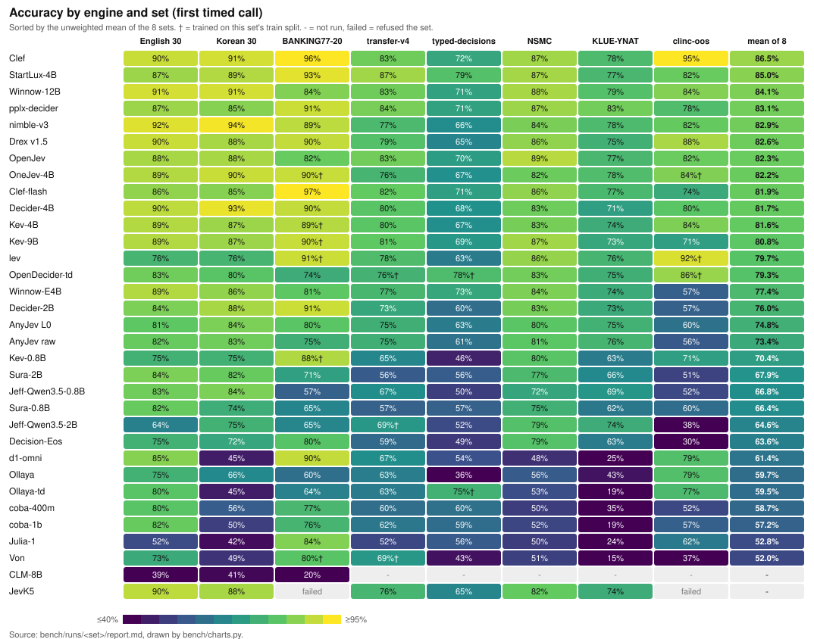
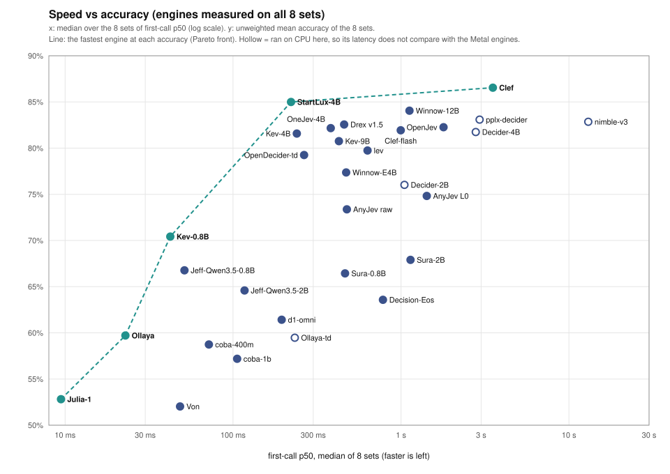
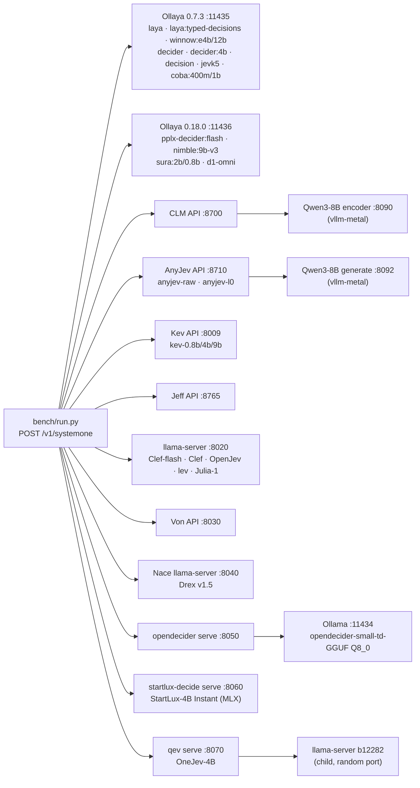
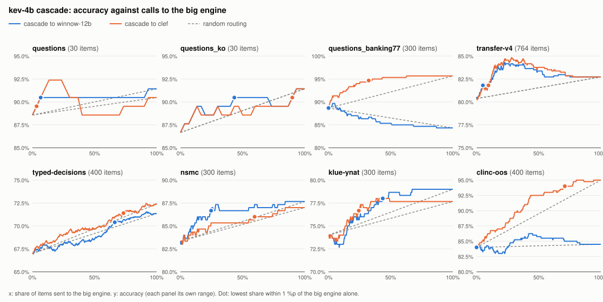
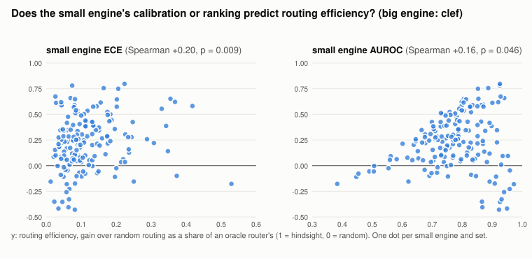

# local-jev-bench: local Jev-style decision models on Apple Silicon

English | [한국어](README.ko.md)

local-jev-bench runs Jev-style System One decision models (typed questions in, calibrated answers out) locally on an
Apple Silicon Mac, and benchmarks them on the same questions. The sets are English and Korean customer tickets, the
public BANKING77 20-way intent set, Kev's out-of-distribution transfer-v4 set, the typed-decisions leaderboard set,
and two Korean sets: NSMC movie reviews and KLUE-YNAT news headlines.

## At a glance





- **Most accurate overall:** Clef (mean of the 8 sets 86.5%), then StartLux-4B (85.0%) and Winnow-12B (84.1%).
  Clef costs 1.5-8.4 s per call here; StartLux-4B 122-1273 ms.
- **Best per set:** StartLux-4B on transfer-v4 (87%) and typed-decisions (79%, level with OpenDecider-td's
  in-distribution 78%†), Clef on clinc-oos (95%, v1 set, withdrawn), Clef-flash on BANKING77-20 (97%), pplx-decider on KLUE-YNAT (83%).
- **Fastest at its accuracy (the dashed line):** Julia-1, Ollaya, Kev-0.8B, StartLux-4B, Clef. No engine is both
  faster and more accurate than these.
- **Ties:** many top-group gaps are 1-2 points and not significant; two engines differ only when the paired
  McNemar p is below 0.05 (see [FAQ](#faq)).

The charts are drawn from `bench/runs/<set>/report.md` by `uv run python bench/charts.py`.

## Quick picks

One line per need, each backed by a result below. Two engines count as different only when the paired McNemar
p is below 0.05 (see [FAQ](#faq)); treat close calls as ties.

| Need | Engine | Why |
|---|---|---|
| Most accurate, generalist | Kev-9B, Kev-4B, Winnow-E4B/12B, Decider-4B, pplx-decider, Drex v1.5, OpenJev, OneJev, StartLux-4B, Clef-flash or Clef | top group on most sets |
| Best out-of-distribution transfer (transfer-v4) | StartLux-4B | 87% (665/764), ahead of pplx-decider's 84% (p < 0.001), most of it on the `emotion` source |
| Best typed-decisions | StartLux-4B (79%, training data not itemised) or OpenDecider-td (in-distribution, 78%†; level, p = 0.121) | see caveats |
| Best Korean (NSMC + KLUE-YNAT) | pplx-decider or Winnow-12B | KLUE-YNAT 83% vs 79% (p = 0.111), NSMC 87% vs 88%; OpenJev's NSMC 89% is level with both |
| Best clinc-oos (intents + out-of-scope) | withdrawn: the v1 set mostly measured picking the `oos` option ([audit](reports/2026-11-12-set-audit.md)) | v1: Clef 95%, lev 92%†, Drex v1.5 88%; remeasure on v2 |
| Fastest | Ollaya (`laya`) | 10.2-43.7 ms first-call p50 outside typed-decisions |
| Best calibrated | Clef-flash | typed-decisions ECE 0.021, KL 0.220 |

Full tables, per-set caveats and McNemar results are in [Results](#results-2026-10-1416-m3-max-36-gb) and [FAQ](#faq).

## Findings

<details><summary>Key results per set and per engine (click to expand)</summary>

**Key results (M3 Max 36 GB; every engine remeasured on every set 2026-10-14..16 on an idle machine, which reproduced the earlier accuracy counts).**
Kev-9B, Kev-4B, Winnow-E4B, Winnow-12B, Decider-4B, pplx-decider, Drex v1.5, OpenJev, OneJev, StartLux-4B,
Clef and Clef-flash are the most accurate engines overall, and paired McNemar tests separate them on only some sets.
On typed-decisions StartLux-4B (79%, training data not itemised) and two in-distribution fine-tunes,
OpenDecider-small-td (78%) and Laya's `ollaya-td` (75%), beat all of them; StartLux-4B also has the best
transfer-v4 score (87%):

- **transfer-v4:** Kev beats Winnow (Kev-9B 81% vs 77%, p = 0.003), but only on the set's two held-out
  policy-structure sources, built from the kind of programmatic policy data Kev trains on (Kev-4B 160/176, Winnow
  125/176). On the six public sources Kev never trained on, the three are level (454, 465 and 460 of 588, p ≥ 0.228), and so is
  training-free AnyJev (458 raw, 457 L0).
- **typed-decisions:** Winnow beats Kev-4B (73% vs 67%) and Kev-9B (69%), both p < 0.001.
- **NSMC and KLUE-YNAT (Korean):** the three, Clef-flash and Clef cannot be told apart, except Clef over Kev-4B on
  NSMC (p = 0.043) and over Kev-9B on KLUE-YNAT (p = 0.014); Winnow-12B, a fourth top engine, leads KLUE-YNAT
  (79%, ahead of Kev-4B, Kev-9B and Winnow-E4B, p ≤ 0.024).
- **clinc-oos (measured on the v1 set, withdrawn 2026-11-12: see [the set audit](reports/2026-11-12-set-audit.md)). v1 listed `oos` itself as one of the 20 options, so 186 of the 300 choices had the answer `oos`, and all 100 yes/no items expected "no". The v1 results below mostly measure how readily an engine picks `oos`. `make_sets.py clinc-oos` now builds v2; remeasure before you compare engines on it.** v1 (CLINC150's 20 largest intents, 300 choice decisions, plus 100 out-of-scope yes/no): Clef leads
  alone, 95% (380/400), ahead of every engine (p < 0.001) on both halves (choice 283/300, out-of-scope 97/100).
  Kev-4B and Winnow-12B follow at 84% (p = 0.894 between them). Kev-9B picks the intent well (269/300, second only to
  Clef) but calls 86 of the 100 out-of-scope requests in scope, so it ends at 71%, below Kev-4B (p < 0.001).
  Clef-flash shows the reverse, 97/100 out-of-scope but 197/300 choice (74%). Ollaya (79%) and Ollaya-td (77%) earn
  most of their score on the out-of-scope half (96-99/100).
- **AnyJev (training-free Qwen3-8B):** level with the top group on KLUE-YNAT (75-76%) and with Winnow on transfer-v4
  (75%), but behind it on typed-decisions (61-63%), and far from the gold distributions there (KL 2.8-3.8 against
  0.2-0.3). It reproduces its own README on BANKING77-20 again, and paired, L0's accuracy gain over raw is real there
  (p = 0.005).
- **Clef-flash (Cloudflare, 9B, measured 2026-10-05):** joins the top group. It is level with Kev-9B on every set
  but BANKING77-20, where it leads (97% vs 90%, p < 0.001; Clef-flash does not publish its training data). On
  transfer-v4 it beats Winnow (82% vs 77%, p = 0.003), again only on the two held-out policy sources (152/176 vs
  125/176); on the six public sources it is level with Kev, Winnow and AnyJev (471 of 588, p > 0.08). It has the
  lowest ECE of all engines on typed-decisions (0.021, KL 0.220) and never changes a choice when the
  options are reversed. It is also slow here: 415-2246 ms first-call p50 on llama.cpp, 1.5-2.8x Kev-9B on the same
  idle machine, against the 38.8 ms median Cloudflare reports from its own GPUs.
- **Clef (Cloudflare, 27B, measured 2026-10-05):** cannot be told apart from Clef-flash on any set but clinc-oos (p ≥ 0.092; clinc-oos 95% vs 74%, p < 0.001) and
  costs 3.4-3.7x its time (1480-8365 ms first-call p50, Q4_K_M; Cloudflare reports a 209.3 ms median on its own
  GPUs). Against Kev-9B it is level everywhere but BANKING77-20
  (96% vs 90%, p < 0.001), typed-decisions (72% vs 69%, p = 0.004), KLUE-YNAT (78% vs 73%, p = 0.014) and clinc-oos
  (p < 0.001). It is the closest engine to typed-decisions' gold distributions after the two in-distribution fine-tunes,
  OpenDecider-td and Ollaya-td (KL 0.196 vs 0.092 and 0.134).
- **Von (395M ModernBERT, measured 2026-10-05):** English only, as its card says: 15% on KLUE-YNAT, 49% on the Korean
  30 and 51% on NSMC (a two-way set). On the English sets it is below the top group (69% transfer-v4, 43%
  typed-decisions), at 29-366 ms first-call p50.
- **New engines (measured 2026-10-10; `ollaya-td` also on typed-decisions 2026-10-09).**
  - **ollaya-td (`laya:typed-decisions`, 421M):** 1505/2000 (75%) on typed-decisions, the bench's best until
    OpenDecider-td (78%, 2026-11-10), ahead of every other engine including Winnow (p = 0.021), Kev-9B (p < 0.001)
    and Clef (p = 0.012), and calibrated second only to OpenDecider-td there (KL 0.134, Brier 0.071). Upstream claims 0.766; this run gives 0.753 (Wilson 73-77). But it is
    a specialist: 63% transfer-v4, 64% BANKING77-20, and 45% on the Korean 30 with 33% order-flips. Its card names
    the four typed-decisions workflows as its fine-tuning data, so mark that 75% in-distribution (†).
    A 2026-10-12 backfill adds NSMC 53% and KLUE-YNAT 19% with 76% order-flips, confirming the collapse.
  - **Winnow-12B (`winnow:12b`, 13 GB Q8_0):** top-group everywhere. transfer-v4 83%, tied first with Clef (632/764) and ahead of
    its E4B sibling (p < 0.001), level with Kev-9B, Clef-flash and Clef. typed-decisions 71%, level with E4B and the
    Clefs, ahead of Kev-9B (p = 0.014). KLUE-YNAT 79% and NSMC 88%, level with or ahead of Kev and Clef. BANKING77-20
    84%, level with E4B (p = 0.132) but below Kev (p ≤ 0.019). Worse calibrated than E4B on typed-decisions
    (KL 0.625 vs 0.286): it ships the author's default temperature 1.0, E4B a fitted 1.2574.
  - **Decider-4B (Mapika, 8.4 GB) and Decider-2B (3.8 GB):** strong generalists. Decider-4B is level with Kev-4B and
    Kev-9B on transfer-v4 (80%, p ≥ 0.467) and BANKING77-20 (90%, p ≥ 0.503), ahead of Winnow on both (p ≤ 0.027),
    and 93% on the Korean 30, ahead of Clef-flash (p = 0.035). Its transfer strength is all public sources (472/588,
    next to Clef's 474); on the policy holdouts it sits between Winnow and Kev (139/176). Decider-2B is a step below
    (transfer 73%, BANKING 91%, Korean 88%) with the lowest ECE of the new batch on English 30 (0.013). Both ran on
    CPU (F32) in Ollaya here, at 0.4-9 s first-call p50 outside typed-decisions (19-56 s there), so their latencies do
    not compare with the Metal rows.
    A 2026-10-12 backfill adds typed-decisions (4B 68%, level with Kev-4B/9B; 2B 60%, ahead of Jeff), NSMC (83%, 83%)
    and KLUE-YNAT (71%, 73%, both top-group).
  - **Jeff-Qwen3.5-0.8B:** 107 ms on the 30-item sets at 83-84%, level with Kev-4B/9B there and ahead of
    Jeff-2B (p < 0.001). The main sets do not reproduce it: transfer 67%, typed 50%, BANKING 57% with 28%
    order-flips, NSMC 72%. The exception is KLUE-YNAT, 69%, level with Kev-4B, Kev-9B and Winnow — the fastest
    engine at that accuracy (28-54 ms outside the 30-item sets and typed-decisions).
  - **Decision-Eos (Qwen3.5-0.8B endpoint head):** mid-tier throughout (transfer 59%, BANKING 80%, 72-75% on the
    30-item sets), level with Kev-0.8B on 30-item English and below it on BANKING (80% vs 88%, p < 0.001). Backfilled 2026-10-12: typed-decisions 49%
    (level with Jeff-0.8B), NSMC 79%, KLUE-YNAT 63% (both level with Kev-0.8B).
  - **JevK5 (alibiserikbay, Qwen3.5-4B, Q8_0 on Metal; first measured 2026-10-16):** top-group on the 30-item
    sets (90% and 88%, level with Kev-4B/9B, Winnow, Clef-flash, Clef and Decider-4B, p ≥ 0.146) and on KLUE-YNAT
    (74%, level with Kev and Winnow-E4B; below Winnow-12B, p = 0.028). Below the top on the larger English sets:
    transfer-v4 76% (level with Winnow-E4B, p = 0.920; below Kev-4B, p = 0.004, and Kev-9B, p = 0.001) and
    typed-decisions 65% (level with Kev-4B, p = 0.056; below Kev-9B, Winnow and Clef, p ≤ 0.001). NSMC 82%, below
    Kev-9B (p = 0.036). It refuses the two 20-option sets (BANKING77-20, clinc-oos) with `TOO_MANY_OPTIONS`.
    194-2872 ms first-call p50.
- **New engines (measured 2026-10-30..11-01; `reports/2026-11-01-analysis.md`).**
  - **pplx-decider (Perplexity, `pplx-decider:flash`, Qwen3.5-4B):** top-group on every set but clinc-oos. The best transfer-v4
    score in the bench until StartLux-4B (87%, 2026-11-11), 84% (638/764), level with Clef, Clef-flash, Winnow-12B and Kev-9B (p ≥ 0.095) and ahead of
    Kev-4B (p = 0.024). KLUE-YNAT 83%, also the best, ahead of Clef (p = 0.036), Clef-flash (p = 0.011) and both
    Kevs (p < 0.001), level with Winnow-12B (p = 0.111). typed-decisions 71%, level with Clef and Winnow-12B, ahead
    of both Kevs. On clinc-oos (78%) it is below Clef, Winnow-12B and Kev-4B. ECE 0.04-0.08 on every set. It needs
    Ollaya 0.18 and runs on CPU here, 1.7-8.0 s first-call p50.
  - **nimble-v3 (Bespoke-Nimble-9B v3, CC BY-NC 4.0):** the best 30-item scores in the bench (92% and 94%), but
    below the top group on the large English sets: transfer-v4 77% (below pplx-decider, Winnow-12B and Clef,
    p < 0.001) and typed-decisions 66% (below Clef, Clef-flash, both Winnows and pplx-decider, p < 0.001; level
    with Kev). BANKING77-20 89%, level with Kev and pplx-decider, below the Clefs (p < 0.001). NSMC 84%, below
    Winnow-12B (p = 0.029). KLUE-YNAT 78%, level with Clef and Winnow-12B, ahead of Kev-9B (p = 0.040), below
    pplx-decider (p = 0.044). clinc-oos 82%, level with Kev-4B and Winnow-12B, below Clef (p < 0.001).
    On CPU in fp32 a 9B is slow here: 4.7-132 s first-call p50. Nimble-v4 is API-only.
  - **coba-400m / coba-1b (Ollaya, Ettin encoders):** fast on Metal (25-640 ms) and well below the top group:
    transfer-v4 60-62%, typed-decisions 59-60%. English only, so the Korean sets collapse (KLUE-YNAT 19-35%).
    The 512-token context refuses 7 typed-decisions states.
- **New engines (measured 2026-11-10, same protocol).**
  - **Drex v1.5 (Nace.AI, 9B, Q8_0 on Metal through Nace's llama.cpp fork):** top-group generalist. 90% on the English 30
    and 88% on the Korean 30, level with Kev, Winnow, the Clefs and pplx-decider there. BANKING77-20 90%, level with Kev and pplx-decider, below the Clefs (p < 0.001). transfer-v4 79%, level
    with Kev-4B and Kev-9B (p ≥ 0.129) and Clef-flash (p = 0.087), below Clef (p = 0.021), Winnow-12B (p = 0.015)
    and pplx-decider (p = 0.003). On clinc-oos it is second only to Clef (88% vs 95%, p < 0.001), ahead of
    Kev-9B, Clef-flash, pplx-decider and nimble-v3 (p ≤ 0.004). typed-decisions is its weak set: 65%, below Kev-9B,
    the Clefs, both Winnows, pplx-decider and OpenDecider-td (p < 0.001), with 18% order-flips. 258-735 ms
    first-call p50 outside typed-decisions (4.5 s there).
  - **OpenDecider-small-td (manjunathshiva, Qwen3-4B LoRA, Q8_0 GGUF in Ollama):** the best typed-decisions score
    in the bench until StartLux-4B (79%, level, p = 0.121), 1555/2000 (78%), ahead of Ollaya-td (p = 0.011) and every other engine then (p < 0.001), and the
    closest to the gold distributions (KL 0.092, Brier 0.048, against Ollaya-td's 0.134 and 0.071). Its card lists
    typed-decisions' train split as training data, so mark that 78% in-distribution (†); the GGUF card claims 0.794,
    this run gives 0.778 (Wilson 76-80). Unlike Ollaya-td it holds up off its home set: 86% on clinc-oos (also in
    its training data, †), level with Drex, Kev-4B and Winnow-12B. NSMC 83% is level with Kev and Drex but below
    Clef (p = 0.023) and Winnow-12B (p = 0.009); KLUE-YNAT 75% is level with Kev, Clef and Drex but below
    pplx-decider (p = 0.003). It is below the top on transfer-v4 (76%, below both Kevs, the Clefs, Winnow-12B and
    pplx-decider, p ≤ 0.001) and BANKING77-20 (74%, below every top-group engine, p < 0.001), and flips 49% of
    its clinc-oos choices when the options are reversed. 130-432 ms first-call p50 outside typed-decisions.
  - **d1-omni (Liquid AI, 600M, text path, Ollaya 0.18 on CPU):** an English-only intent picker. BANKING77-20 90%,
    level with Kev and Drex, and clinc-oos 79%, ahead of Kev-9B (p = 0.015), at 71-360 ms first-call p50. Elsewhere
    it is below the top group (transfer-v4 67%, typed-decisions 54%) and the Korean sets collapse (Korean 30 45%,
    NSMC 48%, KLUE-YNAT 25%).
  - **Sura-2B and Sura-0.8B (Ollaya's own Qwen3.5 decoders, Ollaya 0.18 on CPU):** reproduce their registry's
    typed-decisions claims (56% and 57% against 0.570 and 0.560), and stay mid-tier: transfer-v4 56-57%,
    BANKING77-20 65-71%, clinc-oos 51-60%. Their Korean is better than their English large sets (NSMC 75-77%,
    KLUE-YNAT 62-66%). Paired, Sura-2B is ahead on BANKING77-20 (p = 0.016) and Sura-0.8B on clinc-oos (p < 0.001); the other six
    sets are level (p ≥ 0.115).
- **New engines (measured 2026-11-11, same protocol; ggml-org GGUFs on llama.cpp b11403, Metal).**
  - **OpenJev (27B, Q4_K_M, CC BY-NC 4.0, text only):** top-group generalist. NSMC 89% is the bench's best
    (267/300), though level with Clef, Winnow-12B, pplx-decider, Kev-9B and Drex (p ≥ 0.099); it is ahead of
    OpenDecider-td (p = 0.004) and Decider-2B (p = 0.016). transfer-v4 83% (633/764), level with pplx-decider, Clef,
    Winnow-12B and Kev-9B (p ≥ 0.223), ahead of Drex (p = 0.008) and lev (p = 0.004). 88% on both 30-item sets,
    level with the top group. KLUE-YNAT 77%, level with Clef and Winnow-12B, below pplx-decider (p = 0.013). typed-decisions 70%, level with Kev-9B and Clef-flash, below Clef
    (p = 0.035) and OpenDecider-td (p < 0.001), ahead of Drex (p < 0.001). Its weak sets are BANKING77-20 82%, below
    Kev-9B, the Clefs, pplx-decider and Drex (p < 0.001), and clinc-oos 82%, below Clef, lev and Drex (p ≤ 0.007),
    with 38% order-flips there. 820-9,800 ms first-call p50, faster than Clef on six of the eight sets.
  - **lev (Interfaze, Qwen3.5-4B LoRA, Q8_0):** an intent specialist. clinc-oos 92% is second only to Clef and level
    with it (p = 0.081), ahead of every other engine that answered (p ≤ 0.036), and BANKING77-20 91% is level with Kev, Drex and
    pplx-decider, below the Clefs (p < 0.001). Its card lists `banking77` and `clinc_oos` as training data, so both
    cells are in-distribution (†). NSMC 86% is level with the top group; KLUE-YNAT 76% is level with Clef and
    Winnow-12B, below pplx-decider (p = 0.005). It falls behind on the
    English and Korean 30 (76% each, below Clef, Kev-9B and OpenJev, p ≤ 0.027), transfer-v4 (78%, below OpenJev,
    pplx-decider, Winnow-12B and Clef, p ≤ 0.005) and typed-decisions (63%, below Kev-9B, the Clefs, OpenJev and
    OpenDecider-td, p < 0.001). It never flipped a choice when the options were reversed, on any set (0
    order-flips; not verified whether that is structural). 180-2,340 ms first-call p50.
  - **Julia-1 (Supersonic Labs, 144M ModernBERT encoder on mmBERT-small, Q8_0):** fast (14-113 ms first-call p50)
    and mostly below the rest. BANKING77-20 84% is its one strong set, ahead of Ollaya, Ollaya-td, OpenDecider-td
    and coba-400m (p ≤ 0.001), level with OpenJev (p = 0.337). Elsewhere: English 30 52%, Korean 30 42%,
    transfer-v4 52%, typed-decisions 56%, clinc-oos 62%, NSMC 50% (chance on a yes/no set) and KLUE-YNAT 24%, with
    order-flips of 14-76%. Its card claims 73.15% on 400 typed-decisions cases with its own harness; this run gives
    56% (1118/2000).
- **New engines (measured 2026-11-11, same protocol).**
  - **StartLux-Decision v1.1 4B Instant (StartLux Labs, CC BY-NC 4.0, MLX 8-bit through `startlux-decide serve`):**
    the bench's best on transfer-v4, and level with the in-distribution OpenDecider-td on typed-decisions. transfer-v4 87%
    (665/764), ahead of every other engine (p < 0.001; pplx-decider 45 vs 18 discordant). Most of the lead is the
    `emotion` source (88/116 vs 59-61% for pplx-decider, Clef, Winnow-12B and OpenJev): 495 of the six public
    sources' 588 against pplx-decider's 475 and Clef's 474, and 170/176 on the policy holdouts. typed-decisions 79%
    (1581/2000), level with OpenDecider-td (78%†, p = 0.121) and ahead of every other engine, Ollaya-td included
    (p < 0.001). BANKING77-20 93%, level with Kev-9B, pplx-decider, lev and Drex, below the Clefs (p ≤ 0.022). The
    30-item sets (87%, 89%) and NSMC (87%) are level with the top group; KLUE-YNAT 77% is below pplx-decider
    (p = 0.003). clinc-oos 82%: ahead of Kev-9B and Clef-flash (p < 0.001), below Clef, lev, Drex and OpenDecider-td
    (p ≤ 0.036). Its training data (about 2.7 million decision examples, then 1.7 million) is not itemised, so
    whether these sets are in it is unknown. 122-1,273 ms first-call p50, order-flips 0-6% outside clinc-oos (24%).
  - **OneJev 1.6 4B (OmniJev, Qwen3.5-4B, Apache-2.0, mradermacher's Q8_0 GGUF through `qev serve` on llama.cpp
    b12282):** top group on the 30-item sets (89%, 90%), BANKING77-20 (90%†, level with Kev, pplx-decider, Drex,
    lev and StartLux; below the Clefs, p < 0.001) and KLUE-YNAT (78%, level with Clef, ahead of Kev-9B, p = 0.014;
    below pplx-decider, p = 0.044). clinc-oos 84%† is ahead of Kev-9B, Clef-flash and pplx-decider (p ≤ 0.002), below
    Clef and lev (p < 0.001). OneJev-Data lists `clinc/clinc_oos` (206 rows) and `legacy-datasets/banking77` (142
    rows) among its 127 sources, so both cells are in-distribution (†). It is below the top on transfer-v4 (76%,
    below StartLux, pplx-decider, the Clefs, both Kevs, Winnow-12B and OpenJev, p ≤ 0.006), typed-decisions (67%,
    level with Kev-4B and Kev-9B, below the Clefs, pplx-decider, OpenJev, StartLux and OpenDecider-td, p ≤ 0.007)
    and NSMC (82%, below Clef, Kev-9B, pplx-decider, Winnow-12B, OpenJev and StartLux, p ≤ 0.049). 215-987 ms
    first-call p50.
- **Kev remeasure (2026-10-10, Hub revisions `6cfce5c` and `db029f08`, both dated 2026-10-01).** Kev-4B reproduces
  every 9-30 number exactly (89/87/89/80/67/83/74%), so the September delta updates moved none of this repo's sets
  for it. Kev-9B moved on all seven: English 30 95 → 93, Korean 30 94 → 91, BANKING77-20 267 → 271, transfer-v4
  618 → 620, NSMC 257 → 261, KLUE-YNAT 220 → 218, and typed-decisions 1440 → 1378 of 2000 (72% → 69%), the one
  large move. The 2026-10-14..16 rerun reproduces the 2026-10-10 decisions exactly. Paired against the 9-30 logs
  (`9f5ba1c`), only typed-decisions changed: 158 decisions right only on 9-30 against 96 right only now
  (p < 0.001), almost all in `agent_trace_observability` (305 → 255 of 500, p < 0.001) and on choice and noul
  questions; the other six sets are level (p ≥ 0.22). So Kev-9B's Hub revision regressed on typed-decisions, and
  Winnow now beats it there (p < 0.001), where they were level (p = 0.529).
- **As pairwise judges (2026-11-01..02):** on 200 MT-Bench pairs with human votes, Kev-4B, Kev-9B, Winnow-E4B,
  Winnow-12B and Clef-flash agree with the human winner at Cohen's kappa 0.55-0.65, but only 0.36-0.45 on 200
  Korean pairs. Swapping the two answers' positions changes 9-23% of their verdicts. They show no length or
  same-family preference. Details in [Judge bias](#judge-bias-2026-11-0102-m3-max-36-gb).
- **Cascade routing (simulated from these logs):** sending only Kev-4B's least confident items to Clef reaches
  within 1 %p of Clef alone at 10% of calls on transfer-v4 and 32% on BANKING77-20 (383 vs 2104 ms and 1664 vs
  4312 ms mean). On transfer-v4, routing 28% beats Clef alone by 2.1 %p (p = 0.011), and it holds on held-out
  halves. Kev-4B's ECE does not predict how well routing works. Details in [Cascade routing](#cascade-routing-simulated-from-the-2026-10-1416-logs).

Ollaya (Laya) is the fastest engine, at 10-44 ms first-call p50 outside typed-decisions' long states. It is also among the least
accurate: the lowest of all on typed-decisions, and in the bottom five on every set but clinc-oos, where it scores
79%. It is the worst calibrated (ECE) of Kev, Winnow, Jeff and Ollaya on the Korean 30, BANKING77-20, typed-decisions,
NSMC and KLUE-YNAT; AnyJev and CLM are worse calibrated still on some. Kev-0.8B takes 27-52 ms on the same sets and is as
accurate as Ollaya or more on every set but clinc-oos (71% vs 79%). Kev-4B reproduces its model card on transfer-v4 (534/656 against 0.817). Details are in
[Results](#results-2026-10-1416-m3-max-36-gb).

</details>

## Engines

<details><summary>The twenty-seven engine families and where they come from (click to expand)</summary>

It sets up twenty-seven engine families:

- **CLM** ([Contrastive-LM/CLM](https://github.com/Contrastive-LM/CLM)): a Qwen3-8B encoder served by [vllm-metal](https://github.com/vllm-project/vllm-metal), plus CLM's 75 MB head.
- **Ollaya** ([ollaya-dev/ollaya](https://github.com/ollaya-dev/ollaya)): the `laya` model, run on MLX.
- **Ollaya-td**: `laya:typed-decisions`, Laya's fine-tune on the typed-decisions workflows, run by Ollaya (on CPU here).
- **Winnow** ([ollaya.dev/library/winnow](https://ollaya.dev/library/winnow)): `winnow:e4b`, built on Gemma 4 E4B and run by Ollaya on llama.cpp (Q8_0).
- **Winnow-12B**: `winnow:12b`, the 12B sibling (12.7 GB Q8_0), same runner.
- **Decider-2B / Decider-4B**: Mapika's Qwen3.5 decoders (`decider`, `decider:4b`), run by Ollaya (on CPU here).
- **Decision-Eos**: Decision 1.0 Eos by the vLLM Semantic Router contributors (`decision`), a fine-tuned Qwen3.5-0.8B with an endpoint head, run by Ollaya.
- **JevK5**: alibiserikbay's JevK5 v0.3 (`jevk5`), a Qwen3.5-4B fine-tune on llama.cpp. It refuses questions with more than its option budget (see caveats).
- **pplx-decider**: Perplexity's pplx-decider-flash v1.2 (`pplx-decider:flash`), a Qwen3.5-4B distilled from its 27B decision models. Ollaya 0.7.3 cannot load its `pplx-joint-v1` layout, so it runs on a second daemon, Ollaya 0.18.0 (see Ports), on CPU in fp32 here.
- **coba-400m / coba-1b**: Ollaya's own Ettin encoders distilled from pplx-decider:flash (`coba:400m`, `coba:1b`), English only, run by Ollaya on MLX. Their context is 512 tokens; a longer state is refused with `STATE_TRUNCATED`.
- **nimble-v3**: Bespoke-Nimble-9B v3 (`nimble:9b-v3`, CC BY-NC 4.0), a LoRA on Qwen3.5-9B, on the Ollaya 0.18.0 daemon, on CPU in fp32 here. Nimble-v4 is API-only, so it is not measured.
- **Sura-2B / Sura-0.8B**: Ollaya's own decoder decision models (`sura:2b`, `sura:0.8b`), Qwen3.5 distilled from pplx-decider:flash, on the Ollaya 0.18.0 daemon, on CPU here.
- **d1-omni** ([LiquidAI/d1-omni-600M](https://huggingface.co/LiquidAI/d1-omni-600M)): Liquid AI's 600M decision model, its text path as Ollaya 0.18.0's `d1-omni` (ONNX), on CPU here.
- **Drex v1.5** ([nace-ai/drex-v1.5](https://huggingface.co/nace-ai/drex-v1.5)): Nace.AI's 9B decision model on MiMo-V2.6-Distill-Qwen-9B, as `nace-ai/drex-v1.5-Q8_0`, served by the `llama-server` of Nace's llama.cpp fork (`drex-1.5`); upstream llama.cpp does not load its pointer head.
- **OpenDecider-small-td** ([manjunathshiva/opendecider](https://github.com/manjunathshiva/opendecider)): a LoRA on Qwen3-4B-Instruct-2507 fine-tuned on typed-decisions' train split, as `opendecider-small-td-GGUF` Q8_0 in Ollama, behind `opendecider serve` (`opendecider-td`), which builds the prompt and reads the option probabilities from Ollama's logprobs.
- **AnyJev** ([nokia-applied-research/AnyJev](https://github.com/nokia-applied-research/AnyJev)): training-free; reads label logprobs from Qwen3-8B on vllm-metal, with no correction (`anyjev-raw`) or with cyclic option shifts plus a batch prior (`anyjev-l0`).
- **Kev** ([jaredpalmer/kev](https://github.com/jaredpalmer/kev)): a LoRA plus pointer head on Qwen3.5-0.8B, 4B or 9B Base (`kev-0.8b`, `kev-4b`, `kev-9b`), run on MLX.
- **Jeff** ([firelex/jeff](https://github.com/firelex/jeff)): Jeff-Qwen3.5-2B, a fine-tuned Qwen3.5-2B with a trained answer readout, run on MLX.
- **Jeff-0.8B**: Jeff-Qwen3.5-0.8B, the smaller sibling. Download with `hf download mstrasser/Jeff-Qwen3.5-0.8B --local-dir checkpoints/jeff-0.8b` in the Jeff checkout; `JEFF_CHECKPOINT=checkpoints/jeff-0.8b scripts/serve-jeff.sh` serves it (the bench checks `/health` for `jeff-qwen3.5-0.8b`). `scripts/measure.sh` picks the checkpoint by engine name (`jeff` vs `jeff-0.8b`).
- **Clef-flash** ([Cloudflare/clef-flash](https://huggingface.co/Cloudflare/clef-flash)): Cloudflare's 9B decision model on Qwen3.5-9B, as `ggml-org/Clef-Flash-GGUF` Q8_0, served by llama.cpp's `llama-server` (`clef-flash`). It decides all the questions of a request jointly, in one prompt; the other engines answer each question on its own.
- **Clef** ([Cloudflare/clef](https://huggingface.co/Cloudflare/clef)): the 27B sibling on Qwen3.8-27B, as `ggml-org/Clef-GGUF` Q4_K_M on the same `llama-server` (`clef`). Q8_0 (28.7 GB) leaves too little of the 36 GB.
- **OpenJev** ([openjev/openjev](https://huggingface.co/openjev/openjev)): a 27B decision model (CC BY-NC 4.0), as `ggml-org/OpenJev-GGUF` Q4_K_M on the same `llama-server` (`openjev`), text only (the `mmproj` vision projector is not loaded). Q8_0 (28.6 GB) leaves too little of the 36 GB.
- **lev** ([interfaze-ai/lev](https://huggingface.co/interfaze-ai/lev)): Interfaze's LoRA on Qwen3.5-4B, as `ggml-org/lev-GGUF` Q8_0 on the same `llama-server` (`lev`).
- **Julia-1** ([SupersonicLabs/Julia-1](https://huggingface.co/SupersonicLabs/Julia-1)): Supersonic Labs' 144M ModernBERT decision encoder on mmBERT-small, as `ggml-org/Julia-1-GGUF` Q8_0 on the same `llama-server` (`julia-1`).
- **StartLux-4B** ([startlux-models/StartLux-Decision-v1.1-4B-Instant](https://huggingface.co/startlux-models/StartLux-Decision-v1.1-4B-Instant)): StartLux Labs' 4B Instant decision model (CC BY-NC 4.0), whose full-attention layers read the prompt bidirectionally, as its MLX 8-bit build behind `startlux-decide serve --backend mlx` (`startlux-4b`).
- **OneJev-4B** ([OmniJev/OneJev1.6-4B](https://huggingface.co/OmniJev/OneJev1.6-4B)): OmniJev's OneJev 1.6 on Qwen3.5-4B, as `mradermacher/OneJev1.6-4B-GGUF` Q8_0 (text only) behind OneJev's `qev serve`, which starts its own llama-server (`onejev-4b`).
- **Von** ([wfzyx/von](https://github.com/wfzyx/von)): a 395M ModernBERT encoder with an option-marker head, served by its own `von serve` on Metal (`von`).

All speak TypeSafe's `POST /v1/systemone` wire format.

</details>

## Architecture

Every engine answers `POST /v1/systemone` on its own port; `bench/run.py` sends the same question set to one engine
at a time. A few engines sit behind a shared backend (CLM and AnyJev read Qwen3-8B embeddings or logprobs over
HTTP; the Ollaya-served engines share one of two daemons; OpenDecider reads logprobs from Ollama). Full port list: [Ports](#ports).



## Install

```bash
brew tap vllm-project/vllm-metal https://github.com/vllm-project/vllm-metal   # the tap needs the URL
brew install vllm-project/vllm-metal/vllm-metal
OLLAYA_INSTALL_DIR=$HOME/.local OLLAYA_NO_SERVICE=1 sh -c "$(curl -fsSL https://ollaya.dev/install.sh)"
uv sync
```

[AnyJev](https://github.com/nokia-applied-research/AnyJev) comes from `uv sync`. Its vLLM backend reads label logprobs over HTTP and imports `transformers` only for the tokenizer, so torch is not needed. `serve/anyjev_server.py` wraps it in the `/v1/systemone` format. The request's `model` picks the correction level (`anyjev-raw` or `anyjev-l0`). The adapter asks the generate server for each label's logprob by id (`logprob_token_ids`) rather than AnyJev's `allowed_token_ids` + top-K, because vllm-metal 0.30.0 reports logprobs before that filter and a label can fall out of the top K. A label token missing from the server's logprobs is an HTTP 502, not a filled-in probability.

[Kev](https://github.com/jaredpalmer/kev) keeps its own uv environment (torch, mlx-lm) in its checkout, so it is not a dependency here. `git clone https://github.com/jaredpalmer/kev ~/workspace/tak-bro/kev && (cd ~/workspace/tak-bro/kev && uv sync --extra serve)` sets it up. `scripts/serve-kev.sh` runs its `/v1/systemone` server with the `jaredpalmer/kev-4b` adapter on Qwen3.5-4B-Base; `KEV_RUN=jaredpalmer/kev-0.8b` or `jaredpalmer/kev-9b` serves another size on the same port. The engines `kev-0.8b`, `kev-4b` and `kev-9b` check `/v1/models` before a run and refuse a server running another size.

[Winnow](https://ollaya.dev/library/winnow) runs in Ollaya: `ollaya pull winnow:e4b` (8.0 GB, Gemma 4, Q8_0), measured as the `winnow` engine. `ollaya pull winnow:12b` (12.7 GB) adds the larger sibling, measured as `winnow-12b`. The same pattern adds the rest: `ollaya pull laya:typed-decisions` (`ollaya-td`), `ollaya pull decider` and `ollaya pull decider:4b` (`decider-2b`, `decider-4b`), `ollaya pull decision` (`decision-eos`), `ollaya pull jevk5` (`jevk5`). `bench/run.py`'s `ENGINES` pins the tag per engine name (env-overridable), and `scripts/measure.sh` unloads that tag afterwards. `ollaya stop winnow:e4b` unloads it.

[Jeff](https://github.com/firelex/jeff) keeps its own uv environment too, and its `pyproject.toml` requires uv 0.12.19 or newer, hence `uvx`: `git clone https://github.com/firelex/jeff ~/workspace/tak-bro/jeff && git -C ~/workspace/tak-bro/jeff checkout f06788292874c21a5b5c41549ac220dd9e15da7f`, then in it `uvx --from 'uv>=0.12.19' uv sync --no-default-groups --extra mac` and `uvx --from 'uv>=0.12.19' uv run --no-default-groups hf download mstrasser/Jeff-Qwen3.5-2B --local-dir checkpoints/jeff-2b`. `scripts/serve-jeff.sh` serves it on MLX, which runs Jeff's Qwen models only, so Jeff-Gemma4-E2B is not used here.

[Clef-flash](https://huggingface.co/ggml-org/Clef-Flash-GGUF) needs llama.cpp build 11403: `/v1/systemone` and the clef architecture landed after Homebrew's 0.5.0. Unpack the [b11403 release](https://github.com/ggml-org/llama.cpp/releases/tag/b11403) `llama-b11403-bin-macos-arm64.tar.gz` into `~/.local/opt/llama.cpp/b11403/` (or point `LLAMA_SERVER` at its `llama-server`). `scripts/serve-llama.sh clef-flash` (or `clef`) checks the build, downloads the GGUF at a pinned revision (9.7 GB, or 19.2 GB for Clef) and serves it with the whole prompt in one batch (`-ub 8192`), which clef requires. `scripts/serve-llama.sh julia-1`, `lev` and `openjev` serve the other ggml-org decision GGUFs the same way (0.17, 4.5 and 19.4 GB).

The Ollaya 0.18.0 daemon (see Ports) adds `pplx-decider:flash`, `nimble:9b-v3`, `sura:2b`, `sura:0.8b` and `d1-omni`: `OLLAYA_HOST=127.0.0.1:11436 OLLAYA_MODELS=~/.ollaya-0.18/models ~/.local/ollaya-0.18/bin/ollaya pull sura:2b`, and so on. Ollaya 0.7.3 cannot load them.

[Drex v1.5](https://huggingface.co/nace-ai/drex-v1.5-Q8_0) needs the `drex-v1.5` branch of Nace's llama.cpp fork, built with Metal: `git clone --depth 1 -b drex-v1.5 https://github.com/nace-ai/llama.cpp ~/workspace/ext/nace-llama.cpp`, then `cmake -S ~/workspace/ext/nace-llama.cpp -B ~/workspace/ext/nace-llama.cpp/build -DGGML_METAL=ON -DLLAMA_CURL=OFF -DCMAKE_BUILD_TYPE=Release && cmake --build ~/workspace/ext/nace-llama.cpp/build -j 12 --target llama-server` (or point `DREX_SERVER` at another build). `scripts/serve-drex.sh` checks the fork commit (`e8f7961`), downloads the GGUF at a pinned revision (9.5 GB) and serves it with the model card's flags (`--embedding --pooling none`, `-c 16384`) on Metal.

[OpenDecider](https://github.com/manjunathshiva/opendecider) runs as a uv tool on top of Ollama: `uv tool install "opendecider[serve]==0.9.0"` and `ollama pull hf.co/manjunathshiva/opendecider-small-td-GGUF:Q8_0` (4.3 GB). `scripts/serve-opendecider.sh` checks the version and that Ollama answers on `:11434`, then runs `opendecider serve` with a 300 s request timeout.

[StartLux-Decision](https://github.com/StartLuxLabs/StartLux-Decision) runs as a uv tool: `uv tool install "startlux-decide[mlx] @ git+https://github.com/StartLuxLabs/StartLux-Decision@v1.1.0"`. `scripts/serve-startlux.sh` checks the version, downloads the MLX 8-bit build at a pinned revision (5.1 GB) and serves it on `:8060`.

[OneJev](https://github.com/OmniJev/OneJev)'s `qev` runs as a uv tool too: `uv tool install --python 3.12 "qev @ git+https://github.com/OmniJev/OneJev@9d59064ed540f2b9bcbd2a3e5390b326ebf5fa15"`. It needs llama.cpp b12282: b11403 refuses mradermacher's GGUF, whose header declares an MTP layer (`block_count` 33, `nextn_predict_layers` 1) the file does not ship. Unpack the [b12282 release](https://github.com/ggml-org/llama.cpp/releases/tag/b12282) `llama-b12282-bin-macos-arm64.tar.gz` into `~/.local/opt/llama.cpp/b12282/`. `scripts/serve-onejev.sh` checks both, downloads the GGUF (4.5 GB) and the tokenizer and calibration files at pinned revisions, and serves on `:8070`.

[Von](https://github.com/wfzyx/von) runs from PyPI through `uvx` (`von-sdk==1.3.7`), with weights pinned to one revision of `wfzyx/von` (3.2 GB). `scripts/serve-von.sh` serves it on Metal with `--noul-decision raw`: by default Von moves every noul probability outside 0.2-0.8, which keeps the decision but not the calibration scored here.

`contrastive-lm` declares `vllm` as a dependency, but it only calls the embeddings endpoint over HTTP. `pyproject.toml` overrides that dependency away so a second vLLM is not installed.

## Ports

Every server binds to `127.0.0.1` only.

| Port | Process | Start |
|---|---|---|
| 8091 | small embedding model (smoke only) | `scripts/serve-embed.sh mlx-community/Qwen3-Embedding-0.6B-8bit 8091 embed-small` |
| 8090 | Qwen3-8B encoder for CLM | `scripts/serve-embed.sh Qwen/Qwen3-8B 8090 qwen3-8b` |
| 8700 | CLM System One API | `scripts/serve-clm.sh` |
| 11435 | Ollaya 0.7.3 daemon (`laya`, `winnow:e4b`, `winnow:12b`, `laya:typed-decisions`, `decider`, `decider:4b`, `decision`, `jevk5`, `coba:400m`, `coba:1b`) | `OLLAYA_HOST=127.0.0.1:11435 ~/.local/bin/ollaya serve` |
| 11436 | Ollaya 0.18.0 daemon with its own model store (`pplx-decider:flash`, `nimble:9b-v3`, `sura:2b`, `sura:0.8b`, `d1-omni`) | `OLLAYA_HOST=127.0.0.1:11436 OLLAYA_MODELS=~/.ollaya-0.18/models ~/.local/ollaya-0.18/bin/ollaya serve`; measure with `OLLAYA_URL=http://127.0.0.1:11436` and `~/.local/ollaya-0.18/bin` first on `PATH` |
| 8092 | Qwen3-8B generate server for AnyJev | `scripts/serve-llm.sh Qwen/Qwen3-8B 8092 qwen3-8b` |
| 8710 | AnyJev System One API (`anyjev-raw`, `anyjev-l0`) | `scripts/serve-anyjev.sh` |
| 8009 | Kev System One API (`kev-latest`) | `KEV_RUN=jaredpalmer/kev-4b scripts/serve-kev.sh` (or `kev-0.8b`, `kev-9b`) |
| 8765 | Jeff System One API (`jeff-latest`) | `scripts/serve-jeff.sh` |
| 8020 | llama-server System One API (`Clef-Flash-Q8_0@4a7a08c`, `Clef-Q4_K_M@5f70656`, `OpenJev-Q4_K_M@d2c376d`, `lev-Q8_0@2ef3b3c` or `Julia-1-Q8_0@1e6b48a`) | `scripts/serve-llama.sh clef-flash` (or `clef`, `openjev`, `lev`, `julia-1`) |
| 8030 | Von System One API (`von-latest`) | `scripts/serve-von.sh` |
| 8040 | Nace llama-server System One API (`drex-v1.5-Q8_0@37c2b59`) | `scripts/serve-drex.sh` |
| 8050 | OpenDecider System One API (serves `hf.co/manjunathshiva/opendecider-small-td-GGUF:Q8_0`) | `scripts/serve-opendecider.sh` |
| 8060 | StartLux-Decision System One API (`StartLux-Decision-v1.1-4B-Instant-MLX-8bit@56f18ac`) | `scripts/serve-startlux.sh` |
| 8070 | OneJev `qev` System One API (`OneJev1.6-4B.Q8_0@2b605ac`; its llama-server child takes a random port) | `scripts/serve-onejev.sh` |
| 11434 | Ollama daemon, the model runner behind OpenDecider | `ollama serve` (or the Ollama app) |

The serve scripts refuse to start when their port is already taken.

`serve-embed.sh` pins three settings that were needed on this Mac (M3 Max, 36 GB, vllm-metal 0.30.0):

- `GLOO_SOCKET_IFNAME=lo0 VLLM_HOST_IP=127.0.0.1`: without these, the engine hangs at init because torch.distributed cannot resolve the `.local` hostname.
- `--pooler-config '{"seq_pooling_type": "LAST", "use_activation": true}'`: last-token pooling with L2 normalisation, which is what CLM's head expects. Without it, vLLM falls back to the architecture default.
- `--gpu-memory-utilization 0.7`: vllm-metal applies the fraction to the Metal wired limit (28.1 GB here). The default of 0.92 pushed memory pressure to warn. 0.55 left no KV cache for the 16 GB of bf16 weights.

## Check and benchmark

```bash
scripts/smoke-embed.sh 8091                   # vector returned, L2-normalised
scripts/smoke-embed.sh 8090 4096              # Qwen3-8B: 4096 dims, normalised
uv run python bench/run.py --smoke --engine clm      # CLM README example within tolerance
uv run python bench/run.py --smoke --engine ollaya   # same example, shape only
uv run python bench/run.py                           # 30 questions x 3 reps on CLM and Ollaya, with kernel memory pressure
uv run python bench/run.py --smoke --engine <e>       # shape only (anyjev-raw, anyjev-l0, kev-0.8b, kev-4b, kev-9b, winnow, jeff), its server up
uv run python bench/run.py --engine <e> --reps 1 --questions bench/questions_banking77.jsonl
uv run python bench/score.py bench/runs/questions --check   # report.md matches the raw logs
uv run python bench/charts.py --check                       # docs/charts/*.svg match the reports (no --check: redraw)
uv run python bench/make_sets.py transfer-v4        # Kev's out-of-distribution dev set (764) into bench/data/, gitignored
uv run python bench/make_sets.py typed-decisions    # LocalLLaMA/typed-decisions test (400 cases, 2,000 decisions) with gold distributions
uv run python bench/make_sets.py nsmc               # 300 Korean movie reviews, positive or not (HF card: CC BY 2.0)
uv run python bench/make_sets.py klue-ynat          # 300 Korean headlines, 7 topics (KLUE, CC BY-SA 4.0)
uv run python bench/make_sets.py clinc-oos          # CLINC150 20 seeded intents (300 choice) + 100 in-scope / 100 out-of-scope noul
uv run python bench/make_sets.py massive-en         # MASSIVE 20 intents, 300 en-US utterances (CC BY 4.0)
uv run python bench/make_sets.py massive-ko         # the same 300 utterances in ko-KR: same ids, options and question
uv run python bench/make_sets.py judge-mtbench      # 200 MT-Bench human-judged answer pairs x 2 orders (CC BY 4.0)
uv run python bench/make_sets.py judge-ko           # 200 Korean-Human-Judgements pairs x 2 orders (evaluation only)
uv run python bench/make_sets.py judge-length       # 100 human-winner answers against their own padded copy x 2 orders
uv run python bench/make_judge_self.py --x qwen3:8b --y <other family>   # self-preference pairs, generated on Ollama
uv run python bench/judge_bias.py bench/runs/judge-*   # position, length and self-preference bias, kappa vs humans
uv run python bench/cascade.py --out bench/runs/cascade.md --figures reports/figures   # cascade routing from the raw logs, no engine called
uv run python bench/consensus.py bench/runs/nsmc bench/runs/klue-ynat   # label-noise candidates: the top engines all wrong the same way
uv run python bench/lang_gap.py bench/runs/massive-en bench/runs/massive-ko   # English vs Korean per engine, paired McNemar
uv run pytest -q                              # offline tests, fake servers, no model loaded
```

AnyJev and Kev each need most of the Metal memory, so every engine is measured alone: start its servers, run
`bench/run.py --engine <e> --questions <set>`, stop them. `scripts/measure.sh [--reps N] <engine> <set>...` does
all three and stops the servers even when a step fails; server output goes to `logs/<name>.log`. Each run logs every call (answers with probabilities,
latency, memory pressure) to `bench/runs/<set>/<engine>.jsonl`, replacing that engine's earlier log once the run finishes, and
`bench/score.py` rebuilds `bench/runs/<set>/report.md` from all the logs in that directory. It refuses a log measured
on another version of the set or with another `--reps`. Restart the AnyJev adapter before each run: the L0 batch prior
accumulates across every call the adapter has served.

The benchmark rejects any item whose state plus question instructions (the text CLM actually embeds) exceeds 2048 Qwen3 tokens, because `clm-serve` would otherwise truncate it without an error. Treat the accuracy over 30 hand-written items as a sanity check, not a benchmark.

## Results (2026-10-14..16, M3 Max 36 GB)

`scripts/measure.sh` measured every engine on every set in one pass, one engine at a time, on an otherwise idle
machine (no other model server loaded). The 30-item sets ran 3 reps; every other set ran 1 rep, plus a
reversed-option call where the set has choice questions (all but NSMC). Accuracy is graded per decision (item x question) from each item's first timed call. The full
tables are in `bench/runs/<set>/report.md`: counts with 95% Wilson intervals, Brier, ECE, order-flip, the pairwise
McNemar table, and per-source breakdowns. Each table is rebuilt from the raw logs next to it by
`bench/score.py <dir> --check`. Ollaya ran `laya` on the English sets and `laya:multilingual` on the Korean ones.
The rerun reproduced every earlier accuracy count (2026-09-30 to 2026-10-12) exactly, except AnyJev L0, one decision
lower on transfer-v4 and on typed-decisions; it filled clinc-oos for every engine and measured JevK5 for the first
time. Its interpretation is in `reports/2026-10-16-analysis.md`; the earlier ones in `reports/`.

Accuracy, first timed call (`†` = the engine trained on a train split of data in this set):

| engine | English 30 | Korean 30 | BANKING77-20 | transfer-v4 | typed-decisions | NSMC | KLUE-YNAT | clinc-oos |
|---|---|---|---|---|---|---|---|---|
| decisions | 105 | 105 | 300 | 764 | 2,000 | 300 | 300 | 400 |
| Kev-9B | 89% | 87% | 90%† | 81% | 69% | 87% | 73% | 71% |
| Kev-4B | 89% | 87% | 89%† | 80% | 67% | 83% | 74% | 84% |
| Clef-flash | 86% | 85% | 97% | 82% | 71% | 86% | 77% | 74% |
| Clef | 90% | 91% | 96% | 83% | 72% | 87% | 78% | 95% |
| Winnow-E4B | 89% | 86% | 81% | 77% | 73% | 84% | 74% | 57% |
| Winnow-12B | 91% | 91% | 84% | 83% | 71% | 88% | 79% | 84% |
| pplx-decider | 87% | 85% | 91% | 84% | 71% | 87% | 83% | 78% |
| Drex v1.5 | 90% | 88% | 90% | 79% | 65% | 86% | 75% | 88% |
| Decider-4B | 90% | 93% | 90% | 80% | 68% | 83% | 71% | 80% |
| nimble-v3 | 92% | 94% | 89% | 77% | 66% | 84% | 78% | 82% |
| Decider-2B | 84% | 88% | 91% | 73% | 60% | 83% | 73% | 57% |
| JevK5 | 90% | 88% | failed | 76% | 65% | 82% | 74% | failed |
| OpenDecider-td | 83% | 80% | 74% | 76%† | 78%† | 83% | 75% | 86%† |
| Ollaya-td | 80% | 45% | 64% | 63% | 75%† | 53% | 19% | 77% |
| d1-omni | 85% | 45% | 90% | 67% | 54% | 48% | 25% | 79% |
| OpenJev | 88% | 88% | 82% | 83% | 70% | 89% | 77% | 82% |
| lev | 76% | 76% | 91%† | 78% | 63% | 86% | 76% | 92%† |
| Julia-1 | 52% | 42% | 84% | 52% | 56% | 50% | 24% | 62% |
| StartLux-4B | 87% | 89% | 93% | 87% | 79% | 87% | 77% | 82% |
| OneJev-4B | 89% | 90% | 90%† | 76% | 67% | 82% | 78% | 84%† |
| Sura-2B | 84% | 82% | 71% | 56% | 56% | 77% | 66% | 51% |
| Sura-0.8B | 82% | 74% | 65% | 57% | 57% | 75% | 62% | 60% |
| Kev-0.8B | 75% | 75% | 88%† | 65% | 46% | 80% | 63% | 71% |
| Jeff-Qwen3.5-2B | 64% | 75% | 65% | 69%† | 52% | 79% | 74% | 38% |
| Jeff-Qwen3.5-0.8B | 83% | 84% | 57% | 67% | 50% | 72% | 69% | 52% |
| Ollaya | 75% | 66% | 60% | 63% | 36% | 56% | 43% | 79% |
| Decision-Eos | 75% | 72% | 80% | 59% | 49% | 79% | 63% | 30% |
| coba-1b | 82% | 50% | 76% | 62% | 59%* | 52% | 19% | 57% |
| coba-400m | 80% | 56% | 77% | 60% | 60%* | 50% | 35% | 52% |
| AnyJev L0 | 81% | 84% | 80% | 75% | 63% | 80% | 75% | 60% |
| AnyJev raw | 82% | 83% | 75% | 75% | 61% | 81% | 76% | 56% |
| Von | 73% | 49% | 80%† | 69%† | 43% | 51% | 15% | 37% |
| CLM-8B | 39% | 41% | 20% | - | - | - | - | - |

`†`: Kev (all three sizes) trained on BANKING77's train split, and Jeff on PAWS's. Ollaya-td's card names
the four typed-decisions workflows as its fine-tuning data. OpenDecider-td's card lists typed-decisions' train split,
`clinc/clinc_oos` and PAWS (transfer-v4's `paws` source) among its training sets. PAWS's test split is 80 of
transfer-v4's 764 decisions. lev's card lists `banking77` and `clinc_oos` among its 26 training datasets, and OneJev-Data `clinc/clinc_oos` (206 rows) and `legacy-datasets/banking77` (142 rows) among its 127 sources. Von's card lists Banking77 and dair-ai/emotion in its training corpus without naming
the split; transfer-v4's `emotion` source (116 decisions) is dair-ai/emotion. An engine without a mark either did not train on the set or does not publish its training
data (Winnow, Laya, CLM, Clef, Clef-flash, Decider, Decision-Eos, JevK5, pplx-decider, coba, Nimble, Drex, d1-omni, OpenJev, Julia-1, StartLux). See the training table below.
`*`: of 1,965 graded decisions; coba refused 7 typed-decisions states longer than its 512-token context
(`STATE_TRUNCATED`), so 35 decisions have no answer.

pplx-decider, nimble-v3 and the two coba sizes were measured 2026-10-30..11-01 with the same protocol, on the
same machine (`reports/2026-11-01-analysis.md`); Drex v1.5, OpenDecider-td, d1-omni and the two Sura sizes on
2026-11-10; OpenJev, lev, Julia-1, StartLux-4B and OneJev-4B on 2026-11-11.

First-call p50, ms:

| engine | English 30 | Korean 30 | BANKING77-20 | transfer-v4 | typed-decisions | NSMC | KLUE-YNAT | clinc-oos |
|---|---|---|---|---|---|---|---|---|
| Kev-9B | 481.5 | 457.2 | 489.6 | 333.4 | 1410.3 | 275.2 | 396.5 | 365.8 |
| Kev-4B | 284.0 | 283.0 | 260.8 | 167.9 | 767.0 | 142.6 | 218.4 | 185.7 |
| Clef-flash | 990.5 | 1001.6 | 1183.5 | 551.4 | 2246.2 | 414.5 | 711.8 | 1009.4 |
| Clef | 3398.2 | 3650.9 | 4277.9 | 1988.8 | 8365.4 | 1479.9 | 2631.1 | 3765.0 |
| Winnow-E4B | 576.0 | 604.0 | 500.6 | 312.8 | 1333.1 | 262.9 | 385.4 | 442.5 |
| Winnow-12B | 1138.0 | 1971.1 | 1264.4 | 785.3 | 3350.2 | 637.3 | 992.2 | 1109.1 |
| pplx-decider | 2773.6 | 3105.6 | 3112.8 | 2424.1 | 8008.3 | 1731.7 | 2430.1 | 3114.6 |
| Drex v1.5 | 734.9 | 735.6 | 505.0 | 322.8 | 4543.8 | 258.5 | 412.1 | 404.3 |
| Decider-4B | 8633.5 | 8644.8 | 3197.7 | 1738.5 | 55787.8 | 1014.9 | 2376.8 | 2376.9 |
| nimble-v3 | 40942.7 | 38802.4 | 13730.9 | 6083.7 | 131822.8 | 4711.6 | 7674.4 | 12344.1 |
| Decider-2B | 3153.7 | 3153.3 | 1189.8 | 638.9 | 19049.7 | 366.6 | 902.6 | 906.3 |
| JevK5 | 591.5 | 608.3 | failed | 279.9 | 2872.4 | 193.5 | 361.0 | failed |
| OpenDecider-td | 413.9 | 432.1 | 254.9 | 161.3 | 1024.0 | 130.4 | 274.7 | 228.3 |
| OpenJev | 2556.7 | 4601.1 | 1918.0 | 893.9 | 9796.6 | 819.6 | 1284.2 | 1507.2 |
| lev | 789.9 | 823.2 | 561.9 | 436.4 | 2343.2 | 180.9 | 485.7 | 481.4 |
| Julia-1 | 112.9 | 41.4 | 23.4 | 18.2 | 50.5 | 14.4 | 18.5 | 16.9 |
| StartLux-4B | 497.7 | 456.2 | 226.4 | 179.7 | 1272.9 | 122.1 | 194.6 | 189.8 |
| OneJev-4B | 633.0 | 726.2 | 404.2 | 279.9 | 986.7 | 214.6 | 304.4 | 334.8 |
| Ollaya-td | 274.9 | 721.7 | 191.4 | 126.5 | 2082.0 | 119.7 | 385.8 | 136.6 |
| d1-omni | 257.7 | 359.5 | 196.8 | 108.4 | 1825.8 | 70.7 | 192.7 | 146.9 |
| Sura-2B | 1095.2 | 1183.7 | 1214.4 | 921.0 | 3349.1 | 637.7 | 921.8 | 1220.8 |
| Sura-0.8B | 437.7 | 491.0 | 491.5 | 375.5 | 1266.0 | 264.8 | 394.7 | 512.0 |
| Kev-0.8B | 44.7 | 46.4 | 51.5 | 36.1 | 135.9 | 26.7 | 39.9 | 33.7 |
| Jeff-Qwen3.5-2B | 237.0 | 236.9 | 125.4 | 88.7 | 895.0 | 62.6 | 91.7 | 108.6 |
| Jeff-Qwen3.5-0.8B | 106.6 | 107.2 | 54.0 | 39.7 | 424.9 | 28.2 | 40.8 | 48.7 |
| Ollaya | 43.7 | 22.1 | 31.0 | 21.4 | 262.6 | 10.2 | 13.2 | 23.6 |
| Decision-Eos | 1136.3 | 1103.9 | 837.8 | 379.9 | 4126.7 | 264.2 | 494.6 | 723.1 |
| coba-1b | 103.7 | 285.7 | 77.0 | 52.3 | 639.1 | 52.0 | 107.9 | 110.2 |
| coba-400m | 125.3 | 205.5 | 75.6 | 60.3 | 274.6 | 27.3 | 67.9 | 25.6 |
| AnyJev L0 | 787.3 | 893.2 | 6919.6 | 525.7 | 1955.5 | 337.8 | 2192.4 | 4867.0 |
| AnyJev raw | 570.6 | 658.7 | 515.0 | 289.1 | 1478.7 | 185.9 | 416.3 | 437.2 |
| Von | 101.1 | 135.5 | 32.2 | 28.7 | 366.3 | 44.6 | 52.1 | 29.0 |
| CLM-8B | 260.6 | 299.4 | 137.3 | - | - | - | - | - |

Decider-4B, Decider-2B, Decision-Eos and Ollaya-td ran on CPU (F32, ONNX) in Ollaya's runner on this machine (the
Ollaya server log records `device=cpu` for each load), so their latencies compare runtimes as much as models, like the
llama.cpp rows. pplx-decider and nimble-v3 ran the same way (CPU, fp32, ONNX) in Ollaya 0.18.0, which is why
nimble-v3, a 9B, takes 4.7-132 s per first call here. Sura-2B, Sura-0.8B and d1-omni ran on CPU in Ollaya 0.18.0
too. The other Ollaya rows ran on Metal: Laya and coba on MLX, Winnow and JevK5 on llama.cpp (Q8_0). Drex ran on
Metal in Nace's llama.cpp fork, OpenDecider-td on Metal in Ollama, and OpenJev, lev and Julia-1 on Metal in
llama.cpp b11403, like the Clefs. StartLux-4B ran on Metal in MLX (8-bit), OneJev-4B on Metal in llama.cpp b12282.

What each engine was trained on, as far as its authors publish it:

| engine | this repo's sets in its training data | source |
|---|---|---|
| Kev (all three sizes) | BANKING77 train split. Of transfer-v4's sources, Kev never trained on the six public ones. The two held-out policy structures come from the kind of policy data it trains on | model cards (`datasets`, transfer-v4 description), `kev/data.py` `TRAINABLE` |
| Jeff | PAWS `labeled_final` train split. transfer-v4's `paws` source (80 decisions) is that dataset's test split. None of the other sets is in its source list | `docs/data-sources.md` and `src/jeff/data.py` at `f0678829`, `kev/data.py` (`paws`: train, test) |
| AnyJev | none: training-free, Qwen3-8B as released | AnyJev README |
| Von | Banking77 and dair-ai/emotion (split not named), among about 290k decisions; "no JevBench item" | `wfzyx/von` model card, Training data |
| Clef-flash, Clef | unknown: post-trained from Qwen3.5-9B and Qwen3.8-27B, data not published | `Cloudflare/clef-flash` and `Cloudflare/clef` model cards |
| Winnow (E4B, 12B), Laya, CLM | unknown | |
| Decider-4B, Decider-2B, Decision-Eos | unknown: Mapika's Qwen3.5 decoders and the vLLM Semantic Router contributors' Decision 1.0 Eos; training data not published here | Ollaya registry entries |
| Ollaya-td | the four typed-decisions workflows (0.766 accuracy claimed upstream) | `convaiinnovations/laya-typed-decisions` model card |
| JevK5 | unknown | |
| pplx-decider | unknown: distilled from Perplexity's 27B decision models, data not published | Ollaya registry entry |
| coba (400m, 1b) | none named: distilled from pplx-decider:flash's answers; the in-domain ternary tags, trained on ten public benchmark train splits, are not measured here | Ollaya registry entry |
| nimble-v3 | unknown: contrastive pairs curated by Bespoke Labs ("we did not distill from Jev") | `bespokelabsai/nimble` README |
| Drex v1.5 | unknown: post-trained from MiMo-V2.6-Distill-Qwen-9B, data not published | `nace-ai/drex-v1.5` model card |
| OpenDecider-td | typed-decisions train split, `clinc/clinc_oos`, `go_emotions`, PAWS, among others; the typed-decisions test split "was never used for training" | `manjunathshiva/opendecider-small-td` model card (`datasets`) |
| d1-omni | unknown: post-trained from LFM2.5-Encoder-350M, data not published | `LiquidAI/d1-omni-600M` model card |
| OpenJev | unknown: fine-tuned from an unnamed base, training sets not listed; its own test sets "held out from our fine-tuning" | `openjev/openjev` model card |
| lev | `banking77` and `clinc_oos` (intent detection), among 200,000 examples from 26 public datasets; the build refuses S1Bench subsets | `interfaze-ai/lev` model card, Training |
| Julia-1 | unknown: "decision-format examples" from a private pipeline; typed-decisions is named only as its evaluation set | `SupersonicLabs/Julia-1` model card |
| StartLux-4B | unknown: about 2.7 million decision examples, then 1.7 million more for the bidirectional stage; sources not listed | `startlux-models/StartLux-Decision-v1.1-4B-Instant` model card, arXiv 2610.17309 abstract |
| OneJev-4B | `clinc/clinc_oos` (206 rows) and `legacy-datasets/banking77` (142 rows), among 127 public sources; none of transfer-v4's, typed-decisions' or the Korean sets' sources is listed (`typed-decisions-synth` is a separate synthetic set) | `OmniJev/OneJev-Data` README and `licenses.csv` |
| Sura (2B, 0.8B) | none of the benchmarks' datasets ("zero-shot"): distilled from pplx-decider:flash on about 340,000 permissively licensed questions, coba's zero-shot data | Ollaya registry entry |

Nobody trained on the 30-item sets, which were written for this repo.

Read these results with the following caveats:

- **Machine:** every row comes from the 2026-10-14..16 pass on an idle machine, so the latencies compare across
  engines. Earlier READMEs mixed a 2026-09-30 pass, run beside a leftover vLLM Qwen3-8B server
  (`--gpu-memory-utilization 0.7`), with later passes on an idle machine. The rerun moved most engines' first-call
  p50s by under 15% (per-engine median 0.85-1.08x the earlier value; Kev-4B and Kev-9B slightly higher, at 1.04x and
  1.08x), so that server cost little. Ollaya-td is the exception, at 0.68x.
- **Memory pressure:** Jeff 2B and 0.8B reached `warn` on typed-decisions, NSMC, KLUE-YNAT and clinc-oos, and
  OpenDecider-td (Ollama and `opendecider serve` together) on transfer-v4, typed-decisions, KLUE-YNAT and clinc-oos;
  every other run stayed at `normal`, Clef and Drex included.
- **Ollaya errors:** Ollaya refused 7 typed-decisions items (35 decisions) with `STATE_TRUNCATED`, because the state
  did not fit `laya:en`'s context. They are counted as failed, not wrong.
- **JevK5:** refuses BANKING77-20 and clinc-oos at the cold call with `TOO_MANY_OPTIONS`: their 20 options do not fit
  its option budget, so those two cells read `failed`. On the other six sets it answered every call. The
  `llama_decode failed (-3)` errors of the 2026-10-10 attempt (two English-30 items on every call, the Korean-30
  cold call) did not recur.
- **AnyJev:** `measure.sh` starts a fresh generate server for it and restarts the adapter before every set (the L0
  batch prior accumulates across calls).
- **Clef-flash and Clef:** `ggml-org/Clef-Flash-GGUF` Q8_0 and `ggml-org/Clef-GGUF` Q4_K_M on llama.cpp b11403, one request at a time. Both read all the
  questions of a request in one prompt and decide them jointly; the bench sends each item's questions in one request,
  so their multi-question items are decided that way. Their latencies come from llama.cpp's Metal backend, the others' from
  MLX, Ollaya or vllm-metal, so they compare runtimes as much as models. OpenJev, lev and Julia-1 run on the same
  build with the same flags (`-ub 8192`); OpenJev is its text path only (no `mmproj`).
- **StartLux-4B and OneJev-4B:** StartLux runs its 8-bit MLX build (`mlx` 0.32.4, `mlx-vlm` 0.7.12) with bidirectional
  prompt attention, which its server checks at load; its published numbers come from vLLM in BF16. OneJev runs on
  llama.cpp b12282, not b11403 (see Install), through `qev` 0.1.4, which reads the answer from llama-server's
  next-token logprobs. Both answer each question on its own and ran text only.
- **Von:** `von-sdk` 1.3.7 on Metal (`mps`) with `--noul-decision raw`. Its 0 order-flips come from scoring each
  option independently (`independent_options` in its calibration file), by design.
- **CLM:** measured on the 30-item and BANKING77 sets only. It picks a choice by comparing embeddings of the option
  texts, so its 0 order-flips may be structural rather than a sign of order robustness (not verified).
- **Drex v1.5 and OpenDecider-td:** Drex runs on Nace's llama.cpp fork (commit `e8f7961`), not upstream llama.cpp,
  so its latencies compare that fork as much as the model. OpenDecider-td answers each question in its own forward
  pass (`--small-batch 1`, its exact default) and reads the option probabilities from Ollama's token logprobs.
- **Timeout:** every engine ran with `--timeout 300`; the 120 s default timed out 101 of 400 Decider-4B
  typed-decisions items on a 2026-10-12 attempt.
- **Kev revisions:** Kev-4B serves Hub snapshot `6cfce5c`, Kev-9B `db029f08` (both dated 2026-10-01). Kev-4B
  reproduces every 2026-09-30 count; Kev-9B moved on all seven sets then measured, but paired against the
  2026-09-30 logs (`9f5ba1c`) only typed-decisions changed (1440 to 1378 of 2000, p < 0.001; the rest p ≥ 0.22).
  This pass reproduces the 2026-10-10 decisions exactly. The 2026-09-30 log headers do not name the snapshot Kev-9B
  served then. Von's Hub revision `5df8185` is byte-identical
  to the pinned `498ceba` on all weight and calibration files.

Which engine to use. Engines count as different when the exact McNemar p is below 0.05. With 153-171 pairs per set, some p values under 0.05 come by chance.

- **Most accurate:** Kev-9B, Kev-4B, Winnow-E4B, Winnow-12B, Decider-4B, Ollaya-td (typed-decisions only),
  Clef-flash or Clef.
  - **Clef vs Clef-flash:** only clinc-oos separates them (95% vs 74%, 92 vs 6 discordant, p < 0.001); on the other
    seven sets p ≥ 0.092 (transfer-v4 public 474 vs 471, holdouts 158 vs 152 of 176). Like Clef-flash, Clef beats
    Kev-9B, Kev-4B and Winnow on BANKING77-20, Winnow on transfer-v4 (on the holdouts) and Kev-4B on typed-decisions
    (all p < 0.001). Beyond that, it beats Kev-9B on typed-decisions (p = 0.004) and KLUE-YNAT (p = 0.014), and Kev-4B
    on NSMC (p = 0.043) and on transfer-v4's public sources (474 vs 454, p = 0.047); each of those is one of 153-171
    pairs per set.
  - **Clef-flash vs the others:** level with Kev-9B on the seven original sets but BANKING77-20 (97% vs 90%, 20 vs 1
    discordant, p < 0.001), where it is ahead of every engine but Clef (p = 0.375). It beats Kev-4B on typed-decisions (71% vs 67%, p < 0.001) and is
    level there with Kev-9B (p = 0.122) and Winnow (p = 0.051). On transfer-v4 it beats Winnow (p = 0.003) on the policy
    holdouts only (152 vs 125 of 176); on the six public sources all of them are level (Clef-flash 471 of 588, Kev-9B
    465, p = 0.581). On the Korean sets it cannot be told apart from Kev and Winnow (p ≥ 0.053).
  - **Kev-9B vs Kev-4B:** no original set separates them (typed-decisions 69% vs 67%, 248 vs 210 discordant,
    p = 0.084; it was 72% vs 67% and p < 0.001 before Kev-9B's 2026-10-10 revision). clinc-oos does: Kev-4B 84%,
    Kev-9B 71% (71 vs 18, p < 0.001), all on the out-of-scope half.
  - **Kev vs Winnow on transfer-v4:** Kev is ahead (Kev-4B p = 0.012, Kev-9B p = 0.003), but only on
    `composition_holdout` and `legacy_holdout`. Those are held-out structures of the policy data Kev trains on:
    Kev-4B 160/176, Kev-9B 155/176, Winnow 125/176 (p < 0.001). On the six public sources (`emotion`, `mmlu`, `paws`,
    `qnli`, `sciq`, `tweet_offensive`) they are level: 454, 465 and 460 of 588 (Kev-4B vs Winnow p = 0.58, Kev-9B vs
    Winnow p = 0.66). The counts are sums of the report's `## By source` table. The per-part p values are computed from the raw logs
    (snippet in `reports/2026-09-30-analysis.md`).
  - **Kev vs Winnow on BANKING77:** Kev is ahead, but that set is in Kev's training distribution.
  - **Winnow vs Kev on typed-decisions:** Winnow is ahead of Kev-4B (289 vs 176) and Kev-9B (230 vs 155), both
    p < 0.001.
  - **No difference between Kev and Winnow:** on the 30-item sets, NSMC and KLUE-YNAT. On clinc-oos Kev-4B (84%)
    beats Winnow-E4B (57%).
- **Drex v1.5:** level with Kev-4B and Kev-9B on every set but typed-decisions (below Kev-9B, p < 0.001) and
  clinc-oos (ahead of Kev-9B, 86 vs 18 discordant, p < 0.001; level with Kev-4B, p = 0.058). On clinc-oos only Clef
  beats it (38 vs 9, p < 0.001).
- **OpenJev:** level with Clef on five of eight sets (p ≥ 0.289); Clef is ahead on typed-decisions (p = 0.035),
  BANKING77-20 and clinc-oos (p < 0.001). NSMC 89% and transfer-v4 83% are at the top, but level with the rest of
  the top group.
- **StartLux-4B:** ahead of every engine on transfer-v4 (p < 0.001) and of every engine but OpenDecider-td
  (p = 0.121) on typed-decisions, without published training data; level with the top group on the 30-item sets
  and NSMC, below the Clefs on BANKING77-20 and below Clef, lev, Drex and OpenDecider-td on clinc-oos.
- **OneJev-4B:** top group on the 30-item sets, BANKING77-20† and KLUE-YNAT; below it on transfer-v4,
  typed-decisions and NSMC.
- **lev:** level with Clef on clinc-oos (92%† vs 95%, p = 0.081) and with Kev-9B on BANKING77-20 (p = 1.000), both
  in-distribution for lev; below the top group on the 30-item sets, transfer-v4 and typed-decisions.
- **typed-decisions:** StartLux-4B (0.791) is level with OpenDecider-td (p = 0.121; training data not itemised).
  OpenDecider-td (0.778) and Ollaya-td (0.753) are both in-distribution; OpenDecider-td is
  ahead (211 vs 161 discordant, p = 0.011) and closer to the gold distributions (KL 0.092 vs 0.134). Those aside, Winnow (0.7265) lands where the dataset card puts
  Jev 1.13.0 (0.727, ceiling 0.735). Those are the card's numbers from its own harness, not re-run here. After
  OpenDecider-td (KL 0.092, Brier 0.048), Ollaya-td is closest to the gold distributions (KL 0.134, Brier 0.071), then Clef (KL 0.196, Brier 0.107), Kev-9B (0.214, 0.116
  after the remeasure; 0.209, 0.107 on 9-30) and Clef-flash (0.220, 0.113), against Winnow's 0.286
  and 0.128. The report's uniform row reproduces the
  card's KL 0.444 and Brier 0.238. Winnow-12B is accurate (71%, level with E4B) but poorly calibrated
  (KL 0.625): it ships temperature 1.0, E4B a fitted 1.2574. Decider-4B lands at 68%, level with Kev-4B (p = 0.647)
  and Kev-9B (p = 0.256) and below Winnow (p < 0.001), and is well calibrated there (ECE 0.025, next to
  Clef-flash's 0.021). Decider-2B (60%) beats Jeff (p < 0.001) and is level with AnyJev raw (p = 0.485).
  Decision-Eos (49%) is level with Jeff-0.8B (p = 0.561) but flips 27% of its choices when the options
  are reversed.
- **Under 60 ms:** Kev-0.8B (27-52 ms) or Ollaya (10-44 ms), outside typed-decisions' long states. Von (29-45 ms
  on transfer-v4, BANKING77-20, NSMC and clinc-oos) is English only. Jeff-0.8B (28-54 ms) joins them: KLUE-YNAT 69% at 41 ms,
  level with the 4B/9B models, but 50-67% on the other main sets with 28% BANKING order-flips.
  - **Accuracy:** Kev-0.8B is more accurate on typed-decisions, NSMC and KLUE-YNAT (p < 0.001) and on BANKING77
    (in-distribution). It does not differ from Ollaya on the 30-item sets or transfer-v4.
  - **Order-flip:** Ollaya changes 30-45% of its choices on BANKING77, typed-decisions and KLUE-YNAT when the options
    are reversed. Kev-0.8B changes 8-19%.
- **Korean:** not Von, which is English only.
  - **NSMC:** Kev-9B, Winnow and Kev-4B (83-87%) cannot be told apart, and Kev-9B beats Jeff (p = 0.002) and Kev-0.8B (p = 0.001).
    Decider-4B and Decider-2B (both 83%) join that group (p = 0.815 and 1.0 against Kev-4B; p = 0.072 and 0.152
    against Kev-9B). Decision-Eos (79%) is level with Jeff (p = 1.0). Ollaya-td (53%) is level with Ollaya
    (p = 0.554) and Von (p = 0.582) and below everyone else.
  - **KLUE-YNAT:** Kev-4B, Jeff, Winnow and Kev-9B (73-74%) cannot be told apart (p ≥ 0.59). Kev-0.8B (63%) and
    Ollaya (43%) are below them (p < 0.001). Decider-2B (73%) joins the top group (p = 0.880 against Kev-4B,
    0.875 against Kev-9B, 1.0 against Winnow, 0.888 against Jeff). Decider-4B (71%) is level with Kev-4B
    (p = 0.154) and Kev-9B (p = 0.430) but below Clef (p = 0.001) and Clef-flash (p = 0.004). Decision-Eos (63%)
    is level with Kev-0.8B (p = 1.0). Ollaya-td (19%) is below every engine but Von (p = 0.222) and flips 76%
    of its choices when the options are reversed.
- **AnyJev:**
  - **KLUE-YNAT:** raw 76% and L0 75% are level with Kev-4B, Kev-9B, Winnow and Jeff (p ≥ 0.22).
  - **transfer-v4:** 75% for both, level with Winnow (p ≥ 0.22) and below Kev-4B and Kev-9B (p < 0.001). The whole gap
    to Kev is on the two policy holdouts (Kev-4B 49 vs 2 discordant). On the six public sources AnyJev scores 458 (raw) and
    457 (L0) of 588 against Kev-4B's 454 (p ≥ 0.76).
  - **typed-decisions:** raw 61% and L0 63% are below Kev-4B, Kev-9B and Winnow (p < 0.001). Their forecasts are
    far from gold: KL 3.784 (raw) and 2.815 (L0), ECE 0.35 and 0.31.
  - **NSMC:** 80-81%, below Kev-9B (p = 0.009 raw, 0.008 L0), Clef, Clef-flash and Winnow-12B, and level with
    Kev-4B and Winnow-E4B (p ≥ 0.090).
  - **L0 vs raw:** L0 cuts order-flips on every set where raw flips any (Korean 30 2 → 0, BANKING77 68 → 22, transfer-v4 76 → 25,
    typed-decisions 102 → 32, KLUE-YNAT 46 → 26). It is more accurate on BANKING77 (p = 0.005) and typed-decisions
    (p < 0.001), and it costs 1.3-13.4x the first-call time.
- **Jeff-Qwen3.5-2B:** 52% on typed-decisions. The card lists another checkpoint, Jeff-Gemma4-E2B, at 0.561. Jeff is
  level with the 4B and 9B models on KLUE-YNAT, and flips 24% of BANKING77 choices. **Jeff-Qwen3.5-0.8B** beats it on
  English 30 (83% vs 64%, p < 0.001) at 2.2x the speed and is level with it on Korean 30 (p = 0.136), transfer-v4
  (67% vs 69%, p = 0.185) and typed-decisions (50% vs 52%, p = 0.100), but trails it on BANKING77 (57% vs 65%,
  p = 0.006) and NSMC (72% vs 79%, p = 0.006), with worse order-flips (28% vs 24% on BANKING77).
- **Kev-4B reproduces its model card on transfer-v4:** 534/656 (81.4%, Wilson 78-84) on the clean questions against the
  card's 0.817 over the same 656. The set's other 108 decisions are its none_absent, none_present and permuted
  variants, 36 each (`## By variant` in the report).

Earlier findings on CLM (2026-09-28):

- The vllm-metal embeddings match transformers (MPS, bf16, last-token, L2) with cosine ≥ 0.9998 on four probe texts, so the encoder side is faithful.
- CLM reproduces the README's `department` (billing, 0.987 vs 0.939) and `frustration` (2.00 vs 1.98), but gives `urgency` 0.852 against the README's 0.41. Laya gives 0.795 on the same ticket. The cause is unresolved.
- On this question set CLM answers `frustration` at about 2.0 every time and leans toward `billing` for `department`.

### BANKING77 20-way

`bench/questions_banking77.jsonl` restates AnyJev's `banking20` task, so the numbers can be set beside its README.
It uses the 20 intents most frequent in BANKING77 train, listed by label id with no descriptions, and the question
"What is the customer's intent?". It keeps the first 300 test items after `random.Random(0)`, read from
`mteb/banking77` at a pinned revision. `uv run bench/make_banking77.py` regenerates it. The accuracy is in the table above.
Order-flip on this set (2026-10-14..16):

| engine | order-flip |
|---|---|
| Kev-9B | 24/300 (8%) |
| Kev-4B | 23/300 (8%) |
| Kev-0.8B | 23/300 (8%) |
| Winnow-E4B | 38/300 (13%) |
| Winnow-12B | 27/300 (9%) |
| Decider-4B | 16/300 (5%) |
| Decider-2B | 12/300 (4%) |
| Drex v1.5 | 17/300 (6%) |
| OpenDecider-td | 47/300 (16%) |
| d1-omni | 12/300 (4%) |
| OpenJev | 28/300 (9%) |
| lev | 0/300 (0%) |
| Julia-1 | 41/300 (14%) |
| StartLux-4B | 6/300 (2%) |
| OneJev-4B | 9/300 (3%) |
| Sura-2B | 54/300 (18%) |
| Sura-0.8B | 74/300 (25%) |
| Jeff-Qwen3.5-2B | 73/300 (24%) |
| Jeff-Qwen3.5-0.8B | 85/300 (28%) |
| Ollaya `laya` | 93/300 (31%) |
| Ollaya-td | 72/300 (24%) |
| Decision-Eos | 55/300 (18%) |
| AnyJev L0 | 22/300 (7%) |
| AnyJev raw | 68/300 (23%) |
| Clef-flash | 0/300 (0%) |
| Clef | 0/300 (0%) |
| Von | 0/300 (0%) |
| CLM-8B | 0/300 (0%) |

- **Kev's BANKING77 numbers are in-distribution.** All three Kev cards list `legacy-datasets/banking77` as training data. Here
  Kev-0.8B cannot be told apart from the larger sizes (p ≥ 0.26), unlike on transfer-v4, typed-decisions and KLUE-YNAT
  (p < 0.001). Do not compare them with engines that did not train on it.
- **AnyJev reproduces its README here.** Its README reports, for Qwen3-8B on BANKING77 20-way with 300 test items,
  order-flip 0.230 raw → 0.073 L0 and accuracy 0.747 → 0.803. This run gives 68/300 (0.227) → 22/300 (0.073) and
  224/300 (0.747) → 241/300 (0.803), the same counts as the 2026-09-29 and 2026-09-30 runs. The Wilson intervals overlap (69-79 and
  75-84), but the paired test shows the accuracy gain: 25 decisions only L0 got right against 8 only raw got right,
  p = 0.005. L0 is level with Winnow here (p = 0.868).
- **Clef-flash (290/300) and Clef (287/300) lead here.** Their card reports BANKING77 as one of its own benchmarks
  (macro-F1 on all 77 intents: Clef 94.2, Clef-flash 90.9) and does not publish the training data, so whether this set
  is in their training distribution is unknown.
- **L0 is slow on many options.** It prefills the prompt once per cyclic shift, up to 20 times on a 20-way question:
  6919.6 ms first-call p50 against 515.0 ms raw.
- For scale, not comparison: Laya zero-shot is quoted at 38% on all 77 intents, against 76% for Jev
  (dhruvmehra/jevbench, as reported in a Laya fine-tuning write-up; not verified here). That set is 77-way, this
  one 20-way.

## Judge bias (2026-11-01..02, M3 Max 36 GB)

Five engines judge which of two answers is better. Each pair is asked in both orders. The sets are
`judge-mtbench` (200 MT-Bench pairs with a human majority), `judge-ko` (200 Korean-Human-Judgements pairs, ties
dropped), `judge-length` (100 human-winner answers against a copy padded with a restated first sentence and a
closing courtesy) and `judge-self` (159 questions answered by qwen3:8b and gemma3:4b on Ollama). Tables:
`bench/runs/judge-bias.md` (`bench/judge_bias.py`); interpretation: `reports/2026-11-02-judge-bias-analysis.md`.
Kappa counts a pair whose two orders disagree as a tie; intervals are 95% (pair bootstrap for kappa).

| engine | family, quant | MT-Bench kappa | Korean kappa | position flip (MT-Bench / Korean) | padded copy picked | Qwen answer picked |
|---|---|---|---|---|---|---|
| winnow-12b | Gemma 4, Q8_0 | 0.65 (0.56-0.74) | 0.45 (0.36-0.54) | 9% / 18% | 25% | 39% |
| kev-4b | Qwen3.5, MLX | 0.60 (0.50-0.69) | 0.38 (0.29-0.47) | 10% / 19% | 48% | 37% |
| clef-flash | Qwen3.5, Q8_0 | 0.59 (0.50-0.68) | 0.42 (0.33-0.51) | 14% / 20% | 44% | 33% |
| winnow | Gemma 4, Q8_0 | 0.58 (0.48-0.67) | 0.37 (0.27-0.47) | 11% / 18% | 42% | 36% |
| kev-9b | Qwen3.5, MLX | 0.55 (0.46-0.64) | 0.36 (0.27-0.46) | 16% / 23% | 49% | 41% |

- **Human agreement:** the engines are hard to tell apart pair by pair. Winnow-12B beats only Kev-9B (exact
  McNemar p = 0.020 MT-Bench, p = 0.029 Korean); the other 18 comparisons have p ≥ 0.096.
- **Position:** every engine has position bias, and the direction differs. When Winnow-12B's verdict flips, it
  picked the first answer both times (MT-Bench 15/18, Korean 33/36). Clef-flash picks the second (A both times in
  0/27 and 3/41). Clef-flash never changes a choice when only the option labels are reversed (`order-flip` 0%),
  so label order and answer position are separate axes.
- **Length:** on the natural pairs, judges pick the longer answer as often as humans do on the same pairs
  (gap -0.04 to +0.04; all ten intervals include 0). No engine prefers an answer's padded copy (25-49%); with
  identical content, 34-72% of verdicts follow the position instead.
- **Self-preference:** Gemma's answers were longer in 114 of 159 pairs, and every judge picked them more (Qwen 33-41%).
  Qwen-based judges did not pick Qwen answers more often than Gemma-based judges on the same pairs; the one
  cross-family McNemar under 0.05 (Clef-flash vs Winnow-12B, p = 0.035) goes the other way.
- **When to trust them:** English pairwise verdicts, asked in both orders with disagreements counted as ties.
  Winnow-12B agrees best; Kev-4B is in the same group at 497 ms first-call p50 against Winnow-12B's 2117 ms. Not
  Korean verdicts on their own (kappa ≤ 0.45), and not near-identical answers, where the position decides.
- These are System One decision models answering an A/B choice from the two answers as state, not generative LLM
  judges. No API judge was measured.

## Cascade routing (simulated from the 2026-10-14..16 logs)

A small engine answers every item. Only the items where its confidence is lowest go to a big engine.
Confidence is the probability the small engine gave its own decision, the lowest over an item's questions.
`bench/cascade.py` sweeps the threshold over the raw logs, with no new measurement. Latency is the sum of the two
engines' first-call latencies on routed items; both engines were measured alone (M3 Max 36 GB: Kev-4B MLX and
Winnow-12B Q8_0 on 2026-10-14, Clef Q4_K_M on 2026-10-15). Tables: `bench/runs/cascade.md`; interpretation:
`reports/2026-11-02-cascade-analysis.md`.



Kev-4B to Clef, at the lowest share of calls within 1 %p of Clef alone. These points are picked in-sample;
"held-out" applies the threshold picked on one half of the items to the other half.

| set | Kev-4B / Clef alone | calls to Clef | accuracy (vs Clef) | mean ms (cascade / Clef) | held-out halves |
|---|---|---|---|---|---|
| transfer-v4 | 80.4% / 82.7% (p = 0.120) | 9.6% | 81.8% (-0.9) | 383 / 2104 | 10.7%, -0.3; 8.9%, -1.0 |
| klue-ynat | 74.0% / 77.7% (p = 0.117) | 24.3% | 76.7% (-1.0) | 858 / 2644 | 18.7%, -2.7; 24.7%, +0.0 |
| BANKING77-20 | 88.7% / 95.7% (p < 0.001) | 32.3% | 94.7% (-1.0) | 1664 / 4312 | 18.0%, -4.7; 32.7%, -0.7 |
| nsmc | 83.3% / 87.0% (p = 0.043) | 59.7% | 86.0% (-1.0) | 1074 / 1586 | 12.7%, -4.0; 76.0%, -0.7 |
| clinc-oos | 84.0% / 95.0% (p < 0.001) | 71.0% | 94.0% (-1.0) | 2575 / 3385 | 63.5%, -2.5; 74.5%, +0.0 |
| typed-decisions | 67.0% / 72.4% (p < 0.001) | 73.2% | 71.4% (-1.0) | 6689 / 8259 | 71.0%, -1.5; 81.5%, -0.7 |

- **Savings depend on the set.** Where Clef is clearly better (p < 0.05), only BANKING77-20 gets within 1 %p with a
  third of the calls. That cuts mean latency to 39%. nsmc, clinc-oos and typed-decisions need 60-73% of the calls,
  which keeps 68-81% of Clef's latency. A threshold picked on one half can miss by up to 4.7 %p on the other, so
  tune it on separate data.
- **On transfer-v4 the cascade beats both engines.** Routing 28% to Clef gives 84.8%, 2.1 %p above Clef alone
  (exact McNemar 26 vs 10, p = 0.011). Routing 22% to Winnow-12B gives +1.6 %p (p = 0.050). On held-out halves the
  gains are +1.0 / +1.8 and +1.0 / +1.6 %p. The routed 28% hold 59 of the 69 decisions only Clef gets right.
- **Kev-4B to Winnow-12B rarely pays.** Winnow-12B beats Kev-4B only on typed-decisions and KLUE-YNAT
  (p ≤ 0.024), and loses on BANKING77-20 (p = 0.019).
- **Calibration does not predict routing.** Here the routing efficiency is the gain over random routing as a share of
  an oracle router's gain. Across 21-22 small engines on every set, all routed to Clef (169 pairs), it does not fall with
  the small engine's ECE (Spearman +0.20). Only BANKING77-20 shows the hypothesised negative relation (-0.48,
  p = 0.030). What matters is whether the small engine's unsure items are the ones the big engine gets right.



## FAQ

**What is a System One decision model?**
A model that answers typed questions about a piece of text (a choice among options, a yes/no probability, or a
score) in one forward pass, with calibrated probabilities instead of generated text. TypeSafe's Jev is the hosted
original; its `POST /v1/systemone` format is what every engine here speaks.

**Which local decision model is the most accurate on a Mac?**
Kev-9B, Kev-4B, Winnow-E4B, Winnow-12B, Decider-4B, Clef-flash or Clef — plus Ollaya-td on typed-decisions alone (75%, in-distribution). Kev, Clef-flash, Clef, Winnow-12B and Decider-4B lead on Kev's transfer-v4 set (80-83% against E4B's 77%), but Kev only on its two policy-structure holdouts; Winnow-12B and Decider-4B earn it on the public sources too. Winnow-E4B, Winnow-12B, Clef-flash and Clef lead on typed-decisions (71-73%, against Kev-4B's 67% and Kev-9B's 69% after the remeasure); Ollaya-td is ahead of all of them there. On the Korean sets the top group mostly cannot be told apart: Clef is ahead of Kev-4B on NSMC (p = 0.043) and of Kev-9B on KLUE-YNAT (p = 0.014), Winnow-12B leads KLUE-YNAT (79%, ahead of Kev and Winnow-E4B, p ≤ 0.024), and Decider-4B reaches 93% on the Korean 30. Clef leads clinc-oos alone (95%). Clef-flash has the lowest ECE of the Metal engines on 2 of the 8 sets (typed-decisions, KLUE-YNAT); Ollaya-td's ECE/KL lead is in-distribution. Clef (27B) is more accurate than Clef-flash only on clinc-oos and takes 3.4-3.7x its time.

**Which one is the fastest?**
Ollaya running Laya: 10.2-43.7 ms first-call p50, or 262.6 ms on typed-decisions' long states. Kev-0.8B is next
(26.7-51.5 ms) and is as accurate or more on every set but clinc-oos. Von is faster than Kev-0.8B on transfer-v4 (28.7 ms),
BANKING77-20 (32.2 ms) and clinc-oos (29.0 ms). It is level with Kev-0.8B on the English 30, transfer-v4 and typed-decisions (p ≥ 0.068)
and below it on BANKING77-20 and the three Korean sets (p < 0.001).

**Does AnyJev work on vllm-metal?**
Yes, with one change: vllm-metal 0.30.0 reports raw logprobs whatever `--logprobs-mode` says, so the adapter asks for
each label by `logprob_token_ids`. With that, AnyJev reproduces its README on BANKING77-20.

**Can these models answer in Korean?**
Kev-4B, Kev-9B, Winnow and Jeff can: 83-87% on NSMC for the first three, and 73-74% on KLUE-YNAT for all four.
Winnow-12B (NSMC 88%, KLUE 79%), Decider-4B (NSMC 83%, KLUE 71%), Decider-2B (NSMC 83%, KLUE 73%) and
Decision-Eos (NSMC 79%, KLUE 63%) join them at various levels (see above); Jeff-0.8B reaches 69% on
KLUE-YNAT at 41 ms. Ollaya-td cannot: 45% on the Korean 30 with 33% order-flips, NSMC 53% and KLUE-YNAT 19%
with 76% order-flips — an English-workflow fine-tune used without its router.
AnyJev can too, with no training: 80-81% on NSMC and 75-76% on KLUE-YNAT.
Clef-flash and Clef can: 86-87% on NSMC and 77-78% on KLUE-YNAT, level with Kev and Winnow (Clef is ahead of Kev-4B on NSMC, p = 0.043, and of Kev-9B on KLUE-YNAT, p = 0.014).
Ollaya needs `laya:multilingual` and reaches 56% and 43%. Von cannot: its card says English only, and it scores 51%
on NSMC and 15% on KLUE-YNAT.

**How much memory do they need?**
Kev-4B's server used 2.7 GB RSS after startup. Winnow is an 8.0 GB download, Winnow-12B 13 GB, Decider-4B 8.4 GB, Decider 2B 3.8 GB, Clef-flash Q8_0 a 9.7 GB GGUF, Clef Q4_K_M a 19.2 GB GGUF and Von
3.2 GB of weights. AnyJev and CLM run Qwen3-8B on vllm-metal, which reserves about
20 GB (0.7 of the 28.1 GB Metal wired limit); measure them one at a time.

## vllm-metal vs Ollama, Qwen3-8B chat (2026-09-28, M3 Max 36 GB)

`scripts/serve-llm.sh` serves a chat model through vllm-metal. `bench/llm_compare.py` sends the same 8 prompts (max 256 tokens, temperature 0, thinking off) to any OpenAI-compatible server and appends a row to `bench/llm_report.md`.

| server | TTFT p50 ms | single decode tok/s | 8 concurrent, total tok/s | memory |
|---|---|---|---|---|
| vllm-metal, bf16 | 197 | 16.8 | 77.3 | reserves ~20 GB (0.7 × wired limit) |
| vllm-metal, MLX 4bit | 291 | 30.2 | 48.6 | same reservation |
| Ollama 0.34.2, Q4 (`qwen3:8b`) | 233 | 29.4 | 30.2 | 10 GB (32K context) |

- For a single user, 4-bit models decode at about the same speed on vllm-metal and Ollama (about 30 tok/s). Ollama uses half the memory.
- Under 8 concurrent requests only vllm-metal batches. Ollama's default settings (left untouched) served them at single-request speed.
- Ollama's OpenAI endpoint ignores `/no_think` and `think: false`. Send `reasoning_effort: "none"` to turn thinking off, or `content` stays empty until the thinking tokens finish.
- These numbers come from one run with 8 prompts each and are not repeated.

## License

MIT. See [LICENSE](LICENSE). The benchmarked engines and datasets keep their own licenses.

The judge sets are built locally and never committed:

- [lmsys/mt_bench_human_judgments](https://huggingface.co/datasets/lmsys/mt_bench_human_judgments) (revision
  `f7d2896`), CC BY 4.0: expert and author pairwise votes on six models' answers to the 80 MT-Bench questions
  (Zheng et al. 2023, "Judging LLM-as-a-Judge with MT-Bench and Chatbot Arena").
- [HAERAE-HUB/Korean-Human-Judgements](https://huggingface.co/datasets/HAERAE-HUB/Korean-Human-Judgements) (revision
  `24dae25`): 694 Korean question / answer A / answer B triplets with a human A, B or Tie decision, drawn from
  ko-chatbot-arena, Chatbot Arena and Naver KiN. The card states no license and marks the data "for evaluation
  only", so this repo uses it only to evaluate and does not redistribute it.
