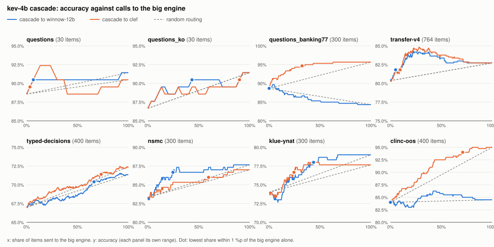
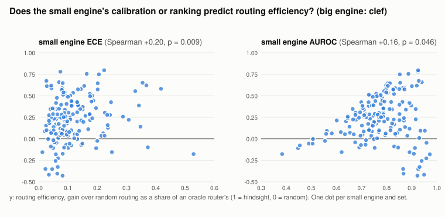

# 보정도 기반 cascade 라우팅 분석 — 2026-11-02

새로 잰 수치는 없다. 2026-10-14~16 전체 재측정(M3 Max 36GB, 유휴 머신, 엔진 하나씩)의 원시 로그
`bench/runs/<set>/<engine>.jsonl` 로 cascade 를 모의한다. 작은 엔진이 모든 문항에 답하고, 확신도가 임계값
이하인 문항만 큰 엔진의 답으로 바꾼다.

- **확신도**: 작은 엔진이 자기 판단에 준 확률, 곧 `forecast` 의 결정 옵션 값이다. 한 문항에 질문이 여럿이면
  가장 낮은 값을 쓴다. 한 요청이 그 질문을 다 답하기 때문이다.
- **지연**: 두 엔진의 첫 호출 지연을 더한다. 넘긴 문항에서만 큰 엔진 지연이 붙는다.

표의 정본은 `bench/runs/cascade.md`(`bench/cascade.py`), 그림은 `reports/figures/cascade-kev-4b.svg` 와
`reports/figures/cascade-calibration.svg` 다.

| 역할 | 엔진 | 서빙 · 양자화 | 측정일 |
|---|---|---|---|
| 작은 엔진 | kev-4b | MLX, Hub `6cfce5c` | 2026-10-14 |
| 큰 엔진 | winnow-12b | Ollaya 위 llama.cpp, Q8_0 | 2026-10-14 |
| 큰 엔진 | clef | llama.cpp `llama-server`, Q4_K_M (`5f70656`) | 2026-10-15 |

## 결론

1. **"큰 엔진 단독 대비 1%p 이내" 기준으로는, 줄일 수 있는 호출 비율이 세트마다 크게 다르다.** 기준점은 정확도가
   큰 엔진 단독의 1%p 안에 드는 가장 낮은 호출 비율이다. Clef 로 넘길 때:

   | 세트 | 작은 엔진 대 Clef (McNemar) | 기준점 호출 | 정확도 (Clef 대비) | 평균 지연 (cascade / Clef 단독) | 절반 교차 검증 |
   |---|---|---|---|---|---|
   | transfer-v4 | 80.4% 대 82.7%, p = 0.120 | 9.6% | 81.8% (-0.9) | 383 / 2104 ms | 10.7%, -0.3 · 8.9%, -1.0 |
   | klue-ynat | 74.0% 대 77.7%, p = 0.117 | 24.3% | 76.7% (-1.0) | 858 / 2644 ms | 18.7%, -2.7 · 24.7%, +0.0 |
   | BANKING77-20 | 88.7% 대 95.7%, p < 0.001 | 32.3% | 94.7% (-1.0) | 1664 / 4312 ms | 18.0%, -4.7 · 32.7%, -0.7 |
   | nsmc | 83.3% 대 87.0%, p = 0.043 | 59.7% | 86.0% (-1.0) | 1074 / 1586 ms | 12.7%, -4.0 · 76.0%, -0.7 |
   | clinc-oos | 84.0% 대 95.0%, p < 0.001 | 71.0% | 94.0% (-1.0) | 2575 / 3385 ms | 63.5%, -2.5 · 74.5%, +0.0 |
   | typed-decisions | 67.0% 대 72.4%, p < 0.001 | 73.2% | 71.4% (-1.0) | 6689 / 8259 ms | 71.0%, -1.5 · 81.5%, -0.7 |

   Clef 가 Kev-4B 보다 유의하게 나은 네 세트 중 BANKING77-20 만 호출 1/3 로 Clef 의 1%p 안에 든다. 그때 지연은
   39% 다(1664 대 4312 ms, Clef 에 대한 McNemar p = 0.250). 나머지 세 세트(nsmc · clinc-oos · typed-decisions)는
   60 ~ 73% 를 넘겨야 같은 정확도가 나온다. 그러면 지연은 Clef 단독의 68 ~ 81% 로 아낄 것이 적다. 기준점은 같은
   데이터에서 고른 in-sample 값이다. 짝수 번째 문항으로 임계값을 고르고 홀수 번째에 적용하면(반대도 같이) 큰 세트에서도
   어긋난다. BANKING77-20 은 한쪽에서 18%, -4.7%p 로 무너진다. 그러니 임계값은 배포 전에 별도 검증 데이터로 다시 잡는다.
   30문항 셋 두 개는 표본이 작아 결론에서 뺐다(정본 표에는 있다).
2. **transfer-v4 에서는 cascade 가 두 엔진보다 모두 정확하다.** Kev-4B 가 덜 확신하는 28% 를 Clef 로 넘기면
   84.8% 로, Clef 단독(82.7%)보다 2.1%p 높다. McNemar 는 26 대 10, p = 0.011 이다. Winnow-12B 로 넘길 때도
   22% 에서 +1.6%p(22 대 10, p = 0.050)다. 이 점도 in-sample 최고점이지만 절반 교차 검증에서 유지된다.
   다른 절반에서 고른 임계값을 적용해도 +1.0 · +1.8%p(Clef), +1.0 · +1.6%p(Winnow-12B)다. 두 엔진의 정확도는 비슷하지만(McNemar
   p = 0.120) 맞히는 판단이 120개나 갈린다. Kev-4B 만 맞힌 판단이 51개, Clef 만 맞힌 판단이 69개다. 그리고
   Kev-4B 가 덜 확신하는 문항에 Clef 만 맞힌 판단이 몰려 있다. 넘긴 28% 문항에 Clef 만 맞힌 판단 69개 중
   59개(86%)가 들어 있고, Kev-4B 만 맞힌 판단은 51개 중 25개만 들어 있다. 소스 단위의 강약 차이는 아니다. 정책 구조 holdout 은
   160 대 158, 공개 소스는 454 대 474 다(Kev-4B 대 Clef, 각 176 · 588 판단). 이 세트에서는 cascade 가 비용
   절감이 아니라 정확도 개선 수단이다.
3. **Kev-4B 에 Winnow-12B 를 붙이는 cascade 는 대부분 의미가 없다.** Winnow-12B 가 Kev-4B 보다 유의하게 나은
   세트는 typed-decisions(p < 0.001)와 klue-ynat(p = 0.024) 둘뿐이다. BANKING77-20 에서는 오히려 Kev-4B 가 낫다
   (88.7% 대 84.3%, p = 0.019). 그 두 세트의 기준점도 66% · 44% 호출이다.
4. **"보정도(ECE)가 나쁘면 라우팅이 실패한다"는 가설은 이 데이터에서 성립하지 않는다.** 21 ~ 22개 엔진을 작은
   엔진으로 놓고 모두 Clef 로 넘겨 본다. 라우팅 효율은 확신도 순 라우팅이 랜덤 라우팅보다 얻은 정확도 면적을, 사후
   정답을 아는 오라클 라우터의 이득으로 나눈 값이다. 오라클 이득이 0.5%p 미만인 조합은 뺐다.
   - 169개 엔진 × 세트 조합에서 효율과 ECE 의 Spearman 은 +0.20(순열 p = 0.009)이다. 보정이 나쁠수록 효율이
     오히려 약간 높다.
   - 세트별로 보면 가설 방향(음의 상관)은 BANKING77-20 하나다(-0.48, p = 0.030). 나머지 일곱 세트는 p ≥ 0.093 이다.
   - 대안 지표도 일관되지 않다. 확신도가 자기 정오답을 얼마나 잘 가르는지(AUROC)는 clinc-oos 에서 +0.95 지만
     transfer-v4 에서는 -0.71 이다. 작은 엔진 오답 중 큰 엔진이 맞히는 비율도 세트마다 부호가 바뀐다
     (transfer-v4 +0.82, BANKING77-20 -0.56).

   라우팅의 성패는 작은 엔진 한쪽의 보정도가 아니라 두 엔진의 오답이 어디서 겹치는지에 달려 있다. 작은 엔진이 덜
   확신하는 문항이 큰 엔진이 맞히는 문항일 때만 이득이 난다. 강한 작은 엔진일수록 남은 오답이 큰 엔진도 틀리는 어려운
   문항인 경우가 많다. 그래서 자기 오답을 잘 가르는 확신도라도 넘길 가치가 적다.

## 제품 설계에 주는 함의

- 엔진 조합을 고르기 전에 쌍 McNemar 로 큰 엔진이 실제로 더 나은지부터 본다. 아니면 cascade 는 지연만 늘린다
  (Kev-4B → Winnow-12B 의 BANKING77-20 · clinc-oos).
- 임계값은 조합과 세트마다 따로, 별도 검증 데이터로 잡는다. 같은 Kev-4B 확신도라도 필요한 호출 비율이 10 ~ 73% 로
  갈리고, in-sample 임계값은 절반 교차 검증에서 300문항 이상 세트에서도 최대 6.0%p
  어긋난다(Winnow-12B 로 넘기는 klue-ynat).
- 작은 엔진의 ECE 로 라우팅 가능성을 미리 판단하지 않는다. 두 엔진의 로그로 cascade 곡선을 직접 그려 본다.
  `bench/cascade.py --small <e> --big <e>` 가 기존 로그만으로 몇 초에 그린다.

## 한계

- 모의다. 두 엔진은 따로 쟀고, cascade 지연은 두 첫 호출 지연의 합이다. 두 서버를 동시에 띄운 메모리 · 지연은 재지
  않았다. Clef Q4_K_M(약 16 GB)과 Kev-4B 를 36 GB 에 함께 올릴 수 있는지는 확인하지 않았다.
- 확신도는 엔진이 낸 확률을 그대로 쓴다. 온도 보정이나 학습된 라우터는 시험하지 않았다.
- 문항 단위 라우팅이다. typed-decisions 처럼 문항에 질문이 다섯 개면 가장 낮은 확신도 하나로 문항 전체를 넘긴다.
- 기준점과 최고점은 in-sample 이다. 절반 교차 검증은 한 번의 고정 분할(짝수 · 홀수)이다.
- 효율 상관 분석의 여러 검정(세트 8개 × 지표 3개)은 다중 비교를 보정하지 않았다.
